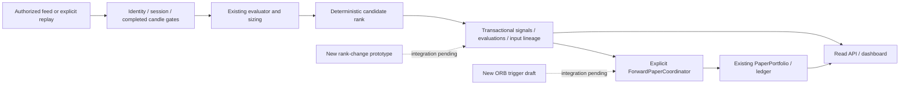

# TradePulse Astra master execution report

Mission TRADEPULSE-ASTRA-OWNER-2026-10-24-V1. Work spanning 2026-10-24–25, Asia/Kolkata.
**PARTIAL CHECKPOINT — tested changes accepted only within their stated scope.**

Last regenerated UTC: 2026-10-25T02:03:10.934194+00:00

## 1. Executive verdict

**PARTIAL VERIFIED OFFLINE ENGINEERING; MASTER MISSION INCOMPLETE.** This session
closed GET/HEAD scan mutation, undeclared historical study-session coverage, and
misleading dashboard sizing/missing-price/stale-P&L behavior, including absent
quality and invalidation. It added a read-only
paper journal, strategy evidence passports in scanner/history/UI, and a tested
standalone deterministic cash rank-change prototype. Original evaluator formulas,
paper accounting and saved operating settings remain unchanged.

The most important remaining defect is **B01 premature automatic paper entry**.
Its isolated reproduction filled at 98 when the long threshold 100 was never reached
(candle high 99). The assigned worker stopped at a usage limit after creating
unintegrated drafts under `docs/drafts/`; forward_paper.py and paper_portfolio.py
were not changed. No trigger repair or new paper-lifecycle acceptance is claimed.
The prototype ranker is not connected to scanner persistence/API/UI yet.

The owner has already chosen personal validation before customers, NSE cash and
staged exact-contract derivatives, selective explainable ranking, strategy-specific
paper triggers, existing Python/SQLite/JS, and no real orders. BSE/swing/positional
and public launch are not accepted. A universal next-close or three-bar rule is
superseded. Workers cannot continue after usage limits/session end; this report and
checkpoint identify the first incomplete action.

## 2. Audit manifest and Git state

Branch main; starting HEAD `fcdbadb`, full SHA and 88 source-file hashes in
`../evidence/astra_baseline_20261024_01.json`. The initial source matched the retained
Phase 6 receipt; new source requires the new proof below. 522 prior documents were
inventoried, including releases under docs/evidence (the baseline's top-level ZIP
list is empty because archives are in that subdirectory). Original BRD was read
as ZIP/XML and preserved. Both saved environment files are compared locally by
whole-file integrity, with no credential values copied here. Operational DB/WAL/SHM
were never opened; concurrent external application activity is not attested.

Runtime: Python 3.14.6, Node 24.18.0, Windows PowerShell. No dependency upgrades or
Git mutations. An unrelated untracked TRADEPULSE_AI_PLUS_PROJECT_INTELLIGENCE_REPORT.md
was observed and left intact. Windows sandbox-created temporary directories may
remain access-denied; no recursive cleanup was attempted.

Changed existing code: server.py, historical_study.py, scanner_engine.py,
candle_lineage.py, public/index.html, test_cash_dashboard.js, test_bot.py and
release_management.py. New implemented modules: strategy_evidence.py and
opportunity_ranking.py; new tests: test_astra_http_safety.py, test_astra_research.py,
test_astra_ranking.py. The unintegrated docs/drafts/astra_paper_triggers_20261025_01.py is a draft, not tested
behavior. Exact final hashes and historical archive checks are in the new
astra_preservation receipt. Source inspection was targeted, not an exhaustive audit
of every function in the repository.

## 3. BRD acceptance ledger

| Phase | Previous report | Current evidence and boundary |
|---|---|---|
|1 foundation|Offline accepted|EXISTING_RECEIPT_VALIDATED at baseline; current regressions and read-safety fix verified; comprehensive customer security NOT_ESTABLISHED|
|2 historical/research|Mechanics accepted, empirical blocked|VERIFIED_CURRENT_SOURCE_AND_TEST for exact fold coverage; genuine empirical/OOS BLOCKED_EXTERNAL|
|3 live market data|Adapters tested, live not accepted|Existing fixture regression coverage; real fresh completed scanner-consumed bars NOT_ESTABLISHED; no provider call|
|4 scanner/ranking|Offline accepted|Current regression proof; evidence-passport integration verified; new ranker prototype tested, runtime rank history NOT_ESTABLISHED|
|5 context/dashboard/alerts|Offline accepted|Current Node/HTTP regressions; paper journal and truthfulness fixes verified; browser visual/mobile/new delivery acceptance NOT_ATTEMPTED|
|6 paper/performance/release|Offline accounting accepted|Existing accounting regressions pass; B01 DEFECT_REPRODUCED and NOT_REPAIRED; no new auto-trigger acceptance or customer release|

Passing old paper tests means their retained contracts still work; those tests did
not require the missing future strategy predicate. No green suite is used to
erase this newly demonstrated requirement gap. Prior report statements of complete
Phase 6 are valid only within their original tested boundary.

## 4. Architecture and call flows

Concrete symbols: `scanner_engine.IntradayBotEngine.run_single_scan` creates the
explicit coordinator, freezes input, invokes `evaluate_strategy_detailed`, applies
sizing/geometry, calls `rank_signal_candidates`, saves evaluations and commits
cash inputs before `ForwardPaperCoordinator.consume_scan`. `_replay_cash_result`
supports existing retained-work recovery. `PaperPortfolio.enter/process_bar`
own financial effects and reconciliation; no second ledger was added.

`server.DashboardRequestHandler._handle_scan` passes an explicitly injected paper
portfolio. `_dispatch_get_or_head` now returns 405 for scan aliases before runtime
initialization. POST remains explicit. `candle_lineage.annotate_signals` loads
retained evaluations/context and exposes descriptive maturity; it cannot promote
actionability. `historical_study.run_frozen_study` verifies exact consumed session
declarations before archiving/executing folds. `option_execution.py` remains the
separate historical premium/depth/lot-aware runner. Exact symbol line ranges are
recorded in astra_code_locations evidence; source hashes identify the revision.

Configuration and providers retain existing boundaries; no token handling changes.
Scheduler remains disabled in saved settings. SQLite operational schema and data
were not migrated by this slice. Existing tests cover transactions, recovery,
loopback policy, source integrity and release exclusion; new customer auth,
multi-tenant isolation and an SBOM/security attestation remain unimplemented.

## 5. Complete strategy contract matrix

All five evaluate completed five-minute candles. Source helpers enforce the
strategy's minimum and session-opening coverage; scanner provenance, freshness,
full continuity and input-consumer checks remain separate mandatory gates. A
valid evaluator output is a decision-time reference, not an instruction to fill
a future observation. None of these evaluator functions defines pending setup
expiry, a universal three-bar deadline, partial exits or a trailing stop.

| Strategy and source | Actual directional predicates | Entry, invalidation, stop, targets |
|---|---|---|
| Order Block/BOS/FVG, `strategies.py:evaluate_order_block_fvg`, minimum 30 bars | Last 15 bars searched newest eligible origin first. Bull: red origin, either next two closes above origin high, then FVG (second impulse low above origin high) OR displacement from origin open at least 1.5 ATR(10). No subsequent close below origin low; no earlier mitigation by low <= origin high * 1.0015. Current low <= that boundary, close above origin open and >= origin low. Bear mirrors with green origin, closes below origin low, second impulse high below origin low OR 1.5 ATR displacement, no close above origin high, no earlier high >= origin low * 0.9985, and current high reaching that boundary with close below origin open and <= origin high. Supplied mitigated-zone set prevents reuse. There is no minimum RVOL or directional VWAP gate here. | Decision close. Long invalidation origin low; stop origin low - 0.25 ATR. Short invalidation origin high; stop origin high + 0.25 ATR. T1/T2 at 2/3 modeled risk units. Zone consumed only after eligible sizing. |
| VWAP Pullback, `evaluate_vwap_pullback`, minimum 35 | Positive preceding-20-bar volume average, RVOL >= 1.4. Bull: low <= VWAP * 1.0025, close > VWAP and open, close >= EMA20 * 0.998, RSI14 inclusive **48–72**. Bear: high >= VWAP * 0.9975, close < VWAP and open, close <= EMA20 * 1.002, RSI14 inclusive **28–52**. | Decision close. Long invalidation min(low,VWAP), stop that level - 0.35 ATR; short invalidation max(high,VWAP), stop + 0.35 ATR. T1/T2 1.8/2.5 risk units. |
| Option Apex, `evaluate_option_apex_oi_shift`, evaluator minimum **1** bar | NIFTY/BANKNIFTY only, validated chain with ATM row. Long CE: CE OI change < 0, PE OI change > 0, **PCR >= 1.10**, spot close >= VWAP * 0.998. Long PE: PE OI change < 0, CE OI change > 0, **PCR <= 0.85**, spot close <= VWAP * 1.002. OI labels are implemented heuristic interpretations, not proven aggressor positions or forecasts. | Selected CE/PE premium LTP reference; both positions buy premium, including bearish PE. Stop/invalidation 0.78 * premium; T1/T2 +1.6/+2.4 premium risk units. An LTP is not an executable ask. Exact dated contract/lot/tick, aligned premium/chain/prior-close OI authority and liquidity are additional execution requirements. |
| Filtered ORB, `evaluate_orb_breakout`, minimum 30 | At least 4 current-session bars and exact opening starts 09:15/09:20/09:25. Positive prior-20 volume average. Bull: prior close <= ORB high, current close > ORB high and VWAP, RSI >= 55, RVOL >= 1.6. Bear: prior close >= ORB low, current close < ORB low and VWAP, RSI <= 45, RVOL >= 1.6. Prior close need not lie inside both range boundaries. A wick touch alone does not pass. | Decision close. Long invalidation ORB high; stop max(ORB low, current low - 0.25 * range). Short invalidation ORB low; stop min(ORB high, current high + 0.25 * range). T1/T2 1.6/2.4 risk units. |
| Supertrend Pullback, `evaluate_supertrend_pullback`, minimum 200 | Supertrend(10,3) current and prior direction must agree. Long: both current/prior closes above their EMA200, current close > VWAP and open, low <= ST * 1.004 OR <= VWAP * 1.003, RVOL >= 1.3. Short mirrors below EMA/VWAP/open with high >= ST * 0.996 OR >= VWAP * 0.997. Exclude 09:15 <= candle start < 09:45 and 11:30 <= start <= 13:30 IST. Positive prior-20 volume average. | Decision close. Invalidation current Supertrend. Long stop min(ST,low) - 0.25 ATR; short stop max(ST,high) + 0.25 ATR. T1/T2 1.5/2.5 risk units. |

Cash target construction uses `max(0.50, abs(entry-stop))`; option targets use
`max(1.00, entry-stop)`. ATR is floored at 0.05 where used. Prices are rounded by
the evaluator. Displayed nominal multiples can therefore differ from actual
price-level RR. `signal_risk_reward` and the existing ranker calculate numerical
geometry; benchmark strings and `confidence_pct` aliases do not establish win
probabilities. Position sizing can independently reject an otherwise detected
setup. Existing tests include `test_p1c_strategy_*_bidirectional*`, Order Block
mitigation/reuse, and Option Apex strict-field cases in `test_bot.py`; these were
source-inspected here, not re-executed by the focused research command.

`strategy_evidence.py` exposes descriptive independent JSON copies, exact bands
and predicates, no empirical metrics, no automatic promotion, and no entry
authority. Unknown identifiers stay `RESEARCH_HYPOTHESIS`. Registered evaluator
mechanics remain `OFFLINE_MECHANICS_TESTED`; empirical/OOS/reviewed live-paper
evidence is not supplied by this registry. The old shared-contract document and
preregistration are preserved as earlier proposals. Their universal future-close
continuation and any arbitrary global expiry proposal are superseded by this
mission's strategy-specific requirement. A descriptive registry does not enforce
the coordinator's execution policy; that must be reviewed separately.

## 6. Dynamic ranking specification and demo

Implemented prototype `opportunity_ranking.build_snapshot/current_view` reuses rule
quality then actual gross T1 RR, stable symbol/strategy/identity ties. It retains
rank_version, as_of, data watermark, input digest, component versions, previous/new
rank, component changes and removal reasons. One selected setup per symbol avoids
double counting. Exact option-contract ranking is deliberately separate; option
premiums cannot enter the cash comparison. Missing relative strength, sector,
regime, depth, spread, net executable reward and empirical edge remain explicit.
It does not invent those features or turn gross RR into net RR/probability.

Eight actual prototype tests pass. The synthetic demo: at 10:00, TCS quality 90 and
INFY 80; at 10:10, TCS 85 and INFY 95. INFY moves 2->1, TCS 1->2, with changed rule-quality
values and source watermarks retained. Equal-score permutations and duplicate input
keep stable priority/version. Stale/forming/rejected inputs leave current ranks;
same-watermark revised data or reversed chronology reject. Expired reads return an
empty current list plus a separately labelled archive without mutating state.
Independent review found expiry five minutes later than rebuild eligibility;
an exact-boundary regression failed before correction. Both now expire at source
bar start +5 minutes +60 seconds. See `astra_rank_demo_20261025_01.json` for
actual synthetic snapshot output, and the retained before/after focused receipts.

This is **mechanics only**. It is not scanner-integrated, a persistent rank-history
API, a strategy performance improvement or a full standalone source validator.
The production scanner still owns mandatory data/strategy/risk gates. Integrating
the prototype must reread retained input/evaluation references, atomically persist
snapshots and test same-transaction failure; do not accept arbitrary HTTP score
payloads. Current UI shows the original retained scan rank with an explicit
historical label. No current dynamic leaderboard is claimed.

Future architecture: hard gates first (authorized fresh exact data, required
warm-up, strategy condition, viable cost/risk/liquidity where available). Research
soft factors through ablation; do not add unrelated indicator gates to all
strategies. Developing watchlist never creates a paper position. Correlation/sector
concentration and empirical factor calibration are still design work.

## 7. Options, volume, depth and Greeks assessment

Upstox's documented chain fields include exact instrument keys, expiry, strike,
bid/ask prices and quantities, volume, OI/previous OI and Greeks. The separate
Greeks endpoint exposes sensitivity/IV fields. These schemas are available in
official documentation, not evidence that this account is entitled or a response
has been observed. IV examples differ in numerical convention across endpoints;
normalize only with endpoint-specific documented units, not an unqualified merge.
[Chain](https://upstox.com/developer/api-documentation/get-pc-option-chain/),
[Greeks](https://upstox.com/developer/api-documentation/option-greek/), accessed
2026-10-24. Provider probability-of-profit fields are not calibrated TradePulse
win probabilities and are not imported as such.

The V3 feed documents regular 5-level quotes and 30-level mode associated with Plus,
with different connection/subscription caps. Implementation must freeze mode,
entitlement, subscription scope and source/receive clocks. More depth does not
establish executed aggressor flow. LTQ, total buy/sell quantities and snapshots
cannot be relabelled trade-direction volume.
[V3 feed](https://upstox.com/developer/api-documentation/v3/get-market-data-feed/),
accessed 2026-10-24.

Current historical option runner uses next observed ask, adverse tick rounding,
lot/depth checks and observed bid exits. Unresolved intrabar stop execution remains
unresolved, not fabricated. Both CE and PE are long premium. Stock F&O expansion,
futures margin/roll semantics and a new normalized point-in-time Greeks contract
remain NOT_IMPLEMENTED in this slice. No assumption of dated lot/tick authority
from hard-coded examples, no spot-to-premium substitution and no naked-short option
paper acceptance.

## 8. Broker matrix and token plan

| Provider | Retained application position | Official documentation / entitlement boundary |
|---|---|---|
|Angel One|Existing adapter/feed preserved; genuine stale packet retained, complete live acceptance absent|Admin notice states daily midnight logout and distinguishes order/GTT static-IP requirements from other APIs. Account entitlement, future token validity and broader pricing not checked by a provider request.|
|Upstox|Optional read-only complement; no source switch|Analytics Token documented free, read-only and valid 1 year; supported quote/history/chain/WebSocket categories. Regular full depth and Plus 30-depth have distinct entitlements.|
|Dhan|Existing code preserved|Premium plan rejected by owner; no subscription, activation or new price claim. Current commercial entitlement UNKNOWN.|

[Upstox Analytics Token](https://upstox.com/developer/api-documentation/analytics-token/)
is generated through the account interface, supports specified read-only access
and cannot place/modify orders. No daily OAuth workflow should be invented for
that use case. Standard OAuth is a different token with the documented 3:30 AM
expiry boundary. [Standard token](https://upstox.com/developer/api-documentation/get-token/).
[Angel admin notice](https://smartapi.angelone.in/smartapi/forum/topic/5254/important-updates-to-smartapi-in-compliance-with-sebi-guidelines/34).
Accessed 2026-10-24. The Angel page includes deleted-topic wording and user replies;
only the visible administrator notice supports the stated lifecycle fact.

Future nonsecret schema proposal: token kind, expiry timestamp, provider and
approved capability set, with the actual token held only in local secret storage.
Do not echo token length/prefix/hash, silently refresh, retry login or change
saved credentials. A future activation requires exact provider/scope/time/rate/
stage/entitlements approval. No such activation occurred; previous one-shot text
is not used as permission under this revised mission. Free API access is separate
from historical authenticity, display, derived-data and redistribution rights.

## 9. Bugs and security findings

| ID/severity | Evidence, correction and disposition |
|---|---|
|B01 P0 paper premature entry|Retained synthetic entry100/high 99/fill98 reproduction. No repaired coordinator/portfolio. Draft only; OPEN.|
|B02 high read mutation|Actual HTTP before: 2 tests,6 failed method/alias subcases. server.py rejects GET/HEAD scan before initialization. After 2/2 pass, POST still consumes explicit paper sentinel.|
|C01 high study integrity|Two failed assertions proved omitted intermediate test/warm-up sessions accepted. Exact source-prefix/range guard before archive/evaluation;23 focused new+old tests pass.|
|E01 medium misleading UI|Before 27 Node tests:24 pass / 3 fail. Missing quantity/prices fabricated, stale equity shown. Removed frontend sizing fallback, retained null chart levels and stale mark withholding; journal tests added.|
|I01 integration regression, corrected|New maturity annotation assumed strategy_id on legacy minimal rows;4 errors retained. UNKNOWN descriptive fallback preserves legacy integrity validation. Re-run54/54 passes.|
|R01 prototype coverage boundary|New rank history is standalone. Net friction, source authenticity and sector correlation are unavailable, not imputed. No runtime integration claim.|
|R02 medium stale current priority, corrected|Independent review found read expiry 5m later than rebuild qualification; exact boundary regression failed then passed after correction.|
|E03 medium absent values, corrected|UI self-review found absent quality coerced to 0 and invalidation borrowed from stop; 32-test before run failed one regression, after32/32 pass. Observed zero remains0.|

Negative controls: offline runner blocks non-loopback sockets; fixtures install
transport sentinels and separate stores. UI renders journal strings via safe text,
withholds corrupt financial state and bounds previews. Actual HTTP GET/HEAD and
renderer refresh tests rule out those paths invoking scans/paper mutations.
This is not proof that every possible future endpoint is safe. No real broker
order endpoint was called and no new broker dispatch was added. The current
HTTP/research/metadata/rank slice received independent read-only source review;
R02 was fixed afterwards and tested by root. UI review was its author's self-review.
Full paper/product/browser approval remains outstanding after worker limits.

## 10. Paper engine detailed verdict

The existing coordinator queues persisted candidates and fills the immediately
next completed close subject to bracket/risk checks. It lacks an explicit future
entry predicate, so a price inside the bracket is insufficient acceptance. The
reproduction shows exactly that. The source inspection and green old ledger tests
do not prove the requested automatic strategy-trigger product.

`docs/drafts/astra_paper_triggers_20261025_01.py` is the latest preserved
unintegrated prospective ORB draft. The earlier draft is retained alongside it;
the only resumed edit corrected a rule-trace field from observed to measurements.
Neither draft is a production module or tested policy. It proposes
freezing the confirmed signal candle high/low, a later completed directional close
cross and original range invalidation, with same-session/account square-off. This
is a new experimental rule, not the original ORB detector or a universal policy.
Its actual candle/trace/schema fields and tick policy remain unverified; do not
import or activate it merely because it compiles. Coordinator/portfolio transaction
integration, direct-entry bypass prevention, old automatic-account migration,
concurrency/restart/rollback and retained outcomes remain B01's next work.

Existing accounting still has capital/exposure/daily-limit checks, conservative
cash stop-first collisions/gaps, T1 full exit and EOD/missing-mark reconciliation.
T2/partial/trailing future lifecycle and exact excursions are not added here. The
new UI reads retained decisions/positions/events and labels missing trigger fields
unavailable. Bounded previews are explicitly partial; pagination UI remains future
work even though ledger APIs exist.

New-policy valid setups, pending setups, triggered trades, stop/target/other exits,
unresolved positions and reconciled-result counts: **NOT_ESTABLISHED**, because no
new-policy ledger cohort was executed. The legacy defect reproduction retains one
incorrect synthetic fill, not an accepted trade count. No live or empirical paper
performance is inferred from test totals or operational DB contents.

## 11. Historical and empirical readiness

Retained public probe evidence contains an authentic provider-response candidate:
73/75 bars for RELIANCE 2026-10-22, missing 15:15 and 15:20. It is not an accepted study.
Publisher trust/signature, current research rights, dated identity and sufficient
complete sessions remain missing. Earlier 'no historical observations' wording is
too broad; 'zero qualified empirical datasets established' is the proper boundary.
Private originals were not re-opened or newly authenticated in this slice.

Separate historical option execution is implemented. Cash-only StudyProtocol's
Strategy3 exclusion is a scope boundary, not absence of option_execution.py.
Historical option bid/ask/depth and dated contract authority remain external gates.
Current source has publisher signature verification, independent rights policy
and immutable original-byte archives. Test roots/rights documents establish
mechanics, not real publisher/legal authorization.

No new empirical study, win-rate claim or promoted strategy. Original nominal
60/20/20, win>=50%, 100-trade or lot-size prose examples are not binding code-derived
acceptance. The research design below is proposed and lacks frozen real datasets.

These are unimplemented research hypotheses, not promoted strategies. A numerical
data acquisition price is **unknown** until scoped vendor/license quotes exist;
this work incurs no subscription or provider call. Reuse already-authorized
qualified inputs where available, and keep cash/option cohorts separate.

| Priority / version | Hypothesis and inputs | Control and falsification | Acquisition dependency |
|---|---|---|---|
| 1 / `relative-participation-h1` | Ranking by stock excess return versus contemporaneous sector/index, confirmed structure and time-of-day participation may distinguish leaders from sector-wide moves. Requires aligned completed bars, point-in-time constituents and volume/turnover. | Unchanged candidate quality rank and no-trade baseline. Reject if sealed OOS incremental net expectancy/selection value is nonpositive or explained by concentrated sector exposure. | Licensed sector/index history and constituent dates; price unknown. |
| 2 / `regime-pullback-h1` | Past-only trend/volatility regime may explain when existing VWAP/ST pullbacks fail; initially a soft research feature, not extra universal gates. | Original unchanged strategies; ablation without regime feature. Reject unstable sign or lost benefit under adverse costs and alternate past-only windows. | Sufficient multi-regime complete history; price unknown. |
| 3 / `opening-rotation-h1` | Compare existing ORB signals with sector-relative participation after the actual open. | Unmodified ORB; strict chronological intraday measurement. Reject if benefit depends on hindsight, top-mover selection, or concentrated event days. | Exact open bars, sector alignment, corporate-action policy; price unknown. |
| 4 / `compression-expansion-h1` | Past-only volatility compression followed by confirmed expansion or a failed-breakout reversal may offer a distinct setup cohort. | Simple fixed ORB/return baselines; version breakout and failure variants separately. Reject if costs or plausible entry delay erase benefit. | Multi-session licensed OHLCV and executable-spread evidence; price unknown. |
| 5 / `underlying-contract-h1` | Separate underlying directional score from option contract tradability, theta/delta exposure, spread and expiry fitness. | Same underlying thesis with predeclared fixed ATM choice; compare observed net outcomes and unresolved rates. Reject if gains depend on LTP fills, stale Greeks or unrealistic depth. | Exact dated chains, quotes, volume/OI baselines and Greeks/IV with source times; entitlement and price unknown. |
| 6 / `depth-flow-h1` | Legally available quote changes/depth may improve short-horizon execution-risk estimates. It is not executed aggressor flow without genuine trade classification. | Quote-only spread/depth control; cancellation/spoofing and sampling sensitivity. Reject if effect is latency-sensitive or survives only snapshots with unknown ordering. | Licensed granular event/depth history, clock quality and retention rights; highest data/engineering burden, price unknown. |
| 7 / `futures-basis-h1` | Dated futures/cash basis and aligned OI changes may help explain participation or contract risk. | Underlying-only thesis and constant contract-selection control. Reject if roll/carry, asynchronous prices or OI timing explain the effect. | Exact dated futures, cash, contract rolls and OI baselines; price unknown. |

Original research offers motivation, not Indian five-minute evidence. Moskowitz
and Grinblatt's *Do Industries Explain Momentum?* (1999, journal publication;
publisher page lists later online publication) motivates controlling industry
effects, not copying a monthly result into this scanner.
[Original journal source](https://onlinelibrary.wiley.com/doi/10.1111/0022-1082.00146),
accessed 2026-10-24. Moskowitz, Ooi and Pedersen's *Time Series Momentum* (2012)
studies longer-horizon own-return signals across futures markets; it is a basis
for a comparator hypothesis, not evidence for intraday Indian profitability.
[Author research page](https://www.aqr.com/Insights/Research/Journal-Article/Time-Series-Momentum),
accessed 2026-10-24. No external performance percentage is imported into the app.

The preserved Astra preregistration is design-only and lacks dataset binding.
Before any genuine OOS run, freeze exact originals, universe membership,
exclusions, corporate actions, strategy/config/source versions, complete session
partitions and cost schedule. Its proposed 252-session/126-training/63-validation/
63-sealed-OOS plan is a starting proposal, not proof of sufficient statistical
power. Do not silently reduce it to accommodate short data. Use past-only warm-up
and never score it as OOS; purge/embargo where labels overlap. For intraday flat
cohorts, explicitly verify no position crosses a fold. Evaluate all declared
variants, retain failures, use session-clustered uncertainty and appropriate
multiple-testing correction. Such inferential tooling is not implemented by the
small partition fix. Report unresolved positions, sample dependence, net R and
INR expectancy, win/loss magnitude, drawdown, exposure, cost share, regime/year
stability and adverse-cost sensitivity. A good fixture metric has no promotion
authority.

Maturity advances only after independent review of qualified source/rights,
frozen untouched OOS outcomes and then a separate genuine forward-paper cohort
under the exact trigger/fill policy. A revised strategy needs a new ID/version
and fresh sealed data. Data/trust failures, unresolved accounting or material
execution drift suspend conclusions. No strategy was promoted or retired here.

## 12. UX and product differentiation

Implemented: safe persisted quantity, missing levels, stale-account withholding,
read-only bounded paper history, maturity and historical scan-rank scope. 32 Node
tests pass; actual browser/mobile/accessibility acceptance was not rerun. Existing
vanilla JS kept. Incomplete trigger and dynamic ranker are not dressed as live UI.

| Priority / feature | Customer problem and competing workaround | Cost/dependency/risk | Acceptance and value hypothesis |
|---|---|---|---|
|1 Rank movers + X-Ray|Manual sorting/screens lose why priority changed|Medium; qualified multi-symbol input and persistent snapshots; stale/missing factor risk|Trace each change to source/component and expire stale ranks; measure time to explain top 3, not number of signals|
|1 Paper shadow journal|Spreadsheet/manual entry loses trigger/fill assumptions|High; B01 first, rights and costs; favorable-fill bias|Replay exact lifecycle and reconcile every event; measure unresolved-rate and explanation accuracy|
|2 Evidence passport|Headline win rate obscures data/sample/cost limits|Low local UI, high empirical dependency|Every claim links period/sample/cost/source or says unavailable; measure comprehension and trust|
|2 Saved comparison/watchlists|Repeated manual filters and separate notes|Medium; later tenant/auth scope|Reopen same retained evidence without accidental trades; measure weekly return usage|
|3 Sector/regime map|Absolute movers confuse market beta and leadership|High data/rights/constituent dependency|Past-only aligned factors and ablations; measure incremental selection value before promotion|
|3 Cash-to-contract|Underlying direction hides bad option execution|High; exact quotes/depth/Greeks/lot/expiry|Separate thesis and contract fitness, reject missing premium; measure unresolved/fill-friction rates|
|Defer missed-opportunity lab|Hindsight makes abstention look wrong|High selection-bias/counterfactual risk|No invented missed fills; preregister universe/exclusions before measuring|

Demand is **unvalidated**: no customer interviews, paid experiments or retention
data were gathered. [Chartink's guide](https://chartink.com/articles/scanner/scanner-user-guide/)
documents configurable technical/fundamental filters and crossovers.
[TradingView's screener guide](https://www.tradingview.com/support/solutions/43000718866-tradingview-stock-screener-trade-smarter-not-harder/)
documents multi-filter tables, saved screens/watchlists and exports. Accessed
2026-10-24. These are real alternative workflows, not proof that their users will
pay TradePulse. The proposed differentiator is an inspectable rank-change and
strategy-trigger history, to be tested against those workflows. Current brokerage
research/options competitor breadth and exact pricing still need verified review.

## 13. Build-to-sell plan

Personal alpha: finish B01, integrate rank snapshots, preserve localhost isolation,
deterministic tests and truthful empty states. Invite-only beta comes after genuine
scanner-consumed market data, rights/legal clearance, financial reconciliation,
stability soak and user-support/runbook acceptance. Public release additionally
needs authenticated tenant isolation, rate limiting, billing/tax/privacy design,
monitoring, incident response, independent security review and explicit approval.

Regulatory assessment is a launch question, not a ban on offline engineering.
SEBI's July 23, 2025 RA FAQ explains that specific-security technical research is
not exempt merely because of its methodology. The live regulations index lists
RA amendments through October 10, 2026; the RA master circular is dated
February 6, 2026. Ask qualified Indian counsel to classify ranked security targets/
stops, paid distribution and any personalized features under RA/IA rules, and map
registration, disclosures, records, complaints, performance advertising and client
obligations. The master-circular linked document failed to open in this tool; its
publication was verified, not a full clause-by-clause current legal audit.
[RA FAQ](https://www.sebi.gov.in/sebi_data/attachdocs/jul-2025/1753268710217.pdf),
[updated regulations](https://www.sebi.gov.in/sebiweb/home/HomeAction.do?doListing=yes&sid=1&ssid=3),
[2026 master circular](https://www.sebi.gov.in/legal/master-circulars/feb-2026/master-circular-for-research-analysts_99571.html).

NSE's current linked usage policy requires intended-use agreements, limits
redistribution, and includes restrictions concerning virtual trading/simulation.
Obtain explicit provider/exchange classification and permission for the proposed
paper product; a broker credential or 'educational' label cannot settle this.
[NSE usage policy, clauses 6.3/7.3/7.4](https://nsearchives.nseindia.com/web/sites/default/files/inline-files/NSE_Data_Sharing%26Usage_Policy.pdf).
Its March 2026 non-display policy includes derived internal analysis and requires
separate agreement/fees for external derived-data distribution.
[NSE non-display policy](https://nsearchives.nseindia.com//web/mediaattachment/2026-03/Non_Display_Policy_20260323164430.pdf).
Accessed 2026-10-24. These are specific unresolved commercial-use gates; no legal
opinion or license is granted here.

Proposed discovery: interview separate cash/derivatives/self-directed cohorts;
test whether users can explain why an opportunity ranks first and why no trade
occurred. Prototype usability before price tests. Free delayed/example education
versus paid licensed research/journal tiers are hypotheses subject to rights and
legal scope. Compare willingness to pay with actual retention, support cost and
licensed data cost. No numeric subscription promise, campaign, purchase or client
enrolment. Use transparent demonstrations and non-cherry-picked case studies only
after applicable approvals; never guaranteed-profit claims.

Proposed metrics: weekly engaged researchers, qualified opportunity review rate,
explanation completion, rank freshness/removal accuracy, paper reconciliation,
unresolved marks and support burden. Candidate SLOs need measurement: no duplicate
financial events, no stale actionable rank, bounded data-to-rank latency and read
API latency within the existing test budget. Business costs remain unquoted for
licensed history/real-time/derived use, hosting, audits, counsel and support.

Keep SQLite and loopback for alpha. Before multi-user hosting: inventory retention,
authentication/authorization, per-user entitlements, encryption/key rotation,
durable event queue and measured database contention. Migrate storage only after
workload evidence; no React or speculative platform rewrite. Deployment checklist:
source-bound tests -> reviewed manifest -> isolated restore drill -> explicit
configuration/entitlement verification -> canary -> measured health. Rollback:
stop new consumers, preserve append-only financial events, return to known code,
verify schema compatibility and reconcile before resuming. No destructive live
restore without separately approved procedure. Privacy applicability/effective
dates and full SBOM review remain unverified work; do not claim commercial readiness.

## 14. Ordered implementation backlog

| Task / phase / owner | State | Dependency, files and measurable acceptance |
|---|---|---|
|B01 /6 /paper owner|IN_PROGRESS, P0 OPEN|Review docs/drafts/astra_paper_triggers_20261025_01.py against actual committed schema; wire explicit ORB contract in forward_paper.py and paper_portfolio.py; direct-entry, invalidation, expiry, gaps, concurrency, rollback, restart and UI tests. Migrate unsafe automatic legacy behavior without changing recorded historical accounting.|
|C03 /4 /coordinator|Prototype VERIFIED; integration NOT_STARTED|Atomically persist rank snapshots with scan inputs, expose read API/UI and test source tamper/rollback, duplicate/empty/out-of-order runs. Preserve original ranker.|
|C02 /2,4,5 /coordinator|Implemented and tested|Evidence metadata wired scanner/history/UI; no promotion authority. Additional calibration requires X01.|
|E01 /5,6 /UI|Narrow slice VERIFIED|Journal bounded preview only; full paging, browser/mobile/keyboard review still pending.|
|E02 /1,6 /independent reviewer|IN_PROGRESS|Read-only HTTP/research/metadata/rank review completed; freshness finding reproduced and fixed. Paper draft and final browser/product acceptance remain unreviewed. UI self-review is not independent.|
|D01 /2,3 /data owner|Documentation PARTIAL|Exact neutral benchmark/chain/Greeks/OI/depth contracts and offline provider fixtures; no new calls; preserve provider fail-closed behavior.|
|F02 /6 /coordinator|Current-slice proof; final release NOT_STARTED|Finish B01/C03, canonical final receipt, independent review and fresh archive. Prior archives preserved.|
|X01 /2 /operator + data owner|BLOCKED_EXTERNAL|Complete authentic history, approved trust/rights, dated corporate-action/instrument universe, frozen OOS protocol; no fixtures as edge.|
|X02 /3 /operator|BLOCKED_EXTERNAL|New exact scoped authorization, official session, unused/approved stage and real accepted stream->scanner evidence.|
|X03 /6 /owner + counsel/vendor|BLOCKED_EXTERNAL|Legal/data/tenant/security/support readiness and separate public-release approval.|

Offline B01/C03/D01/E02 can proceed without market hours or additional credentials.
There is no Phase 7. The task ledger separately tracks completed B02/C01 and remaining
work; a prototype or a prior report is never whole-phase completion.

## 15. Verification ledger

**RUN after completed source edits:** canonical strict receipt
`docs/evidence/master_astra_owner_slice_20261025_02.json` reports 1060 Python
tests and 32 Node tests, no failures/errors/skips/unraisables, plus syntax
checks and 88 root Python files compiled. Exact commands, IDs, counts, times, source-before/after and log
hashes are retained in that receipt. This is partial-slice software proof, not B01
or real-market acceptance.

Command: `.venv_phase4\Scripts\python.exe -B -W error::ResourceWarning verify_offline.py --stage astra_owner_slice_20261025_02`.
Windows sandbox blocked temporary SQLite access in earlier focused runs; those
failures remain recorded, then the exact tests ran outside the sandbox with
external network still blocked by the runner.

| Stage | RUN result |
|---|---|
|Phase 6 receipt validation at baseline|Exit0;1040 retained Python executions validated, not re-executed then|
|HTTP before / after|2 tests:1 pass and6 failing subcases before;2/2 after|
|Research partition before / after|2 failures before;23/23 new+existing after authorized sandbox rerun|
|UI before / worker after|24/27 pass before;30/30 after; intermediate passport test raised count to31; final32 below|
|Rank prototype initial / corrected|6/7 then7/7; deterministic canonical candidate-order digest corrected|
|Integrated focused first / second / third|Sandbox file errors;50/54 with4 real legacy missing-field errors;54/54 after compatible UNKNOWN annotation|
|First canonical,20261024_01|FAIL1056/1059 Python,2 failures and1 error: old GET assumptions and draft production placement; preserved, not accepted|
|Canonical repairs,20261025_03|26/26 pass; POST security/freshness, packaging and8 rank tests; failed sandbox and intermediate request-body fixture attempts preserved|
|Rank expiry boundary before|1/1 failed as expected before fix; included in corrected8 rank tests|
|UI review remaining before/after|31/32 then32/32; absent quality/invalidation remain unavailable, actual zero quality retained|

Retained old archives/receipts are verified separately by
`docs/evidence/astra_preservation_check.py`, which checks manifest bytes against
their historical source snapshots, not today's changed source. It also compares
522 prior documents, both env files and original BRD. Old Phase 6 helper is not run
because it overwrites old receipts and infers DB preservation from size alone.
The first new preservation check exposed a verifier/archive scope difference:
both old proofs hash empty `public/rea`, while both release manifests omit it.
Its SHA256 is the empty-file digest and current size is 0. The corrected check
requires exactly that omission, verifies every packaged source hash and every
archive member, and records the exception explicitly. Old archives contain 111
and 122 public files; they are historical releases, not this changed source.
`astra_preservation_20261025_01.json` passes these checks; no generic missing-file
exception was added. This artifact does not serve as application code or an asset.
No claim of new browser acceptance, full independent final review, empirical
execution, real provider/Telegram delivery or new release bundle.

Workers audited disjoint files. Root integrated/reviewed outputs and ran actual
checks. The paper-draft author then independently reviewed HTTP/research/metadata/
rank files they had not authored; their rank finding led to a retained failing
regression and correction. UI review was explicitly its author's self-review.
Both workers later hit usage limits; no final paper approval is implied. Current
machine receipts take precedence over
prose counts, future mutable checkpoints and historical HEAD labels.

## 16. Outstanding owner decisions

Product goals are already settled. Future approval is required only for precise
provider runs/activation, paid data and licenses, account/customer security setup,
qualified legal/commercial decisions, public launch and destructive migration.
No approval is requested to resume ordinary offline B01/C03 engineering. No new
token, plan, phone/contact detail or screenshot is needed for the current work.

## 17. Next-session checkpoint

Exact incomplete task: **B01.2 — review the preserved docs/drafts/astra_paper_triggers_20261025_01.py draft
against actual candle-lineage/evaluator trace fields, then implement the atomic
strategy-specific trigger consumer and direct-entry guard.** The original premature
entry reproduction is retained; do not re-run the full audit or recreate the plan.
ForwardPaperCoordinator/PaperPortfolio are unchanged; no new trigger policy is
registered. Do not treat the draft's compilation as a successful lifecycle test.

Safe first command from app directory:
`Get-Content docs/project/TRADEPULSE_ASTRA_CHECKPOINT.md`.
Then inspect `git diff --stat`, relevant paper files and the current proof receipt;
the stored source hash reveals any intervening edits. Do not repeat destructive,
external or still-running commands. No session work continues after final response.

Reusable continuation: `CONTINUE FROM CHECKPOINT. Resume B01.2, preserve verified
HTTP/research/UI/passport/rank-prototype work and prior evidence. Finish the ORB
strategy-specific atomic trigger path, migrate unsafe automatic legacy behavior,
test actual scanner/ledger/API use, then integrate persistent rank history. No
provider calls or real orders; update all three checkpoint files after each unit.`

## 18. Source references and evidence limits

Official URLs are cited beside claims in sections 7/8/12/13; accessed 2026-10-24.
Provider docs describe available schemas, not account access, historic date
authority or resale rights. Regulatory documents identify questions for counsel,
not a commercial sign-off. The current NSE linked policy has changed numbering
from older drafts; use verified clauses 7.3/7.4, not copied older 8.3/8.4 references.

Repository evidence: baseline/extracted original BRD; preserved Phases 4/5/6 strict
receipts and manifests; actual pre-fix paper/HTTP/research/UI logs; new focused and
canonical receipts; strategy research notes and earlier proposed preregistration.
Precise source symbols/ranges are in astra_code_locations evidence. No operational
DB contents, private token values or unobserved performance appear in this report.
All experimental rank/paper examples are synthetic engineering examples. Original
six-phase roadmap and every previous report/release/receipt remain preserved.
