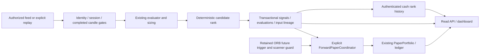

# TradePulse Astra master execution report

Original mission TRADEPULSE-ASTRA-OWNER-2026-10-24-V1; master mission INCOMPLETE.
UI remains DEFERRED_OWNER_UI_REVAMP. Continue original functionality tasks.
Updated UTC: 2026-10-29T09:02:05.209821+00:00; client date2026-10-29, Asia/Kolkata.

## 1. Executive verdict

B01.5a VERIFIED_COMPLETE_LIMITED: 1198 Python / 40 Node / 103 compile; 39 focused (11 VWAP +28 ORB). Fresh verification caches: 103 files / 4516743 bytes removed. Prior E02 cleanup105 remains separate retained history, not an aggregate claim.

Isolated experimental cash VWAP build_contract/evaluate_observation evidence only; non-actionable, no accepted automatic fill policy, no capital reservation or position creation. Existing ORB automatic behavior unchanged. Actual retained scanner/detector pipeline and volume boundaries tested; mocked EMA/RSI boundaries are unit numerical checks only. Initial failure was absent-module ModuleNotFoundError; restricted temporary SQLite smoke failure was a sandbox limitation, followed by approved passing runs. No empirical, performance, live, provider admission or customer acceptance. Original mission INCOMPLETE; UI DEFERRED_OWNER_UI_REVAMP, no UI work.

Current proof: master_astra_b01_vwap_20261029_01.json. Completion/review: astra_b01_vwap_completion_20261029_01.md and astra_b01_vwap_independent_review_20261029_01.md. E02 ledger identity validation and its cleanup remain covered; prior source receipts are historical after new B01 files/registration.

B01.5b NOT_STARTED: explicit opt-in coordinator/portfolio integration with retained-source guards, atomic entry/rollback, direct-enter bypass, concurrency and restart tests. No policy activation or account mutation yet.

## 2. Audit manifest and Git state

This B01 unit adds vwap_paper_triggers.py and test_astra_vwap_paper_triggers.py; existing edits are release_management.py/test_bot.py registration only. Baseline106 becomes108 source files;1183 prior documents, original four handoffs, saved settings and20cached public bodies remain preserved. Prior UI/API fixes are unchanged.

The earlier verified E02.2 unit changed storage.py and test_phase5c_recovery.py. Two
earlier class-only edits in public/index.html predate the owner's UI deferral.
That unit added no application module, database schema or provider route. Its baseline
astra_journal_cleanup_baseline_20261029_01.json preserves1121prior documents,
four original handoffs, saved configuration, owner-confirmed source and20cached
public asset/license bodies. Latest prior handoff bytes are archived again.
The new source-bound proof/closeout supersedes prior receipts for current source.

Owner-confirmed parallel changes to brokers.py/config.py/app .env and local verify_live_quick.py are preserved and separately hash-bound in astra_owner_changes_20261026_01.json. The app env differs from the original baseline. This task did not execute the helper or activate these settings; it excluded only this named local helper from release packaging. Its printed PASS labels are not acceptance evidence.

Current externally advanced HEAD `1404d3bd43567a0717c34614a45d58b226857e3a`; this task made no Git writes.
Branch main; starting HEAD `fcdbadb`, full SHA and 88 source-file hashes in
`../evidence/astra_baseline_20261024_01.json`. The initial source matched the retained
Phase 6 receipt; new source requires the new proof below. 522 prior documents were
inventoried, including releases under docs/evidence (the baseline's top-level ZIP
list is empty because archives are in that subdirectory). Original BRD was read
as ZIP/XML and preserved. Both saved environment files are compared locally by
whole-file integrity, with no credential values copied here. Operational DB/WAL/SHM
were never opened; concurrent external application activity is not attested.

Runtime: Python 3.14.6, Node 24.18.0, Windows PowerShell. No dependency upgrades or
Git mutations. An unrelated untracked TRADEPULSE_AI_PLUS_PROJECT_INTELLIGENCE_REPORT.md
was observed and left intact. Windows sandbox-created temporary directories may
remain access-denied; no recursive cleanup was attempted.

Changed existing code: server.py, historical_study.py, scanner_engine.py,
candle_lineage.py, public/index.html, test_cash_dashboard.js, test_bot.py and
release_management.py. New implemented modules: strategy_evidence.py and
opportunity_ranking.py; new tests: test_astra_http_safety.py, test_astra_research.py,
test_astra_ranking.py. B01 additionally changes forward_paper.py/paper_portfolio.py, adds paper_triggers.py and test_astra_paper_triggers.py, and migrates four existing workflow/recovery test modules. Both original docs/drafts/ files remain preserved; production is independently tested. C03 additionally adds rank_history.py/test_astra_rank_history.py, changes storage.py
and scanner/lineage/server/UI integration, and registers release/test modules. The
HTTP recovery also changes notification_outbox.py/readiness_policy.py and adds
test_astra_context_batch.py/test_astra_health_reads.py plus scanner-reference and
evaluation-read regression modules. Exact source reuse and container traversal
preserve identity, strategy, freshness and nested reference validation. Historical C03 hashes and
archive checks are in astra_rank_preservation_20261027_01.json. Source inspection was targeted, not an exhaustive audit
of every function in the repository.

## 3. BRD acceptance ledger

| Phase | Previous report | Current evidence and boundary |
|---|---|---|
|1 foundation|Offline accepted|EXISTING_RECEIPT_VALIDATED at baseline; current regressions and read-safety fix verified; comprehensive customer security NOT_ESTABLISHED|
|2 historical/research|Mechanics accepted, empirical blocked|VERIFIED_CURRENT_SOURCE_AND_TEST for exact fold coverage; D01.2 observation mechanics VERIFIED_OFFLINE; genuine empirical/OOS BLOCKED_EXTERNAL|
|3 live market data|Adapters tested, live not accepted|Existing fixture regression coverage; real fresh completed scanner-consumed bars NOT_ESTABLISHED; no provider call|
|4 scanner/ranking|Offline accepted|Current regression proof; evidence-passport integration verified; source-bound cash rank history/API/UI VERIFIED_OFFLINE; empirical factors and exact option ranking unavailable|
|5 context/dashboard/alerts|Offline accepted|Current Node/HTTP regressions; paper journal and truthfulness fixes verified; Chrome/Edge assets214 each/four widths and pagination60 each/desktop320 verified; UI journal/accessibility work is deferred to the owner's revamp; no new delivery acceptance|
|6 paper/performance/release|Offline accounting accepted|B01 ORB prospective mechanics and legacy automatic rejection VERIFIED_CURRENT_SOURCE_AND_TEST; other strategy/contract triggers, live evidence and customer release unavailable|

Passing old paper tests means their retained contracts still work; those tests did
not require the missing future strategy predicate. No green suite is used to
erase this newly demonstrated requirement gap. Prior report statements of complete
Phase 6 are valid only within their original tested boundary.

## 4. Architecture and call flows

B01.5a is a separate inspection path: caller-supplied read-only transaction and
retained qualified original inputs -> frozen contract; a later committed input
batch and prior records -> full history replay, past-only indicator/cost checks
and a non-actionable evidence record. The coordinator and portfolio do not call
this new library. Automatic entry integration remains B01.5b.

D01 is an isolated library path: retained raw bytes + master declaration -> pure
option inspection; explicit asset/index windows -> pure alignment. Outputs keep
unavailable capabilities. There is no new edge into scanner, ranking or execution.

Concrete symbols: `scanner_engine.IntradayBotEngine.run_single_scan` creates the
explicit coordinator, freezes input, invokes `evaluate_strategy_detailed`, applies
sizing/geometry, calls `rank_signal_candidates`, saves evaluations and commits
cash inputs before `ForwardPaperCoordinator.consume_scan`. `_replay_cash_result`
supports existing retained-work recovery. `PaperPortfolio.enter/process_bar`
own financial effects and reconciliation; no second ledger was added.

`server.DashboardRequestHandler._handle_scan` passes an explicitly injected paper
portfolio. `_dispatch_get_or_head` now returns 405 for scan aliases before runtime
initialization. POST remains explicit. `candle_lineage.annotate_signals` loads
retained evaluations/context and exposes descriptive maturity; it cannot promote
actionability. `historical_study.run_frozen_study` verifies exact consumed session
declarations before archiving/executing folds. `option_execution.py` remains the
separate historical premium/depth/lot-aware runner. Exact symbol line ranges are
recorded in astra_code_locations evidence; source hashes identify the revision.

Configuration and providers retain existing boundaries; no token handling changes.
Scheduler remains disabled in saved settings. The additive rank table/index migration was tested only in isolated fixtures;
operational SQLite schema and data were not opened or migrated by this slice. Existing tests cover transactions, recovery,
loopback policy, source integrity and release exclusion; new customer auth,
multi-tenant isolation and an SBOM/security attestation remain unimplemented.

## 5. Complete strategy contract matrix

All five evaluate completed five-minute candles. Source helpers enforce the
strategy's minimum and session-opening coverage; scanner provenance, freshness,
full continuity and input-consumer checks remain separate mandatory gates. A
valid evaluator output is a decision-time reference, not an instruction to fill
a future observation. None of these evaluator functions defines pending setup
expiry, a universal three-bar deadline, partial exits or a trailing stop.

| Strategy and source | Actual directional predicates | Entry, invalidation, stop, targets |
|---|---|---|
| Order Block/BOS/FVG, `strategies.py:evaluate_order_block_fvg`, minimum 30 bars | Last 15 bars searched newest eligible origin first. Bull: red origin, either next two closes above origin high, then FVG (second impulse low above origin high) OR displacement from origin open at least 1.5 ATR(10). No subsequent close below origin low; no earlier mitigation by low <= origin high * 1.0015. Current low <= that boundary, close above origin open and >= origin low. Bear mirrors with green origin, closes below origin low, second impulse high below origin low OR 1.5 ATR displacement, no close above origin high, no earlier high >= origin low * 0.9985, and current high reaching that boundary with close below origin open and <= origin high. Supplied mitigated-zone set prevents reuse. There is no minimum RVOL or directional VWAP gate here. | Decision close. Long invalidation origin low; stop origin low - 0.25 ATR. Short invalidation origin high; stop origin high + 0.25 ATR. T1/T2 at 2/3 modeled risk units. Zone consumed only after eligible sizing. |
| VWAP Pullback, `evaluate_vwap_pullback`, minimum 35 | Positive preceding-20-bar volume average, RVOL >= 1.4. Bull: low <= VWAP * 1.0025, close > VWAP and open, close >= EMA20 * 0.998, RSI14 inclusive **48–72**. Bear: high >= VWAP * 0.9975, close < VWAP and open, close <= EMA20 * 1.002, RSI14 inclusive **28–52**. | Decision close. Long invalidation min(low,VWAP), stop that level - 0.35 ATR; short invalidation max(high,VWAP), stop + 0.35 ATR. T1/T2 1.8/2.5 risk units. |
| Option Apex, `evaluate_option_apex_oi_shift`, evaluator minimum **1** bar | NIFTY/BANKNIFTY only, validated chain with ATM row. Long CE: CE OI change < 0, PE OI change > 0, **PCR >= 1.10**, spot close >= VWAP * 0.998. Long PE: PE OI change < 0, CE OI change > 0, **PCR <= 0.85**, spot close <= VWAP * 1.002. OI labels are implemented heuristic interpretations, not proven aggressor positions or forecasts. | Selected CE/PE premium LTP reference; both positions buy premium, including bearish PE. Stop/invalidation 0.78 * premium; T1/T2 +1.6/+2.4 premium risk units. An LTP is not an executable ask. Exact dated contract/lot/tick, aligned premium/chain/prior-close OI authority and liquidity are additional execution requirements. |
| Filtered ORB, `evaluate_orb_breakout`, minimum 30 | At least 4 current-session bars and exact opening starts 09:15/09:20/09:25. Positive prior-20 volume average. Bull: prior close <= ORB high, current close > ORB high and VWAP, RSI >= 55, RVOL >= 1.6. Bear: prior close >= ORB low, current close < ORB low and VWAP, RSI <= 45, RVOL >= 1.6. Prior close need not lie inside both range boundaries. A wick touch alone does not pass. | Decision close. Long invalidation ORB high; stop max(ORB low, current low - 0.25 * range). Short invalidation ORB low; stop min(ORB high, current high + 0.25 * range). T1/T2 1.6/2.4 risk units. |
| Supertrend Pullback, `evaluate_supertrend_pullback`, minimum 200 | Supertrend(10,3) current and prior direction must agree. Long: both current/prior closes above their EMA200, current close > VWAP and open, low <= ST * 1.004 OR <= VWAP * 1.003, RVOL >= 1.3. Short mirrors below EMA/VWAP/open with high >= ST * 0.996 OR >= VWAP * 0.997. Exclude 09:15 <= candle start < 09:45 and 11:30 <= start <= 13:30 IST. Positive prior-20 volume average. | Decision close. Invalidation current Supertrend. Long stop min(ST,low) - 0.25 ATR; short stop max(ST,high) + 0.25 ATR. T1/T2 1.5/2.5 risk units. |

Cash target construction uses `max(0.50, abs(entry-stop))`; option targets use
`max(1.00, entry-stop)`. ATR is floored at 0.05 where used. Prices are rounded by
the evaluator. Displayed nominal multiples can therefore differ from actual
price-level RR. `signal_risk_reward` and the existing ranker calculate numerical
geometry; benchmark strings and `confidence_pct` aliases do not establish win
probabilities. Position sizing can independently reject an otherwise detected
setup. Existing tests include `test_p1c_strategy_*_bidirectional*`, Order Block
mitigation/reuse, and Option Apex strict-field cases in `test_bot.py`; these were
source-inspected here, not re-executed by the focused research command.

`strategy_evidence.py` exposes descriptive independent JSON copies, exact bands
and predicates, no empirical metrics, no automatic promotion, and no entry
authority. Unknown identifiers stay `RESEARCH_HYPOTHESIS`. Registered evaluator
mechanics remain `OFFLINE_MECHANICS_TESTED`; empirical/OOS/reviewed live-paper
evidence is not supplied by this registry. The old shared-contract document and
preregistration are preserved as earlier proposals. Their universal future-close
continuation and any arbitrary global expiry proposal are superseded by this
mission's strategy-specific requirement. A descriptive registry does not enforce
the coordinator's execution policy; that must be reviewed separately.

## 6. Dynamic ranking specification and integrated evidence

`opportunity_ranking.build_snapshot/current_view` uses rule quality descending,
actual gross T1 reward/risk descending, then deterministic identity ties. Policy
`CASH_QUALITY_ACTUAL_RR_DIRECTION_ONE_SYMBOL_V2` includes LONG/SHORT position type
in each opportunity identity and retains one selected setup per cash symbol.
Missing relative strength, sector, regime, liquidity, spread, net executable reward
and empirical edge remain unavailable. No new indicator formula or strategy
promotion was introduced. Exact option-contract fitness is a separate requirement.

`rank_history.record` runs inside `candle_lineage.finish`'s existing scan transaction.
It checks committed candle identity/timestamps/digests, evaluation/trace links,
persisted qualified signal geometry and direction, and the frozen runtime/source
profile before writing. The input snapshot requires ranking, so removal of result
flags and a rank row cannot downgrade a new scan into legacy compatibility.
Signals, evaluations, outbox and rank result commit or roll back together.
Accepted pending input batches may remain available for later recovery.

History links the preceding committed scan in the same runtime scope. Append
checks latest committed input before consulting surviving rank rows; a deleted
latest row cannot be skipped by a later valid scan. Reversed input chronology
rejects. Reads verify current source plus one predecessor's base priority; they
do not recursively audit all historical deltas. The current change explanation
is fully rebuilt. Checksums and cross-table links establish local consistency,
not publisher authenticity or protection against wholesale database rewriting.
The indexed input-scope lookup avoids sorting the full scan history for latest.

GET/HEAD `/api/opportunity-rankings` and `/api/v1/opportunity-rankings` accept only
run_id, bounded limit and offset. They never acquire data, queue paper decisions or
write ranks. The server supplies time; invalid/corrupt data is unavailable with no
fallback to an older current row. Changed profile/code and stale/future snapshots
have empty current rows and an explicit archive. Ordinary SIMULATED scans lack
durable cash input and remain unavailable. Source authenticity is NOT_ESTABLISHED.

The dashboard presents current or historical priority, LONG/SHORT, prior/new rank,
changed components, source watermark, missing factors and removals. All strings
use safe text rendering. Async generation checks prevent old responses restoring
an expired or failed view. Expiry is source bar start +5 minutes +60 seconds;
monotonic elapsed time prevents a backward wall-clock jump extending that window.
The panel is a bounded preview; full user pagination/browser acceptance remains
separate. No ranking control executes a paper or real order.

The integrated synthetic TCS/INFY test uses the actual native-adapter mocked wire,
existing ORB evaluator, scanner and SQLite lineage. New volumes change their
priority and produce retained rule-quality/component deltas. Other tests cover
duplicate replay/restart, empty refresh/removal, direction identity, exact expiry,
profile/code archive, source/score forgery, required-history downgrade, deleted
latest append, predecessor corruption, rollback, indexed lookup and read-only
HTTP/renderer failure handling. This is software acceptance, not observed edge.

Retained integrated demo `astra_rank_integrated_demo_20261027_01.json` executes
that real scanner fixture: TCS quality78 to69; INFY63 to81. Initial TCS/INFY order
becomes INFY/TCS with previous ranks2/1 and SCORE_COMPONENT_CHANGED. Gross T1 RR
is approximately1.6 in both examples. This artifact contains no genuine market data.

## 7. Options, volume, depth and Greeks assessment

D01.1 inventory and D01.2 pure inspection are complete within offline mechanics.
The [D01 implementation report](../reports/astra_d01_completion_20261027_01.md) specifies each endpoint,
raw field presence/unit/time handling, exact declared identity, depth and OI limits,
benchmark alignment, tests, retained failures and unavailable capabilities.
Native provider fixtures are authored synthetic examples. Local master bytes and
declared dates are integrity evidence only. No source/rights/dated tick authority,
normalization policy, current entitlement or genuine live observation is established.

Upstox V2 prev_oi has no documented baseline date. V3 cp is previous close price,
not OI. Nested instrument_token identifies V3 rows. Angel Greeks lack a token/source
clock and require exact unique declared terms. IV/Greeks and REST quantities remain
unscaled; V3 feed contract-volume semantics are not borrowed by REST endpoints.
Benchmark identity remains declared, without a canonical dated master or constituents.
Synthetic OI prior-close arithmetic does not verify the previous trading session.

Existing historical option replay retains lot/tick, quote/depth and source admission
gates. Its integration test rejects snapshots even when relabelled as replay inputs.
No naked-short option, futures/roll, live F&O, premium fill or empirical acceptance.
Official schemas were reconfirmed2026-10-27 from
[chain](https://upstox.com/developer/api-documentation/get-pc-option-chain/),
[Greeks](https://upstox.com/developer/api-documentation/option-greek/) and the
[Angel announcement](https://smartapi.angelone.in/smartapi/forum/topic/4254/announcing-option-greeks-api-for-smartapi-users).
See D01.1 for exact source limitations; no broker request was made.

## 8. Broker matrix and token plan

| Provider | Retained application position | Official documentation / entitlement boundary |
|---|---|---|
|Angel One|Existing adapter/feed preserved; genuine stale packet retained, complete live acceptance absent|Admin notice states daily midnight logout and distinguishes order/GTT static-IP requirements from other APIs. Account entitlement, future token validity and broader pricing not checked by a provider request.|
|Upstox|Optional read-only complement; no source switch|Analytics Token documented free, read-only and valid 1 year; supported quote/history/chain/WebSocket categories. Regular full depth and Plus 30-depth have distinct entitlements.|
|Dhan|Existing code preserved|Premium plan rejected by owner; no subscription, activation or new price claim. Current commercial entitlement UNKNOWN.|

[Upstox Analytics Token](https://upstox.com/developer/api-documentation/analytics-token/)
is generated through the account interface, supports specified read-only access
and cannot place/modify orders. No daily OAuth workflow should be invented for
that use case. Standard OAuth is a different token with the documented 3:30 AM
expiry boundary. [Standard token](https://upstox.com/developer/api-documentation/get-token/).
[Angel admin notice](https://smartapi.angelone.in/smartapi/forum/topic/5254/important-updates-to-smartapi-in-compliance-with-sebi-guidelines/34).
Accessed 2026-10-24. The Angel page includes deleted-topic wording and user replies;
only the visible administrator notice supports the stated lifecycle fact.

Future nonsecret schema proposal: token kind, expiry timestamp, provider and
approved capability set, with the actual token held only in local secret storage.
Do not echo token length/prefix/hash, silently refresh, retry login or change
saved credentials. A future activation requires exact provider/scope/time/rate/
stage/entitlements approval. No such activation occurred; previous one-shot text
is not used as permission under this revised mission. Free API access is separate
from historical authenticity, display, derived-data and redistribution rights.

## 9. Bugs and security findings

| ID/severity | Evidence, correction and disposition |
|---|---|
|B01 P0 paper premature entry|Before reproduction retained. Repaired automatic path: legacy rejection; new source-bound ORB future trigger with atomic guards. Offline proof only; other strategy triggers unavailable.|
|B02 high read mutation|Actual HTTP before: 2 tests,6 failed method/alias subcases. server.py rejects GET/HEAD scan before initialization. After 2/2 pass, POST still consumes explicit paper sentinel.|
|C01 high study integrity|Two failed assertions proved omitted intermediate test/warm-up sessions accepted. Exact source-prefix/range guard before archive/evaluation;23 focused new+old tests pass.|
|E01 medium misleading UI|Before 27 Node tests:24 pass / 3 fail. Missing quantity/prices fabricated, stale equity shown. Removed frontend sizing fallback, retained null chart levels and stale mark withholding; journal tests added.|
|I01 integration regression, corrected|New maturity annotation assumed strategy_id on legacy minimal rows;4 errors retained. UNKNOWN descriptive fallback preserves legacy integrity validation. Re-run54/54 passes.|
|R01 coverage boundary|Cash rank history/API/UI integrated offline. Net friction, publisher authenticity, sector correlation and exact option fitness remain unavailable.|
|R03 high rank history integrity, corrected|Independent review reproduced result/row downgrade and append past deleted latest history. Required input marker and committed-input predecessor selection now reject both; before/after logs retained.|
|R04 medium rank semantics/clock, corrected|Directional identities are distinct; browser uses monotonic elapsed time for expiry. Both findings reproduced before repair and covered in canonical proof.|
|R05 repeated context validation, corrected|16 candidates caused17 context reconstructions and33 evaluation checks. One authenticated batch reduces those to2 each including construction; per-decision checks and atomic rollback remain. Health receipt reads also share one fresh snapshot.|
|R06 concurrent HTTP latency, observed limitation|Three intermediate canonical stages failed HTTP timing; instrumented after-probe still exceeded the3s health assertion. The final uninstrumented proof is stated separately. No global latency guarantee or sole-cause attribution.|
|R02 medium stale current priority, corrected|Independent review found read expiry 5m later than rebuild qualification; exact boundary regression failed then passed after correction.|
|E03 medium absent values, corrected|UI self-review found absent quality coerced to 0 and invalidation borrowed from stop; 32-test before run failed one regression, after32/32 pass. Observed zero remains0.|
|E04 focus/mobile usability, corrected|Actual fixtures reproduced lost selection/refresh/retry focus, missing tab semantics and obstructive mobile header; final assets03 pass214 per browser.|
|E05 chart descriptions, corrected|OI change and hypothetical gross/net model are labeled accurately; no empirical result is implied.|
|E06 pagination truthfulness, corrected|Before browser50/56 and Node38/40 reproduced inverted ranges and stale range after503. Empty current pages retain positive totals; failed pages clear old ranges. Final pagination60 per browser and Node40 pass.|
|E07 mobile retry visibility, corrected|Edge assets02 passed213/214 with the correctly focused retry card offscreen. Focus now restores after cards and inspector render; final assets03 Chrome214/Edge214 pass.|
|D02 typed validation, corrected|Missing current/baseline/both OI status leaked3KeyErrors; ACTIVE-only get check now rejects with typed error. Focused32 and same8diagnostic cases pass without input mutation.|
|E02.2 medium ledger API identity, corrected|Two writer-backed tests reproduced24 failing assertions; positions/recovery payload identities now match account/entity wrappers or return generic503. Focused22 and current canonical pass; no financial writes or payload echo.|

Negative controls: offline runner blocks non-loopback sockets; fixtures install
transport sentinels and separate stores. UI renders journal strings via safe text,
withholds corrupt financial state and bounds previews. Actual HTTP GET/HEAD and
renderer refresh tests rule out those paths invoking scans/paper mutations.
This is not proof that every possible future endpoint is safe. No real broker
order endpoint was called and no new broker dispatch was added. The current
HTTP/research/metadata/rank slice received independent read-only source review;
R02 was fixed afterwards and tested by root. Earlier UI review was its author's self-review. Subsequent independent rank
review and browser DOM/keyboard checks are documented in section15. Full paper,
product/security approval remains open. Limited E01 browser/pagination review is recorded in section15.

## 10. Paper engine detailed verdict

B01.5a now supplies an isolated, non-actionable VWAP future-reclaim evidence contract. Automatic VWAP entries remain unsupported until B01.5b. The existing ORB entry/ledger mechanism below is unchanged and its28focused regressions passed.

The original failure is retained: legacy automatic close policy filled98 when
threshold100 was never reached (high99). The repaired coordinator rejects new
automatic decisions under that legacy policy. Old manual ledger APIs remain for
explicit compatibility tests; they are not the scanner's automatic entry path.
Existing account configuration hashes are never silently migrated.

New `paper_triggers.py` implements only `ORB_FOLLOW_THROUGH_CLOSE_V1`. The existing
ORB detector/formula remains unchanged. A qualified stored detector result fixes
signal high for LONG or low for SHORT; a strictly later completed close must cross
that extreme from the preceding observed close. Every intervening five-minute
observation must be retained and fresh when consumed. A missing observation cannot
be backfilled later. Touch is not cross. Range invalidation or T1 already touched
before the close blocks entry. Same-session/account square-off applies, without
an arbitrary three-bar setup TTL. Fill uses the observed close plus the configured
adverse cost model; cash lot1 is explicit, qualified tick rounding remains
NOT_MODELED_NO_QUALIFIED_TICK. These are mechanics, not an executable-price claim.

The decision stores strategy/source hashes, original candle/evaluation links,
contract, queue time, observation decisions and trigger timestamp. Direct entry
replays original retained inputs under the same SQLite write transaction. It checks
the actual scanner guard before staging effects and after staging the first mark.
Late clock or stream degradation rolls back the position, events and reservation.
Unsupported strategy policies, stale/missing/forged inputs and unconfirmed/direct
calls cannot fill. Concurrent callbacks produce one entry. Existing stop-first
collisions, exposure/sizing/cost checks, marks, full-T1 exit and EOD reconciliation
remain in the same ledger. No second accounting system was introduced.

Independent review found missing decision-identity and recovery timestamp links;
these are repaired and regression-tested. A final recovery-envelope finding was
reproduced as six failing tamper subcases, then repaired. Committed-effect recovery
checks decision/account/run/config/candidate and immutable event/position links
without demanding today's strategy code or fresh market data. The reviewer hit
its usage limit after the last finding; root reviewed and tested the final repair,
so no final independent sign-off beyond those documented findings is claimed.

Actual offline HTTP/scanner tests prove retained ORB detection, waiting, a future
cross, fill102.6 versus reference102, risk rejection, mark/exit and restart. API
and existing dashboard paper journal expose the persisted rule/timestamps. All
25 initial boundary tests and35 HTTP tests passed; the final combined107-test
run adds migration, concurrency and corruption coverage before canonical proof.
These are separate isolated synthetic scenarios, not a performance cohort.
No genuine trade count, win rate, expectancy or live acceptance is inferred.
Other cash strategies and exact CE/PE automatic future triggers remain unavailable;
partial/T2/trailing lifecycle and qualified tick/execution assumptions remain work.

## 11. Historical and empirical readiness

Retained public probe evidence contains an authentic provider-response candidate:
73/75 bars for RELIANCE 2026-10-22, missing 15:15 and 15:20. It is not an accepted study.
Publisher trust/signature, current research rights, dated identity and sufficient
complete sessions remain missing. Earlier 'no historical observations' wording is
too broad; 'zero qualified empirical datasets established' is the proper boundary.
Private originals were not re-opened or newly authenticated in this slice.

Separate historical option execution is implemented. Cash-only StudyProtocol's
Strategy3 exclusion is a scope boundary, not absence of option_execution.py.
Historical option bid/ask/depth and dated contract authority remain external gates.
Current source has publisher signature verification, independent rights policy
and immutable original-byte archives. Test roots/rights documents establish
mechanics, not real publisher/legal authorization.

No new empirical study, win-rate claim or promoted strategy. Original nominal
60/20/20, win>=50%, 100-trade or lot-size prose examples are not binding code-derived
acceptance. The research design below is proposed and lacks frozen real datasets.

These are unimplemented research hypotheses, not promoted strategies. A numerical
data acquisition price is **unknown** until scoped vendor/license quotes exist;
this work incurs no subscription or provider call. Reuse already-authorized
qualified inputs where available, and keep cash/option cohorts separate.

| Priority / version | Hypothesis and inputs | Control and falsification | Acquisition dependency |
|---|---|---|---|
| 1 / `relative-participation-h1` | Ranking by stock excess return versus contemporaneous sector/index, confirmed structure and time-of-day participation may distinguish leaders from sector-wide moves. Requires aligned completed bars, point-in-time constituents and volume/turnover. | Unchanged candidate quality rank and no-trade baseline. Reject if sealed OOS incremental net expectancy/selection value is nonpositive or explained by concentrated sector exposure. | Licensed sector/index history and constituent dates; price unknown. |
| 2 / `regime-pullback-h1` | Past-only trend/volatility regime may explain when existing VWAP/ST pullbacks fail; initially a soft research feature, not extra universal gates. | Original unchanged strategies; ablation without regime feature. Reject unstable sign or lost benefit under adverse costs and alternate past-only windows. | Sufficient multi-regime complete history; price unknown. |
| 3 / `opening-rotation-h1` | Compare existing ORB signals with sector-relative participation after the actual open. | Unmodified ORB; strict chronological intraday measurement. Reject if benefit depends on hindsight, top-mover selection, or concentrated event days. | Exact open bars, sector alignment, corporate-action policy; price unknown. |
| 4 / `compression-expansion-h1` | Past-only volatility compression followed by confirmed expansion or a failed-breakout reversal may offer a distinct setup cohort. | Simple fixed ORB/return baselines; version breakout and failure variants separately. Reject if costs or plausible entry delay erase benefit. | Multi-session licensed OHLCV and executable-spread evidence; price unknown. |
| 5 / `underlying-contract-h1` | Separate underlying directional score from option contract tradability, theta/delta exposure, spread and expiry fitness. | Same underlying thesis with predeclared fixed ATM choice; compare observed net outcomes and unresolved rates. Reject if gains depend on LTP fills, stale Greeks or unrealistic depth. | Exact dated chains, quotes, volume/OI baselines and Greeks/IV with source times; entitlement and price unknown. |
| 6 / `depth-flow-h1` | Legally available quote changes/depth may improve short-horizon execution-risk estimates. It is not executed aggressor flow without genuine trade classification. | Quote-only spread/depth control; cancellation/spoofing and sampling sensitivity. Reject if effect is latency-sensitive or survives only snapshots with unknown ordering. | Licensed granular event/depth history, clock quality and retention rights; highest data/engineering burden, price unknown. |
| 7 / `futures-basis-h1` | Dated futures/cash basis and aligned OI changes may help explain participation or contract risk. | Underlying-only thesis and constant contract-selection control. Reject if roll/carry, asynchronous prices or OI timing explain the effect. | Exact dated futures, cash, contract rolls and OI baselines; price unknown. |

Original research offers motivation, not Indian five-minute evidence. Moskowitz
and Grinblatt's *Do Industries Explain Momentum?* (1999, journal publication;
publisher page lists later online publication) motivates controlling industry
effects, not copying a monthly result into this scanner.
[Original journal source](https://onlinelibrary.wiley.com/doi/10.1111/0022-1082.00146),
accessed 2026-10-24. Moskowitz, Ooi and Pedersen's *Time Series Momentum* (2012)
studies longer-horizon own-return signals across futures markets; it is a basis
for a comparator hypothesis, not evidence for intraday Indian profitability.
[Author research page](https://www.aqr.com/Insights/Research/Journal-Article/Time-Series-Momentum),
accessed 2026-10-24. No external performance percentage is imported into the app.

The preserved Astra preregistration is design-only and lacks dataset binding.
Before any genuine OOS run, freeze exact originals, universe membership,
exclusions, corporate actions, strategy/config/source versions, complete session
partitions and cost schedule. Its proposed 252-session/126-training/63-validation/
63-sealed-OOS plan is a starting proposal, not proof of sufficient statistical
power. Do not silently reduce it to accommodate short data. Use past-only warm-up
and never score it as OOS; purge/embargo where labels overlap. For intraday flat
cohorts, explicitly verify no position crosses a fold. Evaluate all declared
variants, retain failures, use session-clustered uncertainty and appropriate
multiple-testing correction. Such inferential tooling is not implemented by the
small partition fix. Report unresolved positions, sample dependence, net R and
INR expectancy, win/loss magnitude, drawdown, exposure, cost share, regime/year
stability and adverse-cost sensitivity. A good fixture metric has no promotion
authority.

Maturity advances only after independent review of qualified source/rights,
frozen untouched OOS outcomes and then a separate genuine forward-paper cohort
under the exact trigger/fill policy. A revised strategy needs a new ID/version
and fresh sealed data. Data/trust failures, unresolved accounting or material
execution drift suspend conclusions. No strategy was promoted or retired here.

## 12. UX and product differentiation

**DEFERRED_OWNER_UI_REVAMP.** The owner will rework the UI. Continue the original master functionality tasks; the retained UI results below describe earlier bounded work, not a new acceptance.

Current renderer coverage is 40 Node tests. Actual production-assets Chrome 214/214 and Edge 214/214
pass at1440/768/390/320 widths; pagination Chrome 60/60 and Edge 60/60 pass at desktop/320px.
Verified scenarios include native previous/next, sizes10/20/50, filter resets, delayed
reads, empty/error/shrinking totals, selected tab semantics and visible retry focus.
Screenshots cover captured viewports; positive chart rendering covers the signal chart.
Computed contrast is NOT_EVALUATED. No CSS animation was rendered in the checked
fixture state; JavaScript reduced motion and WCAG conformance remain unestablished.
Actual-browser bounded paper journal is E01.2d; its existing40-row cap and complete
ledger API remain preserved. Existing vanilla JS and paper authority remain.

| Priority / feature | Customer problem and competing workaround | Cost/dependency/risk | Acceptance and value hypothesis |
|---|---|---|---|
|1 Rank movers + X-Ray|Manual sorting/screens lose why priority changed|Medium; qualified multi-symbol input and persistent snapshots; stale/missing factor risk|Trace each change to source/component and expire stale ranks; measure time to explain top 3, not number of signals|
|1 Paper shadow journal|Spreadsheet/manual entry loses trigger/fill assumptions|High; B01 first, rights and costs; favorable-fill bias|Replay exact lifecycle and reconcile every event; measure unresolved-rate and explanation accuracy|
|2 Evidence passport|Headline win rate obscures data/sample/cost limits|Low local UI, high empirical dependency|Every claim links period/sample/cost/source or says unavailable; measure comprehension and trust|
|2 Saved comparison/watchlists|Repeated manual filters and separate notes|Medium; later tenant/auth scope|Reopen same retained evidence without accidental trades; measure weekly return usage|
|3 Sector/regime map|Absolute movers confuse market beta and leadership|High data/rights/constituent dependency|Past-only aligned factors and ablations; measure incremental selection value before promotion|
|3 Cash-to-contract|Underlying direction hides bad option execution|High; exact quotes/depth/Greeks/lot/expiry|Separate thesis and contract fitness, reject missing premium; measure unresolved/fill-friction rates|
|Defer missed-opportunity lab|Hindsight makes abstention look wrong|High selection-bias/counterfactual risk|No invented missed fills; preregister universe/exclusions before measuring|

Demand is **unvalidated**: no customer interviews, paid experiments or retention
data were gathered. [Chartink's guide](https://chartink.com/articles/scanner/scanner-user-guide/)
documents configurable technical/fundamental filters and crossovers.
[TradingView's screener guide](https://www.tradingview.com/support/solutions/43000718866-tradingview-stock-screener-trade-smarter-not-harder/)
documents multi-filter tables, saved screens/watchlists and exports. Accessed
2026-10-24. These are real alternative workflows, not proof that their users will
pay TradePulse. The proposed differentiator is an inspectable rank-change and
strategy-trigger history, to be tested against those workflows. Current brokerage
research/options competitor breadth and exact pricing still need verified review.

## 13. Build-to-sell plan

Personal alpha: extend qualified strategy policies, verify actual browser usability, preserve localhost isolation,
deterministic tests and truthful empty states. Invite-only beta comes after genuine
scanner-consumed market data, rights/legal clearance, financial reconciliation,
stability soak and user-support/runbook acceptance. Public release additionally
needs authenticated tenant isolation, rate limiting, billing/tax/privacy design,
monitoring, incident response, independent security review and explicit approval.

Regulatory assessment is a launch question, not a ban on offline engineering.
SEBI's July 23, 2025 RA FAQ explains that specific-security technical research is
not exempt merely because of its methodology. The live regulations index lists
RA amendments through October 10, 2026; the RA master circular is dated
February 6, 2026. Ask qualified Indian counsel to classify ranked security targets/
stops, paid distribution and any personalized features under RA/IA rules, and map
registration, disclosures, records, complaints, performance advertising and client
obligations. The master-circular linked document failed to open in this tool; its
publication was verified, not a full clause-by-clause current legal audit.
[RA FAQ](https://www.sebi.gov.in/sebi_data/attachdocs/jul-2025/1753268710217.pdf),
[updated regulations](https://www.sebi.gov.in/sebiweb/home/HomeAction.do?doListing=yes&sid=1&ssid=3),
[2026 master circular](https://www.sebi.gov.in/legal/master-circulars/feb-2026/master-circular-for-research-analysts_99571.html).

NSE's current linked usage policy requires intended-use agreements, limits
redistribution, and includes restrictions concerning virtual trading/simulation.
Obtain explicit provider/exchange classification and permission for the proposed
paper product; a broker credential or 'educational' label cannot settle this.
[NSE usage policy, clauses 6.3/7.3/7.4](https://nsearchives.nseindia.com/web/sites/default/files/inline-files/NSE_Data_Sharing%26Usage_Policy.pdf).
Its March 2026 non-display policy includes derived internal analysis and requires
separate agreement/fees for external derived-data distribution.
[NSE non-display policy](https://nsearchives.nseindia.com//web/mediaattachment/2026-03/Non_Display_Policy_20260323164430.pdf).
Accessed 2026-10-24. These are specific unresolved commercial-use gates; no legal
opinion or license is granted here.

Proposed discovery: interview separate cash/derivatives/self-directed cohorts;
test whether users can explain why an opportunity ranks first and why no trade
occurred. Prototype usability before price tests. Free delayed/example education
versus paid licensed research/journal tiers are hypotheses subject to rights and
legal scope. Compare willingness to pay with actual retention, support cost and
licensed data cost. No numeric subscription promise, campaign, purchase or client
enrolment. Use transparent demonstrations and non-cherry-picked case studies only
after applicable approvals; never guaranteed-profit claims.

Proposed metrics: weekly engaged researchers, qualified opportunity review rate,
explanation completion, rank freshness/removal accuracy, paper reconciliation,
unresolved marks and support burden. Candidate SLOs need measurement: no duplicate
financial events, no stale actionable rank, bounded data-to-rank latency and read
API latency within the existing test budget. Business costs remain unquoted for
licensed history/real-time/derived use, hosting, audits, counsel and support.

Keep SQLite and loopback for alpha. Before multi-user hosting: inventory retention,
authentication/authorization, per-user entitlements, encryption/key rotation,
durable event queue and measured database contention. Migrate storage only after
workload evidence; no React or speculative platform rewrite. Deployment checklist:
source-bound tests -> reviewed manifest -> isolated restore drill -> explicit
configuration/entitlement verification -> canary -> measured health. Rollback:
stop new consumers, preserve append-only financial events, return to known code,
verify schema compatibility and reconcile before resuming. No destructive live
restore without separately approved procedure. Privacy applicability/effective
dates and full SBOM review remain unverified work; do not claim commercial readiness.

## 14. Ordered implementation backlog

| Task / phase / owner | State | Dependency, files and measurable acceptance |
|---|---|---|
|B01 /6 /paper owner|ORB + ISOLATED VWAP EVIDENCE VERIFIED; lifecycle INCOMPLETE|VWAP contract11tests/ORB28pass; integration5b and other strategies/contracts remain pending.|
|C03 /4,5 /coordinator|VERIFIED_COMPLETE for offline cash priority scope|Source-bound atomic history, read API/UI, TCS/INFY evaluator fixture, adversarial corruption/rollback/ordering and canonical proof. Wider empirical/contract factors remain unavailable.|
|C02 /2,4,5 /coordinator|Implemented and tested|Evidence metadata wired scanner/history/UI; no promotion authority. Additional calibration requires X01.|
|E01 /5,6 /UI|DEFERRED_OWNER_UI_REVAMP|Preserve prior verified scope; further UI work belongs to the planned revamp.|
|E02 /1,6 /independent reviewer|IN_PROGRESS|Read-only HTTP/research/metadata/rank review completed; freshness finding reproduced and fixed. B01 repair and C03 received scoped independent review; Chrome/Edge DOM/keyboard checks passed. Final E01/D01 scoped review passes; full product/security, paper-journal browser and accessibility conformance remain open.|
|D01 /2,3 /data owner|D01.1/2 VERIFIED_OFFLINE; runtime admission absent|Exact neutral benchmark/chain/Greeks/OI/depth contracts and offline provider fixtures; no new calls; preserve provider fail-closed behavior.|
|F02 /6 /coordinator|Current-slice proof; mission release NOT_STARTED|B01 ORB, C03 and D01.2 source verified; runtime D01 admission, broader lifecycle, paper-journal browser and full accessibility/product review remain. Existing release packager includes new modules; no new archive or customer release.|
|X01 /2 /operator + data owner|BLOCKED_EXTERNAL|Complete authentic history, approved trust/rights, dated corporate-action/instrument universe, frozen OOS protocol; no fixtures as edge.|
|X02 /3 /operator|BLOCKED_EXTERNAL|New exact scoped authorization, official session, unused/approved stage and real accepted stream->scanner evidence.|
|X03 /6 /owner + counsel/vendor|BLOCKED_EXTERNAL|Legal/data/tenant/security/support readiness and separate public-release approval.|

Offline remaining B01/D01/E01.2/E02 can proceed without market hours or additional credentials.
There is no Phase 7. The task ledger separately tracks completed B02/C01 and remaining
work; a prototype or a prior report is never whole-phase completion.

## 15. Verification ledger

**Current source:** master_astra_b01_vwap_20261029_01.json: B01.5a VERIFIED_COMPLETE_LIMITED: 1198 Python / 40 Node / 103 compile; 39 focused (11 VWAP +28 ORB). Fresh verification caches: 103 files / 4516743 bytes removed. Prior E02 cleanup105 remains separate retained history, not an aggregate claim.

Exact executed IDs, source-before/source-after and log hashes match. Previous E02/E01 verification below is historical at its own source boundary. No new UI verification was run.

**Historical E02 source:** `master_astra_backend_cleanup_20261029_01.json`: PASS 1187/1187 Python, 40/40 Node, 101 compiled Python files;
zero failures/errors/skips/unraisables and exact source-before/source-after equality.
RUN: `.venv_phase4\Scripts\python.exe -B -W error::ResourceWarning verify_offline.py --stage astra_backend_cleanup_20261029_01`.
Focused E02 after22/22; before2tests/24failures, plus retained initial sandbox failure.
Cleanup dryrun/apply passed:105untracked files, 4,566,808bytes,
two empty directories, no recursive deletion. All1121prior documents and274images
are preserved. Final independent review and separate closeout validation are retained.
No provider/order/send/operationalDB/Git mutation. E01UI work is owner-deferred.

**Historical verification ledger below:** the E01 receipts identify earlier source,
before the two class edits and ledger API correction. They were not rerun as UI work.

**Historical E01 source:** `master_astra_e01_20261029_02.json`: PASS 1185/1185 Python, 40/40 Node, 101 compiled Python files; zero failures/errors/skips/
unraisables, exact executed IDs and unchanged source. RUN:
`.venv_phase4\Scripts\python.exe -B -W error::ResourceWarning verify_offline.py --stage astra_e01_20261029_02`.
Final assets03 Chrome 214/214 and Edge 214/214; pagination03 Chrome 60/60 and Edge 60/60; focused Node40/40.
Actual production HTML and16cached assets/4licenses are used. No JavaScript exceptions,
crashes or unexpected fixture requests; browsers exited, servers stopped and profiles
were removed. Focused D0132/32 and identical-input diagnostic8/8 pass. Exact hashes,
logs, screenshots and handoffs are bound by the E01 closeout/separate validation.
Final scoped review is in astra_e01_ui_review_20261029_02.md.

Before browser04 passed186/210 with24genuine focus/retry/label failures. Earlier
receipts preserve focus-reset, identical-read serialization and CDP-pumping harness
mistakes; interim after04 was209/210 due to the harness race. Later pagination before
was50/56; its two added Node regressions gave38/40 before repair, then40/40. Edge
assets02 was213/214 with a correctly focused retry card offscreen; restoration now
follows full rendering and final assets03 pass in both browsers. Failures remain intact.

**Historical E01 stage01:** master_astra_e01_20261029_01.json passed1185Python,
38Node and101compiled before pagination/layout repairs. Earlier completion/review01
are preserved and do not identify the final source.
**Historical D01:** master_astra_d01_20261027_01.json passed1184Python/38Node/
101compiled at that source boundary. Its56new tests and numerical/clock diagnostics
remain retained; current proof includes the later typed-rejection fix. The original
D01 reviewer authored option tests, not production. Later scoped review is independent.

**Historical C03 canonical proof:** `../evidence/master_astra_rank_history_20261027_01.json`: PASS
1128/1128 Python, 38/38 Node, 97 compiled files, exit 0 and
zero failures/errors/skips/unraisables. Exact executed IDs, timestamps, log hashes
and unchanged source-before/after are retained. RUN command:
`.venv_phase4\Scripts\python.exe -B -W error::ResourceWarning verify_offline.py --stage astra_rank_history_20261027_01`.

C03 canonical stages _01 and _02 each completed1106/1107 Python. The first timed
out in the concurrent dashboard burst; the second timed out waiting for the slow
primary scan response. Node38 and compile92 passed both. The original four-test
Phase1F class passed between them with unchanged limits. All failures remain.

Instrumented before-probe PASS4 recorded48 separate context submissions across
three scans. A deterministic regression then demonstrated17 snapshot reconstructions
and33 evaluation validations for16 candidates. Atomic batching now requires2 each
(construction plus fresh transaction validation), preserving every decision/intent
check. A separate health regression demonstrated one connection per symbol;
the shared read snapshot removes that repetition while rechecking every receipt.
Combined context/health/HTTP/rank/cash integration PASS104/104, including11 new
batch tests and3 health tests; independent read-only review found no material issue.

Instrumented after-probe FAIL3/4: a health response took3.44s against the unchanged
3s assertion. Context enrichment across3scans measured1.085s versus3.245s before;
210 acceptance lookups measured0.025s versus2.892s. These overlapping instrumented
wall times are not a controlled performance benchmark. This failure is retained;
neither successful integrity tests nor the final uninstrumented canonical result
establish a production latency guarantee. There was no timeout relaxation.

Stage _03 completed1118/1121 (two failures/one error): health3.44s>3s, primary
scan5s timeout, and a newly added unregistered local helper. Owner confirmed
separate brokers/config/app-env/helper changes; source was unchanged during that
run. The helper is preserved and explicitly excluded from bundles; focused release
tests PASS17. Existing unknown-production-module detection remains active.

Further native scan profiling found86 repeated source-reference normalizations
and37472 recursive reference visits in one evaluation read. A retained one-stock
regression found7 normalizations versus2; scan-local metadata reuse keys exact
raw candle content, returns deep copies, and preserves evaluator/freshness checks.
Nested reference traversal now recurses only into containers, checking every dict
even inside arbitrary extension/list fields. New regressions verify unchanged
payloads, raw-input mutation invalidation and later rehashed source corruption.
Initial scanner-after failures from a missing copy import and a mistyped test
module are retained, corrected, and superseded by actual successful checks.
Combined latency/integrity/release integration passed129/129. Review then found
raw datetime input could fail the optional fingerprint; a retained failing test
was corrected by bypassing metadata reuse when raw JSON fingerprinting fails.
The final focused scanner/evaluation/HTTP run passed11/11 (4 scanner,3 traversal,
4 original concurrent HTTP tests). Independent scanner/release review found no
remaining material issue. The traversal author owns its3 tests; coordinator
review is separate. Recursion dropped37472 to3844 calls with all nested-reference
checks retained. This is bounded work reduction, not production SLO acceptance.

Actual browsers: astra_browser_chrome_20261026_02 and astra_browser_edge_20261026_01
each PASS36, exit0. Desktop1440x1000 and mobile390x844: DOMContentLoaded, literal
hostile text, missing/zero values, native Tab/Enter refresh/navigation, real expiry,
HTTP503 clearing and delayed-response suppression. GET-only exact-origin requests,
blocked external/POST probes, no JS exception/crash, clean browser/profile/server
shutdown. Chrome155/Edge156 runs took4.755/5.43seconds. CSS/fonts omitted and
Chart/Tailwind stubbed; screenshots are diagnostic DOM evidence, not visual/mobile
layout approval. Initial Chrome _01 FAIL retained; the harness's async Enter wait
was corrected without production changes. Browser receipt/artifact hashes checked.

Integrated demo20261027_01 PASS1/1, two source-bound views, unchanged historical C03 source
snapshot matching its canonical receipt. Earlier _02 matched the prior97-file
snapshot; its first sandbox SQLite failure remains preserved. D01.1 read-only inventory
reconfirmed public schemas and documents exact unresolved units/clocks; no provider
request or validator implementation is implied by that inventory.

C03 RUN receipts: rank_history_initial_20261025_01 had one fixture exception
expectation error; integrated_20261025_01 PASS48; review_repairs_20261025_01 PASS105;
rank_history_boundary_20261026_01 PASS62. Downgrade, direction and clock before-fix
failures remain preserved. Node clock-after PASS38. rank_order_before_20261026_01
failed3 on sandbox SQLite access; authorized offline rerun _02 PASS2/FAIL1 proved
the append-history gap. Corrected boundary/canonical runs include that regression.

Independent read-only reviewer confirmed the first three repairs, then found the
append gap. Root reproduced, repaired and tested it; the reviewer subsequently
confirmed the final repair with no further material finding. This is scoped
independent review, not whole-product sign-off. Browser DOM-double tests are
distinct from actual browser acceptance. No provider/network/order/send claim.

`astra_rank_preservation_20261027_01.json` validates522 original documents,
original BRD and both historical archives. Root env matches the original baseline;
the app env and separate source edits match the owner-confirmed change receipt,
not their original baseline. No credential values were retained. Current source differs
from their historical proof, as expected. Prior mutable handoff text is archived
in `astra_handoff_before_rank_20261027_01.json`; machine receipts never overwrite.
`astra_rank_closeout_20261027_02.json` binds the historical C03 corrected handoff; its parent01 and original handoff bytes remain retained.

**Historical B01 boundary proof:** `../evidence/master_astra_orb_trigger_20261025_02.json` passes1088/1088
Python,32/32Node,90compiled files; zero failures/errors/skips/unraisables.
Source-before equals source-after; exact IDs/log hashes retained. Command:
`.venv_phase4\Scripts\python.exe -B -W error::ResourceWarning verify_offline.py --stage astra_orb_trigger_20261025_02`.

New focused receipts: orb_boundaries_20261025_02 PASS25; orb_http_20261025_02
PASS35; orb_integrated_20261025_01 PASS107. Earlier sandbox failures, legacy
inventory failures and one migration assertion mismatch remain preserved.
orb_recovery_before_20261025_01 intentionally fails six tamper subcases before
the recovery-envelope fix; the final combined/canonical runs include the repair.
`astra_b01_preservation_20261025_01.json` checks522 original documents, both env
files, original BRD and both historical archives without operational DB access.

**Historical prior slice:** canonical strict receipt
`docs/evidence/master_astra_owner_slice_20261025_02.json` reports 1060 Python
tests and 32 Node tests, no failures/errors/skips/unraisables, plus syntax
checks and 88 root Python files compiled. Exact commands, IDs, counts, times, source-before/after and log
hashes are retained in that receipt. This is partial-slice software proof, not B01
or real-market acceptance.

Command: `.venv_phase4\Scripts\python.exe -B -W error::ResourceWarning verify_offline.py --stage astra_owner_slice_20261025_02`.
Windows sandbox blocked temporary SQLite access in earlier focused runs; those
failures remain recorded, then the exact tests ran outside the sandbox with
external network still blocked by the runner.

| Stage | RUN result |
|---|---|
|Phase 6 receipt validation at baseline|Exit0;1040 retained Python executions validated, not re-executed then|
|HTTP before / after|2 tests:1 pass and6 failing subcases before;2/2 after|
|Research partition before / after|2 failures before;23/23 new+existing after authorized sandbox rerun|
|UI before / worker after|24/27 pass before;30/30 after; intermediate passport test raised count to31; final32 below|
|Rank prototype initial / corrected|6/7 then7/7; deterministic canonical candidate-order digest corrected|
|Integrated focused first / second / third|Sandbox file errors;50/54 with4 real legacy missing-field errors;54/54 after compatible UNKNOWN annotation|
|First canonical,20261024_01|FAIL1056/1059 Python,2 failures and1 error: old GET assumptions and draft production placement; preserved, not accepted|
|Canonical repairs,20261025_03|26/26 pass; POST security/freshness, packaging and8 rank tests; failed sandbox and intermediate request-body fixture attempts preserved|
|Rank expiry boundary before|1/1 failed as expected before fix; included in corrected8 rank tests|
|UI review remaining before/after|31/32 then32/32; absent quality/invalidation remain unavailable, actual zero quality retained|

Retained old archives/receipts are verified separately by
`docs/evidence/astra_preservation_check.py`, which checks manifest bytes against
their historical source snapshots, not today's changed source. It also compares
522 prior documents, both env files and original BRD. Old Phase 6 helper is not run
because it overwrites old receipts and infers DB preservation from size alone.
The first new preservation check exposed a verifier/archive scope difference:
both old proofs hash empty `public/rea`, while both release manifests omit it.
Its SHA256 is the empty-file digest and current size is 0. The corrected check
requires exactly that omission, verifies every packaged source hash and every
archive member, and records the exception explicitly. Old archives contain 111
and 122 public files; they are historical releases, not this changed source.
`astra_preservation_20261025_01.json` passes these checks; no generic missing-file
exception was added. This artifact does not serve as application code or an asset.
The historical receipt did not establish browser acceptance. The new browser scope
is stated above; no full independent product review, empirical
execution, real provider/Telegram delivery or new release bundle.

Workers audited disjoint files. Root integrated/reviewed outputs and ran actual
checks. The paper-draft author then independently reviewed HTTP/research/metadata/
rank files they had not authored; their rank finding led to a retained failing
regression and correction. UI review was explicitly its author's self-review.
Those workers later hit usage limits; the subsequent B01 review and tests are described above. Current
machine receipts take precedence over
prose counts, future mutable checkpoints and historical HEAD labels.

## 16. Outstanding owner decisions

The owner has settled the immediate direction: continue the original Astra master mission and defer UI work to its planned revamp. No new provider authorization is inferred.

Product goals are already settled. Future approval is required only for precise
provider runs/activation, paid data and licenses, account/customer security setup,
qualified legal/commercial decisions, public launch and destructive migration.
No approval is requested to resume ordinary offline B01/C03 engineering. No new
token, plan, phone/contact detail or screenshot is needed for the current work.

## 17. Next-session checkpoint

B01.5a VERIFIED_COMPLETE_LIMITED: 1198 Python / 40 Node / 103 compile; 39 focused (11 VWAP +28 ORB). Fresh verification caches: 103 files / 4516743 bytes removed. Prior E02 cleanup105 remains separate retained history, not an aggregate claim.

No command is running at this checkpoint. Master mission remains incomplete. UI is deferred; provider/order/send/operational database/Git actions were not performed.

B01.5b NOT_STARTED: explicit opt-in coordinator/portfolio integration with retained-source guards, atomic entry/rollback, direct-enter bypass, concurrency and restart tests. No policy activation or account mutation yet.

Use astra_b01_pending_continuation_20261029_01.md and the completed5a contract as the starting point; do not restart the audit or reimplement completed work. Resume: CONTINUE FROM CHECKPOINT.

## 18. Source references and evidence limits

Official URLs are cited beside claims; D01 schemas were reconfirmed2026-10-27.
Earlier broker/commercial/legal references retain their original2026-10-24 access dates; this slice did not revalidate those topics.
Provider docs describe available schemas, not account access, historic date
authority or resale rights. Regulatory documents identify questions for counsel,
not a commercial sign-off. The current NSE linked policy has changed numbering
from older drafts; use verified clauses 7.3/7.4, not copied older 8.3/8.4 references.

Repository evidence: baseline/extracted original BRD; preserved Phases 4/5/6 strict
receipts and manifests; actual pre-fix paper/HTTP/research/UI logs; new focused and
canonical receipts; strategy research notes and earlier proposed preregistration.
Precise source symbols/ranges are in astra_code_locations evidence. No operational
DB contents, private token values or unobserved performance appear in this report.
All experimental rank/paper examples are synthetic engineering examples. Original
six-phase roadmap and every previous report/release/receipt remain preserved.
