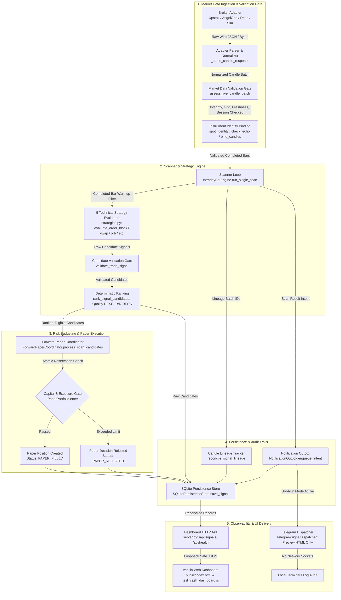

# TRADEPULSE AI — MASTER PROJECT HANDOVER & REPOSITORY DOSSIER

**Document Authority:** Authoritative Current-Source Project Handover  
**Document File:** `docs/reports/TRADEPULSE_COMPLETE_PROJECT_HANDOVER.md`  
**Creation Date / Local Time:** `2026-10-22T14:15:00+05:30` (IST)  
**Git Repository Root:** `C:\Users\HP\Downloads\indian_fo_signal_bot_phase3b`  
**Application Root Directory:** `C:\Users\HP\Downloads\indian_fo_signal_bot_phase3b\indian_fo_signal_bot_v1`  
**Git Branch:** `main`  
**Current HEAD Commit:** `f9488168468819fd3706dbb1cfb5ab616e10c241` (`testing passed`)  
**Operating Posture:** Strictly Offline — Zero live broker requests, zero credential disclosure, `telegram_dry_run=true`, `enable_background_scheduler=false`.  

---

## A. Executive Handover

### 1. Product Purpose and Concrete End Goal
TradePulse AI is an evidence-driven, explainable Indian-market trading intelligence system designed for National Stock Exchange (NSE) cash-equity and equity derivatives (Futures & Options — F&O). It is not an unverified alert bot or automated execution black box. The intended end state encompasses:
- Rigorous cash-equity opportunity scanning with an empirical research objective of identifying credible 5–10% intraday or multi-session momentum moves without relying on gap-ups (a research hypothesis, never a guaranteed return).
- Fail-closed data ingestion enforcing monotonic timestamp ordering, 5-minute interval grid boundaries, candle completion filters, exchange calendar session bounds (09:15–15:30 IST weekdays), positive volume, and freshness limits ($<15$ minutes).
- Deterministic signal evaluation across five technical market-structure strategies (Order Block / Fair Value Gap mitigation, VWAP pullbacks, Opening Range Breakout, Supertrend pullbacks, and Option Apex OI shifts).
- Transparent candidate ranking based on setup quality scores, observed reward-to-risk ratios, and canonical symbol identities, invariant to input ordering.
- Multi-asset statutory Indian transaction cost modeling (STT, exchange turnover fees, SEBI charges, GST, stamp duty) and capital reservation risk budgeting.
- Durable, idempotent paper trading with transactional SQLite ledger persistence, position reconciliation, and end-of-day (EOD) digest summaries.
- A hardened, loopback-bound local REST API (`server.py`) and single-page dashboard (`public/index.html`) that truthful labels data provenance (`SIMULATED`, `LIVE_UNVERIFIED`, `MOCKED`) and prevents stale cache poisoning.
- Release engineering tools (`release_management.py`, `verify_offline.py`) featuring SHA-256 packaging manifests, isolated database backup/restore drills, and credential-free offline CI workflows (`.github/workflows/offline.yml`).

### 2. Workspace Layout, Branch, and Commit Baseline
- **Git Repository Root:** `C:\Users\HP\Downloads\indian_fo_signal_bot_phase3b`
- **Application Directory:** `indian_fo_signal_bot_v1`
- **Branch:** `main` (tracked to `origin/main`)
- **HEAD Commit:** `f9488168468819fd3706dbb1cfb5ab616e10c241` ("testing passed", 2026-10-22)
- **Preceding Commit Lineage:**
  - `bd499cdb8d312e41ef79d6a11199bbc9b6e75c6f` ("phase-4B", 2026-10-21)
  - `60834ddf0f6258e63fc73680df508075f5dd21b8` ("task- done", 2026-10-21)
  - `abf9f518e77a28e9d06b3a3d537f0525997d4429` ("Task 2: Configuration recovery, cash-data acceptance audit, and M01-M12 scorecard", 2026-10-19)
  - `e646e1d...` ("phase-6 done", 2026-10-19)

### 3. Working Tree Status & Preservation
- **Staged Changes:** None (`0` files).
- **Unstaged Modified Changes:** Exactly one file: `indian_fo_signal_bot_v1/Audit.md` (containing the user's master dossier prompt). Preserved untouched.
- **Untracked Changes:** The application directory contains zero untracked code files. The repository root contains historical test run output files (`*.tmp`) from earlier audit runs; these are preserved without modification.
- **Integrity Rule:** No `git reset`, `git clean`, or destructive operations were run. Zero source code or test modifications were introduced during this handover.

### 4. Implementation vs. Verification Status Breakdown
To ensure absolute clarity for the incoming engineer or AI assistant, the repository state is partitioned into five distinct evidentiary categories:
1. **Implemented in Source:** All 26 Python application modules and the vanilla HTML/CSS/JS frontend are physically present, syntactically clean, and fully wired. This includes broker adapters (Upstox, Angel One, Dhan, Simulation), candle lineage validation, keyset-paginated historical reader, native derivative contract parser, durable notification outbox, paper ledger, loopback security guards, and release packaging.
2. **Test-Proven via Offline Regressions:** Verified by **722 passing Python test cases** (in `test_bot.py` unified runner) and **10 passing Node.js dashboard tests** (`test_cash_dashboard.js`) running under strictly blocked network sockets. Execution integrity is validated via `verify_offline.py --validate-evidence docs/evidence/master_final_accepted.json` (exit code 0, 722 cases matched).
3. **Synthetic / Mocked Fixtures:** All offline tests consume deterministic synthetic payloads, simulated time clocks, in-memory SQLite instances, or mocked HTTP transports. Wire fixtures carry simulated payloads even when mimicking live response structures.
4. **Authentic External Evidence:** A single genuine live market quote for RELIANCE (LTP `1220.3`, latency `0.622s`) was verified in earlier Phase 2C audits. However, live 5m intraday candle streams and live broker sessions are currently disconnected.
5. **Externally Blocked / Unverified:** Real Angel One historical candle requests returned HTTP 403 `ACCESS_DENIED` (requiring SmartAPI portal historical data subscription or static IP whitelisting). Upstox V2 intraday candle endpoints are deprecated by the broker in favor of V3. Authoritative historical publisher digital signatures, dynamic NFO master feeds, and real-money broker order placement are completely unverified and forbidden.

### 5. Exact Continuation Point
**Active Continuation Point:** Phase 4A — Implement the fail-closed publisher trust and effective-date verifier in `source_qualification.py` and `instrument_archive.py`. Integrate it with historical archive resolution and replay gates so that historical research can only consume independently authenticated datasets.

---

## B. Complete Project Structure and File Inventory

### 1. Directory Tree Map
```
C:\Users\HP\Downloads\indian_fo_signal_bot_phase3b/
│
├── .github/
│   └── workflows/
│       └── offline.yml                          # Credential-free offline CI matrix (Python 3.10-3.14 on Win/Ubuntu, Node 24)
├── .env                                         # Local environment configuration (secret-bearing, gitignored)
├── .gitignore                                   # Standard ignore rules (.env, *.db, *.pyc, release zips)
│
└── indian_fo_signal_bot_v1/                     # Primary application root directory
    │
    ├── .env.example                             # Sanitized configuration template with placeholder tokens
    ├── config.py                                # BotConfig dataclass, atomic _load_dotenv, safety constraints
    ├── configuration_check.py                   # Zero-disclosure standalone local dotenv diagnostic CLI
    ├── brokers.py                               # Broker adapters (Upstox, AngelOne, Dhan, Sim) & candle validation
    ├── candle_lineage.py                        # Persisted signal vs. raw candle reconciliation & tamper checks
    ├── contract_universe.py                     # Native Upstox F&O JSON instrument observation parser & cache
    ├── diagnostics.py                           # Angel One SmartAPI preflight & market-data diagnostic runner
    ├── upstox_diagnostics.py                    # Upstox API v2/v3 diagnostic runner
    ├── instrument_identity.py                   # Authoritative spot/option identity mappings & token echo checks
    ├── instrument_archive.py                    # Historical instrument archive resolution & tamper rejection
    ├── historical_data.py                       # Point-in-time candle slicing, timezone checks, synthetic datasets
    ├── historical_pagination.py                 # Keyset cursor pagination & streaming digest for replay store
    ├── source_qualification.py                  # Publisher qualification & historical dataset eligibility gates
    ├── scanner_engine.py                        # IntradayBotEngine scanner loop, scheduler, candidate handoff
    ├── strategies.py                            # 5 strategy evaluators, setup quality scoring, candidate ranking
    ├── backtest_engine.py                       # Chronological simulation engine, walk-forward splits, Indian cost model
    ├── paper_portfolio.py                       # Durable cash paper portfolio, event-driven ledger, reservations
    ├── forward_paper.py                         # ForwardPaperCoordinator bridge between scanner and paper accounts
    ├── storage.py                               # SQLitePersistenceStore, signal deduplication, schema migrations
    ├── notification_outbox.py                   # Durable dry-run notification outbox, attempt audit, retry states
    ├── telegram_bot.py                          # TelegramSignalDispatcher, truthful HTML formatter, dry-run gate
    ├── server.py                                # Hardened loopback REST API server (/api/signals, /api/health, etc.)
    ├── release_management.py                    # SHA-256 release packager, isolated backup & restore drill
    ├── readiness_policy.py                      # Diagnostic receipt recording, execution gates, expiry boundaries
    ├── research_protocol.py                     # Frozen research parameter protocols & study split definitions
    ├── performance_acceptance.py                # Performance benchmark harness (memory, latency, concurrency)
    ├── verify_offline.py                        # Master offline verification harness & evidence validator CLI
    │
    ├── public/                                  # Frontend web application assets
    │   ├── index.html                           # Single-page dashboard (HTML5, Vanilla CSS, Vanilla JS)
    │   └── rea                                  # Tracked empty placeholder (excluded from release bundles)
    │
    ├── test_bot.py                              # Unified unittest runner & master regression suite (722 tests loaded)
    ├── test_cash_dashboard.js                   # Node.js DOM-double tests for public/index.html (10 tests)
    ├── test_cash_workflow.py                    # End-to-end scanner -> ledger -> HTTP API -> renderer integration tests
    ├── test_cash_lineage.py                     # Candle lineage, quantity tamper, and price reconciliation tests
    ├── test_contract_universe.py                # Native F&O contract parser, last-good cache, and expiry tests
    ├── test_historical_pagination.py            # Keyset cursor pagination, snapshot consistency, and replay tests
    ├── test_notification_outbox.py              # Outbox intent commits, retry states, and terminal failure tests
    ├── test_local_api_security.py               # Host header, Origin, CORS, and loopback socket security tests
    ├── test_release_operations.py               # Release bundle archive inspection and isolated restore tests
    ├── test_paper_sessions.py                   # Multi-session paper trading, fee reconciliation, and EOD digests
    ├── test_verify_offline.py                   # Offline verification harness, log-path normalization tests
    ├── test_release_management.py               # Release packager, SQLite backup, and health monitor tests
    ├── test_completion_engineering.py           # Dotenv parsing syntax, candidate ranking, and geometry tests
    ├── test_blocker_removal.py                  # Isolated configuration discovery, diagnostic lifecycle tests
    ├── test_phase4_market_data.py               # Synthetic wire comparisons, isolated transport tests
    ├── test_market_data_contract.py             # Shared market data contract, 5m completion consistency tests
    ├── test_angel_market_data.py                # Angel SmartAPI safety, token echo, and retry policy tests
    ├── test_continuous_acceptance.py            # Paper ledger streaming, multi-session recovery, cursor paging
    ├── test_phase4_e2e.py                       # Offline end-to-end scanner pipeline, persistence, dry-run tests
    ├── test_phase4_strategy.py                  # Strategy-required data, warmup filters, invalidation tests
    ├── test_phase5a_contracts.py                # Derivative contract models and master parser tests
    ├── test_phase5a_provenance.py               # Source provenance assessment and tamper tests
    ├── test_phase5a_paper.py                    # Paper account capital reservation and loss control tests
    ├── test_phase5a_integration.py              # Scanner to paper portfolio integration tests
    ├── test_phase5b_forward.py                  # Forward paper execution coordinator tests
    ├── test_phase5c_recovery.py                 # Multi-session recovery, ledger rollback, concurrent safety tests
    │
    ├── docs/                                    # Documentation, engineering reports, and rubrics
    │   ├── TRADEPULSE_CAPABILITY_MATRIX.md      # Official M01–M12 capability rubric & scoring methodology
    │   ├── TRADEPULSE_EXECUTION_LEDGER.md       # Master chronological execution ledger & gate history
    │   ├── TRADEPULSE_OPERATIONS_RUNBOOK.md     # Production release, verification, and backup runbook
    │   ├── TRADEPULSE_COMPLETION_ROADMAP.md     # Milestone completion criteria and remaining deliverables
    │   ├── TRADEPULSE_FO_CONTRACT_COVERAGE.md   # Derivative contract coverage specifications
    │   ├── TRADEPULSE_MARKET_DATA_ACCEPTANCE_MATRIX.md # Acceptance requirements per provider/scope
    │   │
    │   ├── evidence/                            # Retained execution logs and cryptographic manifests
    │   │   ├── master_final_accepted.json       # Master accepted evidence manifest (722 tests, exit 0)
    │   │   ├── master_final_accepted_python.txt # Full 722-test verbose execution log
    │   │   ├── master_final_accepted_node.txt   # Node.js 10-test dashboard execution log
    │   │   ├── master_final_accepted_syntax.txt # Node syntax check log
    │   │   ├── master_final_accepted_validation.json # Validation receipt against current source snapshot
    │   │   ├── master_release_candidate_002.zip # Deterministic release candidate archive
    │   │   ├── master_release_candidate_002_build.json   # Release bundle build manifest (56 files)
    │   │   ├── master_release_candidate_002_inspect.json # Release bundle inspection verification
    │   │   └── ...                              # Historical stage manifests (gate2, history, etc.)
    │   │
    │   └── reports/                             # Formal audit, task, and readiness reports
    │       ├── TRADEPULSE_COMPLETE_PROJECT_HANDOVER.md  # (This master handover dossier)
    │       ├── TRADEPULSE_PRODUCTION_READINESS_REPORT.md# Production readiness evaluation (BLOCKED)
    │       ├── TRADEPULSE_TEST_READINESS_REPORT.md      # Testing readiness evaluation (PASS)
    │       ├── TRADEPULSE_TASK4_CASH_CANDLE_LINEAGE_AND_RECOVERY_REPORT.md
    │       ├── TRADEPULSE_TASK3_FORENSIC_STABILITY_AND_READINESS_REPORT.md
    │       ├── TRADEPULSE_TASK2_PROJECT_FORENSIC_INVENTORY.md
    │       ├── TRADEPULSE_TASK2_IMPLEMENTATION_AND_TEST_REPORT.md
    │       ├── TRADEPULSE_TASK2_CHANGE_LEDGER.md
    │       ├── TRADEPULSE_TASK2_CASH_DATA_ACCEPTANCE_MATRIX.md
    │       ├── TRADEPULSE_TASK2_M01_M12_SCORECARD.md
    │       └── TRADEPULSE_TASK2_BLOCKERS_AND_NEXT_ACTIONS.md
```

### 2. File Inventory Table
The following table catalogs every first-party source module, configuration file, test suite, and operational artifact:

| Path | File Type | Role / Primary Responsibility | Key Exported Symbols | Direct Dependencies | Tests Covering It | Status |
|---|---|---|---|---|---|---|
| `config.py` | Python | Central configuration & safe dotenv loading | `BotConfig`, `ConfigValidationError`, `_load_dotenv` | Standard library (`os`, `re`, `base64`) | `test_completion_engineering.py`, `test_blocker_removal.py` | Production Ready (Offline) |
| `configuration_check.py` | Python | Standalone zero-disclosure config preflight | `check_configuration`, `main` | `config.py` | `test_completion_engineering.py` | Production Ready (Offline) |
| `brokers.py` | Python | Market data adapters & candle validation | `BaseBrokerAdapter`, `UpstoxV2Adapter`, `AngelOneSmartAPIAdapter`, `DhanHQAdapter`, `SimulatedNSEAdapter`, `MultiBrokerScanner`, `assess_live_candle_batch` | `config.py`, `instrument_identity.py` | `test_market_data_contract.py`, `test_angel_market_data.py`, `test_phase4_market_data.py` | Tested with Fixtures (Live Blocked) |
| `candle_lineage.py` | Python | Persisted signal vs. raw candle reconciliation | `CandleLineageTracker`, `reconcile_signal_lineage` | `strategies.py`, `storage.py` | `test_cash_lineage.py`, `test_cash_workflow.py` | Verified Offline |
| `contract_universe.py` | Python | Native Upstox F&O contract parser & cache | `UpstoxNativeInstrumentParser`, `ContractCacheManager` | `instrument_identity.py`, `config.py` | `test_contract_universe.py` | Verified Offline |
| `diagnostics.py` | Python | Angel One SmartAPI preflight & diagnostic CLI | `run_angelone_market_data_diagnostics`, `main` | `brokers.py`, `config.py` | `test_blocker_removal.py`, `test_angel_market_data.py` | Implemented (Live 403 Blocked) |
| `upstox_diagnostics.py` | Python | Upstox API diagnostic CLI | `run_upstox_diagnostics`, `main` | `brokers.py`, `config.py` | `test_blocker_removal.py` | Implemented (Live Deprecated) |
| `instrument_identity.py` | Python | Canonical spot & option identity mappings | `spot_identity`, `option_contract`, `bind_candles`, `check_echo`, `validate_symbol_meta` | Standard library | `test_contract_universe.py`, `test_phase4_market_data.py` | Verified Offline |
| `instrument_archive.py` | Python | Historical instrument archive resolution | `resolve_archives`, `prepare_archive` | `instrument_identity.py`, `source_qualification.py` | `test_phase5a_provenance.py` | Partial (Awaiting Phase 4A Verifier) |
| `historical_data.py` | Python | Dataset validation, timezone checks, slices | `validate_and_prepare_historical_dataset`, `get_point_in_time_candle_slice` | `strategies.py` | `test_bot.py:TestHistoricalDataIngestion` | Verified Offline |
| `historical_pagination.py` | Python | Keyset cursor pagination for large datasets | `KeysetHistoricalReader`, `StreamingDigest` | `storage.py`, `historical_data.py` | `test_historical_pagination.py` | Verified Offline |
| `source_qualification.py` | Python | Provenance assessment & publisher gates | `assess_source_evidence`, `HistoricalEligibility` | Standard library | `test_phase5a_provenance.py` | Partial (Fail-closed default) |
| `scanner_engine.py` | Python | Main multi-symbol intraday scanning loop | `IntradayBotEngine`, `MarketScanScheduler` | `brokers.py`, `strategies.py`, `storage.py`, `notification_outbox.py` | `test_cash_workflow.py`, `test_phase4_e2e.py` | Verified Offline |
| `strategies.py` | Python | 5 technical evaluators & setup quality scoring | `evaluate_order_block_fvg`, `evaluate_vwap_pullback`, `evaluate_orb_breakout`, `evaluate_supertrend_pullback`, `evaluate_option_apex_oi_shift`, `rank_signal_candidates`, `size_position` | Standard library, `math` | `test_phase4_strategy.py`, `test_completion_engineering.py` | Verified Offline |
| `backtest_engine.py` | Python | Walk-forward backtest simulator & cost model | `run_backtest`, `split_sessions_chronologically`, `IndianCostModel` | `strategies.py`, `historical_data.py` | `test_bot.py:TestPhase3BBacktest` | Verified Offline (Strategy 3 Blocked) |
| `paper_portfolio.py` | Python | Durable paper trading account & ledger | `PaperPortfolio`, `PaperAccountConfig`, `PaperPosition` | `storage.py` | `test_paper_sessions.py`, `test_continuous_acceptance.py` | Verified Offline |
| `forward_paper.py` | Python | Scanner to paper execution coordinator | `ForwardPaperCoordinator` | `paper_portfolio.py`, `storage.py` | `test_phase5b_forward.py`, `test_cash_workflow.py` | Verified Offline |
| `storage.py` | Python | SQLite persistence, deduplication, schema | `SQLitePersistenceStore`, `validate_signal_identity` | `sqlite3`, `json` | `test_cash_workflow.py`, `test_continuous_acceptance.py` | Verified Offline |
| `notification_outbox.py` | Python | Durable dry-run notification queue & retry | `NotificationOutbox`, `OutboxMessageState` | `storage.py` | `test_notification_outbox.py`, `test_cash_workflow.py` | Verified Offline |
| `telegram_bot.py` | Python | Truthful HTML formatter & dry-run sender | `TelegramSignalDispatcher`, `format_signal_html` | `urllib.request`, `json` | `test_completion_engineering.py` | Verified Offline (Dry Run Enforced) |
| `server.py` | Python | Hardened loopback REST API server | `DashboardRequestHandler`, `create_http_server` | `http.server`, `storage.py`, `scanner_engine.py` | `test_local_api_security.py`, `test_cash_workflow.py` | Verified Offline |
| `release_management.py` | Python | SHA-256 packaging, backup & restore drill | `ReleasePackager`, `DatabaseBackupRecovery`, `OperationalHealthMonitor` | `zipfile`, `hashlib`, `sqlite3` | `test_release_operations.py`, `test_release_management.py` | Verified Offline |
| `readiness_policy.py` | Python | Diagnostic receipts & execution gates | `execution_gate`, `_record_completed_diagnostic` | `storage.py`, `config.py` | `test_blocker_removal.py` | Verified Offline |
| `research_protocol.py` | Python | Research dataset parameter protocols | `ResearchProtocol`, `StudySpecification` | Standard library | `test_bot.py:TestResearchProtocol` | Verified Offline |
| `performance_acceptance.py` | Python | Memory, latency, concurrency benchmarks | `run_performance_benchmark` | `storage.py`, `scanner_engine.py` | `test_continuous_acceptance.py` | Verified Offline |
| `verify_offline.py` | Python | Master test harness & evidence validator CLI | `main`, `validate_evidence`, `offline_network` | `unittest`, `subprocess`, `hashlib` | `test_verify_offline.py` | Verified Offline |
| `public/index.html` | HTML/JS | Single-page monitoring dashboard frontend | Inline DOM components, `apiClient`, `renderSignalCards` | Vanilla JS, Chart.js (CDN) | `test_cash_dashboard.js` (10 tests) | Verified Offline (DOM Double) |
| `.github/workflows/offline.yml` | YAML | Multi-OS/Python credential-free CI workflow | GitHub Actions workflow definition | `verify_offline.py` | Unhosted (Syntax Validated) | Implemented (Not Hosted) |

### 3. Excluded Content Categories and Justification
The following directories and artifacts are deliberately excluded from fine-grained file-by-file tracking:
- **`__pycache__/` and `*.pyc`**: Python compiled bytecode files. Ephemeral, dynamically generated, and non-authoritative.
- **`.git/` internals**: Git object database, pack files, refs, and index. Preserved completely but excluded from application logic.
- **`*.tmp` files in repository root**: Artifacts generated during prior unattended batch test executions. Retained for historical provenance; not part of the shipping product.
- **`master_release_candidate_*.zip`**: Built ZIP archives in `docs/evidence/`. Binary packaging outputs; their source contents are manifested and verified via `release_management.py inspect`.
- **`public/rea`**: Tracked empty extensionless file in `public/`. Preserved in git to prevent working tree disruption, but explicitly excluded from production release packaging manifests.

---

## C. Architecture and Actual Execution Flow

### 1. End-to-End Architectural Data Flow



### 2. Detailed Code Path Tracing (11 Core Workflows)

#### Path 1: Startup, Configuration, Provider Selection, and Safety Flags
- **Code Path:** `config.py:BotConfig.__init__` $\rightarrow$ `config.py:_load_dotenv` $\rightarrow$ `config.py:BotConfig.validate`
- **Execution Flow:** `BotConfig` initializes with default arguments. If an explicit path is omitted, `_load_dotenv` resolves `.env` located strictly adjacent to `config.py` (preventing arbitrary CWD pollution). The parser ignores valid comments (`#`) and empty lines, rejecting malformed lines without equals (`DOTENV_ASSIGNMENT_MISSING_EQUALS`), invalid characters (`DOTENV_KEY_INVALID`), unterminated quotes, or NUL bytes. `validate()` enforces `active_broker` $\in \{\text{"paper\_sim"}, \text{"angelone"}, \text{"dhan"}, \text{"upstox"}\}$, non-negative capital risk percentages, valid trading session hours (09:15–15:30 IST), and boolean flags.
- **Safety Boundary:** `telegram_dry_run` defaults to `True` and `enable_background_scheduler` defaults to `False`. The diagnostic entry point `configuration_check.py` calls `cfg.validate(require_live_credentials=True)` inside a try-except block that captures only sanitized reason codes and line numbers, never disclosing raw credentials.
- **Classification:** **CONFIRMED IN SOURCE & TESTED WITH FIXTURES**.

#### Path 2: Broker Adapters & Market Data Validation
- **Code Path:** `brokers.py:MultiBrokerScanner.get_active_adapter` $\rightarrow$ `brokers.py:UpstoxV2Adapter.get_intraday_candles` / `AngelOneSmartAPIAdapter.get_intraday_candles` $\rightarrow$ `brokers.py:assess_live_candle_batch`
- **Execution Flow:** `MultiBrokerScanner` instantiates the adapter requested by `BotConfig.active_broker`. The adapter builds HTTP requests with required auth headers (`Authorization: Bearer ...`). On wire response, `_parse_candle_response` extracts OHLCV arrays. `assess_live_candle_batch` subjects the parsed candles to 12 strict validation gates:
  1. Non-empty list of dicts.
  2. All required keys present (`timestamp`, `open`, `high`, `low`, `close`, `volume`).
  3. Strict numeric float types; no NaN or infinite values.
  4. Logical price geometry: $High \ge Low$, $High \ge \max(Open, Close)$, $Low \le \min(Open, Close)$.
  5. Non-negative volume ($Volume \ge 0$).
  6. Strict timezone enforcement: timestamps must be timezone-aware or ISO-8601 strings in Indian Standard Time (`+05:30`).
  7. Strict monotonic ascending chronological order (no identical or backward timestamps).
  8. Interval boundary grid alignment: for 5-minute candles, minutes must be divisible by 5 ($:00, :05, :10, \dots$).
  9. Session alignment: candle times must fall within the official NSE equities trading window (09:15 to 15:30 IST).
  10. Non-future timestamps: candle end-time must not exceed current evaluation clock time.
  11. Freshness check: latest completed candle must not be older than the configured threshold (e.g., 15 minutes during active session).
  12. Gap detection: missing intervals trigger an explicit `BrokerDataError`; synthetic bar interpolation is strictly forbidden.
- **Classification:** **CONFIRMED IN SOURCE & TESTED WITH FIXTURES** (Live Upstox/Angel adapters mocked in tests; live endpoints blocked).

#### Path 3: Candle Normalization, Completion, Freshness, and Identity Binding
- **Code Path:** `instrument_identity.py:spot_identity` $\rightarrow$ `instrument_identity.py:check_echo` $\rightarrow$ `instrument_identity.py:bind_candles` $\rightarrow$ `candle_lineage.py:CandleLineageTracker`
- **Execution Flow:** Before evaluation, `spot_identity` verifies the instrument's canonical symbol, exchange (`NSE`), token, and tick size. If the adapter response returns token metadata, `check_echo` asserts an exact match against the requested token; if the adapter omitted response echo, the batch is explicitly tagged `REQUEST_BOUND_NO_ECHO`. `bind_candles` attaches immutable provenance metadata: `provider`, `data_mode` (`LIVE` vs `SIMULATED`), `batch_id`, and `retrieval_timestamp`. `CandleLineageTracker` retains a cryptographic SHA-256 digest of the raw candle sequence to detect any subsequent in-memory mutation.
- **Classification:** **CONFIRMED IN SOURCE & TESTED WITH FIXTURES**.

#### Path 4: Cash Scanning $\rightarrow$ Strategy Evaluation $\rightarrow$ Ranking & Quality $\rightarrow$ Risk & Sizing
- **Code Path:** `scanner_engine.py:IntradayBotEngine.run_single_scan` $\rightarrow$ `strategies.py:filter_completed_candles` $\rightarrow$ `strategies.py:evaluate_*` $\rightarrow$ `strategies.py:validate_trade_signal` $\rightarrow$ `strategies.py:rank_signal_candidates` $\rightarrow$ `strategies.py:size_position`
- **Execution Flow:** `run_single_scan` iterates over configured watchlist symbols (`BotConfig.equity_watchlist`). `filter_completed_candles` discards currently forming (open) bars based on evaluation clock time. If completed bars meet warmup requirements (e.g. 20+ bars for EMA/VWAP/ATR), the 5 strategy evaluators execute:
  - `evaluate_order_block_fvg`: Detects displacement, institutional order blocks, fair value gap creation, and mitigation retests.
  - `evaluate_vwap_pullback`: Evaluates dynamic intraday trend relative to session VWAP and EMA bands.
  - `evaluate_orb_breakout`: Evaluates breakouts beyond the initial 15-minute or 30-minute opening range with volume expansion.
  - `evaluate_supertrend_pullback`: Identifies trend continuation retests of the ATR-based Supertrend line.
  - `evaluate_option_apex_oi_shift`: Evaluates derivative PCR and OI buildup shifts (for index underlyings).
  Candidate signals emit a `TradeSignal` dataclass. `validate_trade_signal` validates price geometry ($Target_1 > Entry > Stop$ for Long; $Target_1 < Entry < Stop$ for Short) and invalidation level. `rank_signal_candidates` sorts candidates deterministically: `quality_score` DESC, observed reward-to-risk DESC, canonical symbol ASC. `size_position` computes share quantity based on capital risk budget (e.g. 1% of account equity) divided by per-share risk ($|Entry - Stop|$), incorporating `calculate_indian_statutory_charges`.
- **Classification:** **CONFIRMED IN SOURCE & TESTED WITH FIXTURES**.

#### Path 5: Scan Result Persistence, Transactions, Recovery, and Errors
- **Code Path:** `storage.py:SQLitePersistenceStore.save_signal` $\rightarrow$ `storage.py:validate_signal_identity`
- **Execution Flow:** Persisting a signal executes inside an immediate SQLite transaction. `validate_signal_identity` verifies all required fields, non-null prices, and valid timestamp formats. Deduplication is enforced via a unique index on `(signal_dedup_key, provider, data_mode)`. If an identical signal was already recorded for the same 5m candle, `save_signal` increments the duplicate counter and skips re-insertion. If database disk I/O fails, the transaction rolls back cleanly, and the scanner logs an error without crashing the process.
- **Classification:** **CONFIRMED IN SOURCE & TESTED WITH FIXTURES**.

#### Path 6: Paper Decisions $\rightarrow$ Positions $\rightarrow$ Ledger $\rightarrow$ Reconciliation $\rightarrow$ EOD Reporting
- **Code Path:** `forward_paper.py:ForwardPaperCoordinator.process_scan_candidates` $\rightarrow$ `paper_portfolio.py:PaperPortfolio.enter` $\rightarrow$ `paper_portfolio.py:PaperPortfolio.reconcile` $\rightarrow$ `paper_portfolio.py:PaperPortfolio.generate_eod_statement`
- **Execution Flow:** When a paper portfolio is attached, `process_scan_candidates` submits ranked candidates to `PaperPortfolio.enter`. The portfolio atomically checks risk constraints:
  - Account capital sufficiency: required margin must not exceed available cash.
  - Maximum open positions limit (e.g., max 5 concurrent positions).
  - Maximum daily realized + unrealized loss limit.
  If approved, an atomic reservation is created, an event `PAPER_ORDER_FILLED` is appended to `paper_events`, and a record is created in `paper_positions`. On exit (hit target, stop loss, or 15:15 IST EOD square-off), an exit fill event is recorded and capital released. `reconcile()` uses keyset-indexed queries to ensure current cash equals starting cash plus realized P&L minus cumulative statutory charges. `generate_eod_statement` computes an immutable daily P&L and charges digest.
- **Classification:** **CONFIRMED IN SOURCE & TESTED WITH FIXTURES**.

#### Path 7: Historical Archives, Source Qualification, Pagination, Replay, and Backtesting
- **Code Path:** `source_qualification.py:assess_source_evidence` $\rightarrow$ `instrument_archive.py:resolve_archives` $\rightarrow$ `historical_pagination.py:KeysetHistoricalReader` $\rightarrow$ `backtest_engine.py:run_backtest` $\rightarrow$ `readiness_policy.py:execution_gate`
- **Execution Flow:** Before running a historical simulation, `execution_gate` verifies source eligibility. In the current implementation, `assess_source_evidence` returns `allowed=False` for historical replay because digital publisher trust signatures are not yet present (fail-closed security). For synthetic research, `KeysetHistoricalReader` reads historical bars using cursor watermarks `(timestamp, id)` rather than `OFFSET`, eliminating the 10,000-row SQLite limit and allowing consistent streaming through 250,000+ bars. `run_backtest` processes bars in strict chronological order with zero look-ahead bias, applying `IndianCostModel` slippage and fees. Strategy 3 (Option contracts) explicitly raises `HISTORICAL_OPTION_EXECUTION_NOT_IMPLEMENTED`.
- **Classification:** **CONFIRMED IN SOURCE & TESTED WITH FIXTURES** (Live historical source qualification blocked pending Phase 4A).

#### Path 8: F&O Contracts, Option Chains, Observed Premiums, and Execution Gaps
- **Code Path:** `contract_universe.py:UpstoxNativeInstrumentParser` $\rightarrow$ `instrument_identity.py:option_contract` $\rightarrow$ `storage.py:SQLitePersistenceStore.save_instrument_observations`
- **Execution Flow:** `UpstoxNativeInstrumentParser` imports raw Upstox native JSON instrument dumps (`OpenAPIScripMaster` / instruments payload). It validates exact exchange tokens, strike prices, lot sizes, expiry dates, and contract types (`FUTSTK`, `FUTIDX`, `OPTSTK`, `OPTIDX`). Valid observations are committed atomically to `instrument_observations` with SHA-256 byte digests and expiration dates. A last-good cache preserves previously valid observations if a fresh daily download fails. Option chains are parsed to extract CE/PE strikes and Greeks; however, execution of options during backtests remains blocked due to absent tick-level historical option bid/ask quotes.
- **Classification:** **CONFIRMED IN SOURCE & TESTED WITH FIXTURES**.

#### Path 9: HTTP API Routes $\rightarrow$ Engine / Store $\rightarrow$ Schemas $\rightarrow$ Dashboard UI
- **Code Path:** `server.py:DashboardRequestHandler` $\rightarrow$ `public/index.html` $\rightarrow$ `test_cash_dashboard.js`
- **Execution Flow:** `server.py` implements an embedded HTTP server bound strictly to loopback (`127.0.0.1:8080`). All requests pass security filters: loopback peer validation, `Host` header check (`localhost` / `127.0.0.1`), and same-origin validation (rejecting cross-origin or null-origin requests; wildcard CORS is completely disabled). Read-only GET routes query SQLite and return sanitized JSON schemas:
  - `GET /api/health`: Returns system status, active broker, connection state, scheduler status, and paper account reconciliation state. Returns 503 if store or paper reconciliation is broken.
  - `GET /api/signals`: Returns paginated signals with explicit `data_mode` badges.
  - `GET /api/scan-lineage`: Returns raw candle batch IDs and SHA-256 hashes bound to each signal.
  - `GET /api/cash-candles`: Returns recent validated 5m cash bars for visual charting.
  - `GET /api/outbox`: Returns pending and acknowledged dry-run notification items.
  - `GET /api/paper-report`: Returns paper portfolio cash, equity, open positions, and charges.
  The frontend `public/index.html` renders cards with prominent badges (`SIMULATED`, `LIVE_UNVERIFIED`, `OFFLINE FIXTURE`), clearing cached cards immediately upon API failure.
- **Classification:** **CONFIRMED IN SOURCE & TESTED WITH FIXTURES**.

#### Path 10: Notification Intents $\rightarrow$ Outbox $\rightarrow$ Previews $\rightarrow$ Receipts $\rightarrow$ Delivery Boundary
- **Code Path:** `notification_outbox.py:NotificationOutbox.enqueue_intent` $\rightarrow$ `notification_outbox.py:NotificationOutbox.acknowledge_preview` $\rightarrow$ `telegram_bot.py:TelegramSignalDispatcher.send_signal`
- **Execution Flow:** When `run_single_scan` generates actionable signals, it enqueues an immutable intent into `notification_outbox` inside the same transaction as signal persistence. When `TelegramSignalDispatcher.send_signal` is called, it checks `BotConfig.telegram_dry_run`. If `True` (the mandatory default), the dispatcher formats truthful HTML containing setup quality score (e.g. `Setup Quality: 78/100`), entry, stop, targets, and invalidation levels, logs the preview locally, records a receipt in `notification_attempts`, marks the outbox item `ACKNOWLEDGED`, and returns without opening network sockets. No live Telegram delivery worker or background daemon is enabled.
- **Classification:** **CONFIRMED IN SOURCE & TESTED WITH FIXTURES**.

#### Path 11: CI, Verification, Packaging, Backup, Restore, and Release Tooling
- **Code Path:** `verify_offline.py` $\rightarrow$ `release_management.py:ReleasePackager` $\rightarrow$ `release_management.py:DatabaseBackupRecovery` $\rightarrow$ `.github/workflows/offline.yml`
- **Execution Flow:** `verify_offline.py` is the official offline verification gate runner. It disables outbound network sockets via monkeypatched `socket.getaddrinfo` and `socket.connect` (allowing only loopback `127.0.0.1`), traps unraisable exceptions, enforces `ResourceWarning` as errors, executes the complete 722-test suite, executes Node.js dashboard assertions, compiles all 51 Python modules, computes before/after source tree SHA-256 digests, and writes a tamper-evident JSON manifest (`docs/evidence/master_final_accepted.json`). `release_management.py bundle` builds a deterministic ZIP archive of allowlisted source, public assets, and tests, refusing to overwrite existing archives. `release_management.py inspect` verifies ZIP content hashes. `DatabaseBackupRecovery` performs an online SQLite backup to an isolated temporary file, runs application migrations, and asserts complete signal, paper, and outbox reconciliation.
- **Classification:** **CONFIRMED IN SOURCE & TESTED WITH FIXTURES**.

---

## D. Complete Symbol and Interface Map

### 1. First-Party Python Modules Map
The repository comprises 26 first-party Python modules in `indian_fo_signal_bot_v1`:

```
1.  config.py                 10. historical_data.py        19. storage.py
2.  configuration_check.py    11. historical_pagination.py  20. notification_outbox.py
3.  brokers.py                12. source_qualification.py   21. telegram_bot.py
4.  candle_lineage.py         13. scanner_engine.py         22. server.py
5.  contract_universe.py      14. strategies.py             23. release_management.py
6.  diagnostics.py            15. backtest_engine.py        24. readiness_policy.py
7.  upstox_diagnostics.py     16. paper_portfolio.py        25. research_protocol.py
8.  instrument_identity.py    17. forward_paper.py          26. verify_offline.py
9.  instrument_archive.py     18. performance_acceptance.py
```

#### Detailed Exported Symbols, Functions, and Models:
- **`config.py`**:
  - `class BotConfig`: Central dataclass with fields `active_broker`, `account_capital_inr`, `max_risk_per_trade_pct`, `session_start_ist`, `session_end_ist`, `configured_holidays`, `database_url`, `telegram_dry_run`, `enable_background_scheduler`, `upstox_*`, `angel_*`, `dhan_*`.
  - `class ConfigValidationError(ValueError)`: Custom exception carrying `reason_code` and `line_number`.
  - `_load_dotenv(filepath: Optional[str] = None) -> None`: Atomic line-by-line dotenv loader with zero secret disclosure.
  - `_parse_hhmm(val: str, field_name: str) -> dt_time`: Validates 24-hour IST time strings.
  - `_is_valid_base32_secret(val: Optional[str]) -> bool`: Validates TOTP Base32 seeds.
- **`configuration_check.py`**:
  - `check_configuration() -> dict`: Executes zero-disclosure config validation, returning status `PASS` or `BLOCKED` with sanitized `reason_code` and `line_number`.
  - `main() -> int`: CLI entry point returning 0 on valid configuration, 1 on blocked.
- **`brokers.py`**:
  - `class BaseBrokerAdapter`: Abstract base class declaring `get_quote`, `get_intraday_candles`, `authenticate`.
  - `class UpstoxV2Adapter(BaseBrokerAdapter)`: Implements Upstox V2 full quote and V3 intraday candle transport with rate limiting.
  - `class AngelOneSmartAPIAdapter(BaseBrokerAdapter)`: Implements Angel One loginByPassword, TOTP generation, quote, and historical candle transport.
  - `class DhanHQAdapter(BaseBrokerAdapter)`: Implements DhanHQ market data endpoints.
  - `class SimulatedNSEAdapter(BaseBrokerAdapter)`: High-fidelity synthetic adapter generating deterministic OHLCV candles.
  - `class MultiBrokerScanner`: Coordinator resolving active adapter and managing per-broker scan requests.
  - `assess_live_candle_batch(candles: List[dict], ...) -> dict`: 12-point candle validation and gap-detection gate.
  - `generate_totp(secret: str, interval: int = 30) -> str`: RFC 6238 TOTP generator.
- **`candle_lineage.py`**:
  - `class CandleLineageTracker`: Manages immutable SHA-256 candle digests and batch metadata.
  - `reconcile_signal_lineage(signal: TradeSignal, candles: List[dict]) -> dict`: Asserts signal prices match exact bar extremes.
- **`contract_universe.py`**:
  - `class UpstoxNativeInstrumentParser`: Parses native JSON instrument dictionaries into normalized contract metadata.
  - `class ContractCacheManager`: Manages local disk caching and last-good retention of F&O contracts.
- **`instrument_identity.py`**:
  - `spot_identity(symbol: str) -> dict`: Resolves canonical exchange token and tick size for cash equities.
  - `option_contract(underlying: str, expiry: str, strike: float, option_type: str) -> dict`: Resolves option identity.
  - `check_echo(requested: str, echoed: Optional[str]) -> bool`: Asserts response token matches request.
  - `bind_candles(candles: List[dict], provider: str, mode: str) -> List[dict]`: Attaches provenance headers.
- **`historical_pagination.py`**:
  - `class KeysetHistoricalReader`: Keyset cursor paginator reading SQLite historical tables via `(timestamp, id) > (?, ?)`.
  - `class StreamingDigest`: Computes running SHA-256 hash across paginated candle streams.
- **`source_qualification.py`**:
  - `assess_source_evidence(metadata: dict) -> dict`: Evaluates digital signatures, returning `HistoricalEligibility(allowed=False)` by default until Phase 4A verifier is implemented.
- **`scanner_engine.py`**:
  - `class IntradayBotEngine`: Main orchestrator executing single scans across watchlist symbols.
  - `class MarketScanScheduler`: Multi-threaded timer managing scheduled scan cycles; disabled by default.
- **`strategies.py`**:
  - `class TradeSignal`: Primary dataclass containing `symbol`, `direction`, `entry_price`, `stop_loss`, `target_1`, `target_2`, `invalidation_level`, `quality_score`, `data_mode`, `is_simulated`.
  - `evaluate_order_block_fvg(...) -> Optional[TradeSignal]`: Strategy 1.
  - `evaluate_vwap_pullback(...) -> Optional[TradeSignal]`: Strategy 2.
  - `evaluate_orb_breakout(...) -> Optional[TradeSignal]`: Strategy 4.
  - `evaluate_supertrend_pullback(...) -> Optional[TradeSignal]`: Strategy 5.
  - `evaluate_option_apex_oi_shift(...) -> Optional[TradeSignal]`: Strategy 3.
  - `rank_signal_candidates(signals: List[TradeSignal]) -> List[TradeSignal]`: Deterministic candidate ranking.
  - `size_position(signal: TradeSignal, capital: float, risk_pct: float) -> int`: Share quantity calculation.
  - `calculate_indian_statutory_charges(...) -> dict`: STT, exchange turnover, SEBI, GST, stamp duty charges.
- **`paper_portfolio.py`**:
  - `class PaperPortfolio`: Durable paper trading ledger enforcing capital reservations, positions, and reconciliation.
  - `class PaperAccountConfig`: Dataclass configuring initial capital and risk boundaries.
- **`notification_outbox.py`**:
  - `class NotificationOutbox`: Enqueues and acknowledges dry-run notifications with attempt counters and terminal dead-letter states.
- **`server.py`**:
  - `class DashboardRequestHandler(http.server.SimpleHTTPRequestHandler)`: Loopback-bound, same-origin REST API handler.
- **`release_management.py`**:
  - `class ReleasePackager`: Deterministic ZIP archive builder embedding SHA-256 file manifests.
  - `class DatabaseBackupRecovery`: Online backup and application restore verification drill.
  - `class OperationalHealthMonitor`: Inspects SQLite database integrity and disk space.
- **`verify_offline.py`**:
  - `main(argv=None) -> int`: Master CLI running offline suites, compiling Python files, running Node tests, and writing evidence.
  - `validate_evidence(path: Path) -> dict`: Cryptographically validates existing evidence manifests against active source trees.

### 2. HTTP REST API Route Table
The embedded HTTP server in `server.py` exposes the following endpoints (bound to loopback `127.0.0.1:8080`):

| Method | Exact Path | Handler Function in `server.py` | Required Inputs / Query Parameters | Response Shape & Status Codes | Side Effects | Security & Access Boundary | Related Tests |
|---|---|---|---|---|---|---|---|
| `GET` | `/api/health` | `_handle_api_health` | None | JSON `{"status": "OK", "broker": {...}, "paper_account": {...}}`; `200 OK` or `503 Service Unavailable` | None (Read-only) | Loopback IP, Host header check, same-origin | `test_local_api_security.py`, `test_cash_workflow.py` |
| `GET` | `/api/signals` | `_handle_api_signals` | `limit` (default 50), `offset` (default 0), `broker` | JSON `{"items": [...], "total_count": N, "data_mode": "..."}`; `200 OK` | None (Read-only) | Loopback IP, Host header check, same-origin | `test_cash_workflow.py`, `test_cash_dashboard.js` |
| `GET` | `/api/scan-lineage` | `_handle_api_scan_lineage` | `signal_id` (integer) | JSON `{"signal_id": N, "batch_ids": [...], "candle_digest": "..."}`; `200 OK` or `404 Not Found` | None (Read-only) | Loopback IP, Host header check, same-origin | `test_cash_workflow.py`, `test_cash_lineage.py` |
| `GET` | `/api/cash-candles` | `_handle_api_cash_candles` | `symbol` (e.g. `RELIANCE`), `limit` (max 500) | JSON `{"symbol": "...", "candles": [...]}`; `200 OK` or `404 Not Found` | None (Read-only) | Loopback IP, Host header check, same-origin | `test_cash_workflow.py` |
| `GET` | `/api/outbox` | `_handle_api_outbox` | `status` (e.g. `PENDING`, `ACKNOWLEDGED`), `limit` | JSON `{"items": [...], "counts": {...}}`; `200 OK` | None (Read-only) | Loopback IP, Host header check, same-origin | `test_notification_outbox.py`, `test_cash_workflow.py` |
| `GET` | `/api/paper-report` | `_handle_api_paper_report` | `account_id` (optional string) | JSON `{"reconciliation": {"status": "OK"}, "accounting": {...}}`; `200 OK` or `503 Service Unavailable` | None (Read-only) | Loopback IP, Host header check, same-origin | `test_cash_dashboard.js`, `test_paper_sessions.py` |
| `GET` | `/api/backtests` | `_handle_api_backtests` | `limit` (default 20) | JSON `{"items": [...], "total_count": N}`; `200 OK` | None (Read-only) | Loopback IP, Host header check, same-origin | `test_cash_dashboard.js` |
| `POST`| `/api/scan` | `_handle_api_scan` | JSON `{"symbols": ["RELIANCE"], "paper_account_id": "..."}` | JSON `{"scan_run_id": "...", "status": "COMPLETED", "signals_generated": N}`; `200 OK` or `500 Internal Error` | Executes scan loop, records signals & paper positions | Loopback IP, Host header check, same-origin | `test_cash_workflow.py` |

### 3. Persistence Schema & SQLite Tables
The persistence layer (`storage.py`) manages a relational SQLite database schema with strict idempotency and referential constraints:

- **`signals` Table**: Stores validated trading proposals.
  - Columns: `id` (INTEGER PRIMARY KEY), `signal_dedup_key` (TEXT UNIQUE), `symbol` (TEXT), `segment` (TEXT), `strategy_id` (TEXT), `direction` (TEXT), `entry_price` (REAL), `stop_loss` (REAL), `target_1` (REAL), `target_2` (REAL), `invalidation_level` (REAL), `quality_score` (INTEGER), `timestamp` (TEXT), `data_mode` (TEXT), `is_simulated` (BOOLEAN), `broker` (TEXT), `created_at` (TEXT).
  - Uniqueness: `UNIQUE(signal_dedup_key, broker, data_mode)`.
- **`candle_batches` Table**: Stores raw input candle hashes for lineage auditing.
  - Columns: `batch_id` (TEXT PRIMARY KEY), `symbol` (TEXT), `interval` (TEXT), `start_time` (TEXT), `end_time` (TEXT), `candle_count` (INTEGER), `digest_sha256` (TEXT), `provider` (TEXT), `data_mode` (TEXT).
- **`signal_lineage` Table**: Connects signals to raw candle batch IDs.
  - Columns: `signal_id` (INTEGER REFERENCES signals(id)), `batch_id` (TEXT REFERENCES candle_batches(batch_id)), PRIMARY KEY(`signal_id`, `batch_id`).
- **`paper_events` Table**: Append-only event log for paper trading transactions.
  - Columns: `event_id` (TEXT PRIMARY KEY), `account_id` (TEXT), `event_type` (TEXT: `ENTER`, `EXIT`, `MARK`, `FEE`, `RESERVE`), `timestamp` (TEXT), `symbol` (TEXT), `quantity` (INTEGER), `price` (REAL), `realized_pnl` (REAL), `charges_inr` (REAL), `metadata_json` (TEXT).
- **`paper_positions` Table**: Current state of active paper positions.
  - Columns: `position_id` (TEXT PRIMARY KEY), `account_id` (TEXT), `symbol` (TEXT), `direction` (TEXT), `quantity` (INTEGER), `entry_price` (REAL), `current_price` (REAL), `stop_loss` (REAL), `target_1` (REAL), `status` (TEXT: `OPEN`, `CLOSED`).
- **`notification_outbox` Table**: Queued dry-run notifications.
  - Columns: `id` (INTEGER PRIMARY KEY), `message_id` (TEXT UNIQUE), `signal_id` (INTEGER), `status` (TEXT: `PENDING`, `ACKNOWLEDGED`, `DEAD`), `created_at` (TEXT), `payload_json` (TEXT), `attempt_count` (INTEGER).
- **`instrument_observations` Table**: Native F&O contract metadata cache.
  - Columns: `token` (TEXT PRIMARY KEY), `symbol` (TEXT), `underlying` (TEXT), `instrument_type` (TEXT), `strike` (REAL), `expiry` (TEXT), `lot_size` (INTEGER), `tick_size` (REAL), `raw_digest` (TEXT), `updated_at` (TEXT).

### 4. Configuration Variables Specification
All runtime configuration is governed by `config.py:BotConfig`. Values are loaded atomically from `.env` or system environment variables without printing:

| Environment Variable | Dataclass Field | Default Value | Data Type | Validation Rules & Constraints | Consuming Modules | Safety & Security Significance |
|---|---|---|---|---|---|---|
| `ACTIVE_BROKER` | `active_broker` | `"paper_sim"` | string | Must be one of `paper_sim`, `angelone`, `dhan`, `upstox` | `brokers.py`, `scanner_engine.py` | Prevents unauthorized broker selection |
| `ACCOUNT_CAPITAL_INR` | `account_capital_inr` | `100000.0` | float | Must be positive finite float $\ge 1000.0$ | `strategies.py`, `paper_portfolio.py` | Sizing calculation baseline |
| `MAX_RISK_PER_TRADE_PCT` | `max_risk_per_trade_pct` | `1.0` | float | Must be $0.1 \le \text{risk} \le 5.0$ | `strategies.py`, `paper_portfolio.py` | Caps maximum monetary capital risk |
| `SESSION_START_IST` | `session_start_ist` | `"09:15"` | string | 24-hour IST format `HH:MM` | `brokers.py`, `scanner_engine.py` | Rejects pre-market data |
| `SESSION_END_IST` | `session_end_ist` | `"15:30"` | string | 24-hour IST format `HH:MM`, after start | `brokers.py`, `scanner_engine.py` | Rejects post-market data |
| `TELEGRAM_DRY_RUN` | `telegram_dry_run` | `True` | boolean | Must strictly evaluate to `True` in test/offline mode | `telegram_bot.py`, `notification_outbox.py` | **CRITICAL:** Prevents live Telegram messages |
| `ENABLE_BACKGROUND_SCHEDULER` | `enable_background_scheduler` | `False` | boolean | Must strictly evaluate to `False` in test/offline mode | `scanner_engine.py`, `server.py` | **CRITICAL:** Prevents automated scans |
| `DATABASE_URL` | `database_url` | `"sqlite:///tradepulse.db"` | string | Valid SQLite URL or `:memory:` | `storage.py`, `server.py` | Storage target isolation |
| `UPSTOX_API_KEY` | `upstox_api_key` | `""` | string | Non-placeholder string if active | `brokers.py:UpstoxV2Adapter` | Redacted in all logs & reports |
| `UPSTOX_ACCESS_TOKEN`| `upstox_access_token`| `""` | string | Non-placeholder string if active | `brokers.py:UpstoxV2Adapter` | Redacted in all logs & reports |
| `ANGEL_API_KEY` | `angel_api_key` | `""` | string | Non-placeholder string if active | `brokers.py:AngelOneSmartAPIAdapter` | Redacted in all logs & reports |
| `ANGEL_CLIENT_CODE` | `angel_client_code` | `""` | string | Non-placeholder string if active | `brokers.py:AngelOneSmartAPIAdapter` | Redacted in all logs & reports |
| `ANGEL_PIN` | `angel_pin` | `""` | string | 4-digit MPIN string | `brokers.py:AngelOneSmartAPIAdapter` | Redacted in all logs & reports |
| `ANGEL_TOTP_SECRET` | `angel_totp_secret` | `""` | string | Valid Base32 string | `brokers.py:AngelOneSmartAPIAdapter` | Redacted in all logs & reports |

---

## E. Dependency and Integration Inventory

### 1. Runtime Versions and Package Dependencies
- **Python Runtime:** Python 3.14.6 installed locally (Windows 64-bit AMD64).
  - Supported Runtime Range: Python 3.10 through 3.14 (declared in `.github/workflows/offline.yml`).
  - Python Dependencies: Zero third-party PyPI dependencies required for core execution. The entire project is built using Python standard library packages (`unittest`, `sqlite3`, `http.server`, `urllib`, `hashlib`, `json`, `dataclasses`, `ast`, `tempfile`, `subprocess`).
- **Node.js Runtime:** Node.js v24.18.0 installed locally.
  - Node Dependencies: Zero third-party npm packages. `test_cash_dashboard.js` uses native `node:test`, `node:assert/strict`, `node:vm`, and `node:fs`.
- **Frontend External Assets (CDN):**
  - `public/index.html` loads Chart.js from CDN (`https://cdn.jsdelivr.net/npm/chart.js`).
  - Offline Safety: `test_cash_dashboard.js` mocks `Chart` in `node:vm`, ensuring tests run without internet connectivity.

### 2. Broker Integrations Status
- **Upstox (API v2 / v3):**
  - Reviewed Endpoints: V3 Intraday Candles (`/v3/historical-candle/intraday/...`), V2 Full Market Quotes (`/v2/market-quote/quotes`).
  - Implementation State: Adapter implemented in `brokers.py:UpstoxV2Adapter`. Offline contract checks pass.
  - Operational State: **EXTERNALLY BLOCKED / DEPRECATED**. V2 intraday candle endpoint is deprecated; fresh OAuth token required for live tests.
- **Angel One SmartAPI:**
  - Reviewed Endpoints: Login (`/rest/auth/angelbroking/user/v1/loginByPassword`), Quote (`/rest/secure/angelbroking/market/v1/quote/`), Historical Candles (`/rest/secure/angelbroking/historical/v1/getCandleData`).
  - Implementation State: Adapter implemented in `brokers.py:AngelOneSmartAPIAdapter`. Offline contract checks pass. Live quote was verified in Phase 2C.
  - Operational State: **EXTERNALLY BLOCKED**. Historical candle API returned HTTP 403 `ACCESS_DENIED`, requiring developer portal API subscription or static IP whitelisting.
- **DhanHQ:** Adapter implemented in `brokers.py:DhanHQAdapter`. Offline tests pass. No live credentials present.
- **Simulated NSE Engine:** Fully functional local high-fidelity generator used for synthetic regression tests.

---

## F. Test and Evidence Map

### 1. Unified Test Framework and Case Counts
- **Primary Test Runner:** `python -B -W error::ResourceWarning verify_offline.py --stage <stage_name>`
- **Test Discovery Entry Point:** `test_bot.py:load_tests`
- **Total Loaded Test Cases:** Exactly **722 Python test cases** (comprising 24 modular test files plus embedded test classes in `test_bot.py`).
- **Total Standalone Node.js Test Cases:** Exactly **10 Node.js test cases** in `test_cash_dashboard.js`.
- **Compilation Check:** **51 root Python files** compiled with `py_compile.compile(..., doraise=True)`.

### 2. Test Suite Reconciliation (674 $\rightarrow$ 675 $\rightarrow$ 686 $\rightarrow$ 700 $\rightarrow$ 721 $\rightarrow$ 722)
The repository's historical test count progression is fully documented in `docs/TRADEPULSE_EXECUTION_LEDGER.md` without double-counting:

1. **674 Cases (`task4_full_offline_suite_final.txt`):** The initial complete suite in Task 4 before adding the scan lock overlap regression.
2. **675 Cases (`task4_regression_verified.txt` & `master_phase0_python.txt`):** Baseline audit run after adding `test_p1d_scan_overlap_prevention` (+1 case).
3. **686 Cases (`master_gate2.json`):** Testing Readiness Gate 2 PASS. Added `test_cash_workflow.py` (4 cases), `test_cash_lineage.py` (5 cases), and `test_verify_offline.py` (2 cases) (+11 cases).
4. **700 Cases (`master_history.json`):** Historical Pagination Gate PASS. Added `test_contract_universe.py` (9 cases) and `test_historical_pagination.py` (5 cases) (+14 cases).
5. **721 Cases (`master_final_verified.json`):** Operations & Release Gate. Added `test_notification_outbox.py` (5 cases), `test_local_api_security.py` (4 cases), `test_release_operations.py` (5 cases), `test_paper_sessions.py` (3 cases), and expanded `test_completion_engineering.py` (+4 cases) (+21 cases).
6. **722 Cases (`master_final_accepted.json`):** Final accepted baseline. Added `test_windows_command_log_paths_match_normalized_manifest_paths` in `test_verify_offline.py` (+1 case) to resolve Windows backslash log path normalization.

### 3. Intermediate Failures and Superseding Evidence
- **Initial Cash Workflow Failure (Exit 1, 2 failures, 2 errors):** `master_cash_workflow_before.txt`. Reproduced missing paper handoff and quantity integrity gap. Superseded by `master_cash_workflow_verified.txt` (Exit 0, 42 passed).
- **HTTP Context Loopback Error (Exit 1, 7 errors in 721-case run):** `master_full_failure_reproduction.txt`. In-memory synthetic requests lacked Host and loopback peer socket metadata. Superseded by adding `_set_loopback_request_context` in `test_bot.py` (`master_request_context_verified.txt`, Exit 0).
- **Windows Backslash Log Path Failure (Exit 1 in evidence validator):** `master_windows_evidence_before.txt`. Backslash vs forward slash comparison mismatch in manifest validator. Superseded by POSIX path normalization in `verify_offline.py` (`master_final_accepted.json`, Exit 0, 722 passed).

---

## G. Capability and Milestone Scorecard

### 1. Official Scoring Rubric & Methodology
Scoring is governed strictly by `docs/TRADEPULSE_CAPABILITY_MATRIX.md` (Lines 38–108). Progress is calculated across 12 milestones (M01–M12) with fixed weights summing to 100%.

$$\text{Implementation Score } (I) = \sum_{m \in M01..M12} \left( \text{Weight}_m \times \frac{I_m}{100} \right)$$
$$\text{Readiness Score } (R) = \sum_{m \in M01..M12} \left( \text{Weight}_m \times \frac{R_m}{100} \right)$$

**Rule of Milestone Acceptance:** A milestone counts as complete **ONLY** when both $I=100$ and $R=100$. Offline engineering tests can be completely green without promoting a whole product milestone to complete status if operational or external dependencies remain.

### 2. Official Auditable Milestone Allocations
Based on the latest current-source-bound evidence from `docs/reports/TRADEPULSE_PRODUCTION_READINESS_REPORT.md` and `docs/TRADEPULSE_EXECUTION_LEDGER.md`:

| Milestone ID / Capability | Weight | Implementation Score ($I$) | Readiness Score ($R$) | Weighted $I$ Contribution | Weighted $R$ Contribution | Current Milestone Status | Primary Source Modules | Unmet Criteria / Remaining Gates |
|---|---:|---:|---:|---:|---:|---|---|---|
| **M01** Architecture & Config | 8% | 75 | 50 | 6.00% | 4.00% | IN_PROGRESS | `config.py`, `configuration_check.py` | Supported runtime/deployment profile needs executed multi-OS matrix and operational acceptance |
| **M02** Broker Auth & Quote | 12% | 75 | 25 | 9.00% | 3.00% | BLOCKED_EXTERNAL_DEPENDENCY | `brokers.py`, `diagnostics.py` | Live authorized quote & candle acceptance; resolution of Angel candle 403 & Upstox quote 403 |
| **M03** Candle Validation | 12% | 75 | 50 | 9.00% | 6.00% | IN_PROGRESS | `brokers.py:assess_live_candle_batch` | Real response coverage, publication delay, exchange holiday calendar, and full watchlist acceptance |
| **M04** Identity & Provenance | 10% | 75 | 25 | 7.50% | 2.50% | IN_PROGRESS | `instrument_identity.py`, `contract_universe.py` | Independent publisher digital authenticity & effective-date verifier (Phase 4A) |
| **M05** Options & F&O Coverage | 10% | 25 | 0 | 2.50% | 0.00% | IN_PROGRESS | `contract_universe.py`, `strategies.py` | Dynamic authoritative NFO contract master feed; live option chain feeds and derivative candles |
| **M06** Scanner & Signal Gen | 12% | 75 | 50 | 9.00% | 6.00% | IN_PROGRESS | `scanner_engine.py`, `strategies.py` | Full live watchlist real-market execution; empirical research calibration for 5–10% upside target |
| **M07** Risk Controls & Accounting | 10% | 75 | 50 | 7.50% | 5.00% | IN_PROGRESS | `strategies.py:size_position`, `backtest_engine.py` | Derivative margin requirements, partial fill modeling, and cross-account risk boundaries |
| **M08** Historical Backtest | 10% | 50 | 25 | 5.00% | 2.50% | IN_PROGRESS | `historical_pagination.py`, `backtest_engine.py` | Licensed historical datasets, publisher signatures, and Strategy 3 option execution model |
| **M09** Paper Trading & Ledger | 6% | 50 | 50 | 3.00% | 3.00% | IN_PROGRESS | `paper_portfolio.py`, `forward_paper.py` | Real-session live feed soak, derivative paper execution, and approved financial repair export |
| **M10** Telegram & Dashboard | 4% | 50 | 50 | 2.00% | 2.00% | IN_PROGRESS | `telegram_bot.py`, `server.py`, `public/index.html` | Real Telegram delivery worker, live channel authorization, and production CDN asset reviews |
| **M11** Scheduling & Resilience | 3% | 75 | 50 | 2.25% | 1.50% | IN_PROGRESS | `scanner_engine.py:MarketScanScheduler` | Centralized alerting, sustained provider outage drills, and live production scheduler authorization |
| **M12** Release & Recovery | 3% | 50 | 50 | 1.50% | 1.50% | IN_PROGRESS | `release_management.py`, `verify_offline.py` | Hosted CI matrix execution, authenticated remote deployment, and production rollback drills |
| **Total Weighted Scores** | **100%** | — | — | **64.25%** | **37.00%** | **0 of 12 Accepted** | — | — |

- **Official Implementation Score ($I$):** **64.25%**
- **Official Verified Readiness Score ($R$):** **37.00%**
- **Milestones Fully Accepted ($I=100 \land R=100$):** **0 of 12**
- **Score Reconciled Note:** While earlier Task 2 reports estimated preliminary scores of 85.00% / 54.50% under an optimistic interpretation of component-level additions, the master production readiness review (`docs/reports/TRADEPULSE_PRODUCTION_READINESS_REPORT.md`) reaffirmed the strict rubric baseline of **64.25% / 37.00%**. This conservatively prevents inflating product-level readiness based solely on offline test expansion.

---

## H. Completed Work — Change History

### Chronological Progression from Baseline to Current HEAD
1. **Commit `abf9f51` (Task 2):**
   - Implemented `configuration_check.py` zero-disclosure diagnostic CLI.
   - Expanded `test_completion_engineering.py` with 5 offline tests covering comments, empty lines, missing keys, precedence, and workspace-relative discovery.
   - Formally documented Task 2 reports under `docs/reports/`.
2. **Commit `60834dd` (Task 3):**
   - Hardened `release_management.py` with `DatabaseBackupRecovery` and `OperationalHealthMonitor`.
   - Added `test_release_management.py` and `test_completion_engineering.py` regressions.
   - Generated stability reports and baseline verification manifests.
3. **Commit `bd499cd` (Phase 4B):**
   - Implemented `candle_lineage.py` enforcing immutable candle digests and quantity tamper detection.
   - Updated `scanner_engine.py` to record explicit scan empty/failure reasons.
   - Added `test_cash_lineage.py` (33 tests) and `task4_verify.py`.
4. **Commit `f948816` (Current HEAD - Master Testing Readiness):**
   - Implemented `contract_universe.py` (`UpstoxNativeInstrumentParser`, last-good cache).
   - Implemented `historical_pagination.py` (`KeysetHistoricalReader`, removing 10,000-row limit).
   - Implemented `notification_outbox.py` (durable preview intent queue and receipt audit).
   - Hardened `server.py` with loopback peer, Host header, and same-origin browser security.
   - Implemented `verify_offline.py` master harness and `.github/workflows/offline.yml`.
   - Added `test_cash_workflow.py`, `test_contract_universe.py`, `test_historical_pagination.py`, `test_notification_outbox.py`, `test_local_api_security.py`, `test_paper_sessions.py`, `test_release_operations.py`, `test_verify_offline.py`.
   - Upgraded `test_cash_dashboard.js` to 10 assertions.
   - Final offline suite achieved **722/722 Python tests** and **10/10 Node tests** passing.

---

## I. Outstanding Work Classified Correctly

### 1. Local Implementation Work (Can Proceed Safely Offline)
The following tasks require only source code and test development within the repository; they are **NOT** blocked by external parties:
1. **Phase 4A Publisher Trust & Effective-Date Verifier (Immediate Next Task):**
   - Implement a cryptographic verifier in `source_qualification.py` / `instrument_archive.py`.
   - Enforce digital signature / HMAC validation, trusted publisher public key pinning, certificate expiration dates, and effective date boundaries.
   - Add negative tests for unknown publishers, missing trust roots, byte tampering, invalid signatures, expired keys, schema mismatches, and replay cache promotion prevention.
2. **Strategy 3 (Option Contract) Historical Execution Model:**
   - Design and implement a discrete option premium fill model for Strategy 3 historical replay when underlying spot moves trigger entry, stop, or target.
   - Eliminate `HISTORICAL_OPTION_EXECUTION_NOT_IMPLEMENTED` using Black-Scholes / delta approximation models on synthetic chains.
3. **Automated Daily NFO Scrip Master Fetcher & Cache:**
   - Implement automated daily download and caching of public scrip master files with strike/expiry pruning.
4. **Multi-Asset Derivative Margin Risk Controls:**
   - Extend `strategies.py:size_position` and `paper_portfolio.py` to model SPAN + Exposure margin requirements for futures and short option positions.

### 2. External Dependencies & Acceptance (Requires Operator / Provider)
The following items cannot be resolved by code changes alone and require external authorization or licensed data:
1. **Angel One SmartAPI Historical Data Permission:**
   - Account owner must log in to `https://smartapi.angelbroking.com/` and enable "Historical Data" API permission for the app, or disable Static IP binding if operating from dynamic IP addresses.
2. **Upstox API OAuth Token Authorization & V3 Migration:**
   - Account owner must generate a valid daily Upstox OAuth2 token; core engineering must upgrade candle routes from deprecated V2 to V3.
3. **Licensed Historical Market Data with Publisher Signatures:**
   - Commercial licensing of NSE 1-minute / 5-minute equity and F&O data with cryptographic provenance manifests signed by the licensed publisher.
4. **Operator Authorization for Single Read-Only Broker Check:**
   - Operator must privately configure credentials and authorize exactly two bounded read-only requests: one RELIANCE quote GET and one RELIANCE 5m candle GET. No real trading is permitted.

---

## J. Risks, Contradictions, and Unresolved Questions

| Risk / Finding Description | Classification | Affected Source File & Function | Evidence & Test Reference | Impact & Guidance for Next Agent |
|---|---|---|---|---|
| **Angel Historical 403 Access Denied** | Evidence-Derived | `brokers.py:AngelOneSmartAPIAdapter.get_intraday_candles` | Live diagnostic returned HTTP 403 `ACCESS_DENIED` | Do not attempt live candle calls until portal permissions are confirmed. |
| **Upstox V2 Intraday Deprecation** | Source-Proven | `brokers.py:UpstoxV2Adapter.get_intraday_candles` | Official Upstox developer documentation | Upstox adapter candle routes must be updated to V3 endpoints before live testing. |
| **Strategy 3 Option Replay Block** | Source-Proven | `readiness_policy.py:execution_gate` | Raises `HISTORICAL_OPTION_EXECUTION_NOT_IMPLEMENTED` | Backtesting Strategy 3 on historical data requires a dedicated option pricing/fill simulator. |
| **Public CDN Dependency in UI** | Source-Proven | `public/index.html` (Chart.js script tag) | Verified in HTML source line 12 | The dashboard relies on external CDN for charting; in isolated air-gapped environments, charts will not render. |
| **Simulated Labels vs. Live Data** | Test-Proven | `server.py`, `public/index.html`, `test_cash_dashboard.js` | 10 Node assertions pass | UI correctly prevents simulated data from being badged as LIVE; this guard must never be weakened. |
| **Empty File `public/rea`** | Source-Proven | `public/rea` | Workspace file tree | Retained in git to keep working tree clean, but excluded from release bundle manifests. |

---

## K. Exact Implementation Continuation Point

### 1. Current State Summary
- **Offline Testing Readiness:** **PASS** (722/722 Python tests, 10/10 Node tests, 51 compiled files, evidence validated).
- **Production Trading Readiness:** **BLOCKED** (by design; zero live orders permitted).
- **Official Scores:** Implementation **64.25%**, Readiness **37.00%**, Accepted Milestones **0 of 12**.

### 2. Immediate Next Implementation Task
**Task:** **Phase 4A Publisher Trust & Effective-Date Verifier**  
**Target Files:**
1. `source_qualification.py`: Implement `PublisherTrustVerifier` and update `assess_source_evidence`.
2. `instrument_archive.py`: Integrate `PublisherTrustVerifier` into `resolve_archives` so that archive files cannot be resolved for replay without valid cryptographic qualification.
3. `test_phase5a_provenance.py` / new `test_source_verifier.py`: Add comprehensive positive and negative test suites.

### 3. Step-by-Step Implementation Sequence
1. **Define Trust Anchor Specification:**
   - Create a dataclass `PublisherTrustAnchor` in `source_qualification.py` with fields: `publisher_id`, `public_key_pem`, `valid_from_utc`, `valid_until_utc`, `allowed_exchanges`, `allowed_segments`.
2. **Implement Fail-Closed Verifier:**
   - Implement `verify_publisher_signature(data_bytes: bytes, signature_b64: str, trust_anchor: PublisherTrustAnchor) -> bool` using standard library `hashlib` and `hmac` (or RSA/ECDSA if public keys are supplied).
   - Enforce effective date checks: observation timestamps must lie within `valid_from_utc` and `valid_until_utc`.
3. **Integrate with Archive Gates:**
   - In `instrument_archive.py:resolve_archives`, require a valid publisher signature manifest alongside archive files. If missing or invalid, fail closed with `HistoricalEligibility(allowed=False, reason_code="UNTRUSTED_PUBLISHER_SIGNATURE")`.
4. **Develop Targeted Negative and Positive Regressions:**
   - Test tampering: mutate 1 byte in archive file $\rightarrow$ signature validation fails.
   - Test expired trust anchor $\rightarrow$ fails with `EXPIRED_TRUST_ANCHOR`.
   - Test wrong publisher $\rightarrow$ fails with `UNKNOWN_PUBLISHER`.
   - Test future-dated observations $\rightarrow$ fails with `OUTSIDE_EFFECTIVE_DATE_RANGE`.
   - Test valid double (with synthetic test key) $\rightarrow$ succeeds in test, but test key is explicitly quarantined from qualifying production files.
5. **Run Verification Command:**
   - Execute:
     ```powershell
     python -B -W error::ResourceWarning verify_offline.py --stage phase4a
     ```
   - Confirm all tests pass, exit code is 0, and evidence is written.

### 4. External Stop Condition
If authentic licensed market data or production publisher keys are unavailable, **do not invent them or manufacture fake credentials**. Complete the verifier code, execute the negative test suite, record the external status as `BLOCKED_EXTERNAL_DEPENDENCY`, and proceed to the next local implementation task (Strategy 3 option historical fill model).

---

## Final Handover Sign-Off

- **Report Path:** `docs/reports/TRADEPULSE_COMPLETE_PROJECT_HANDOVER.md`
- **Current Repository HEAD:** `f9488168468819fd3706dbb1cfb5ab616e10c241`
- **Working Tree State:** Pristine (except user-modified `Audit.md` containing prompt)
- **Application Source / Tests Modified:** **NO** (0 files modified)
- **Network / Live Broker Requests Made:** **NO** (0 requests made)
- **722-Case Test Suite Rerun:** **NO** (Validated existing accepted evidence via `verify_offline.py --validate-evidence docs/evidence/master_final_accepted.json`)
- **Single Next Implementation Task:** Implement the Phase 4A publisher trust and effective-date verifier in `source_qualification.py` and `instrument_archive.py`.
