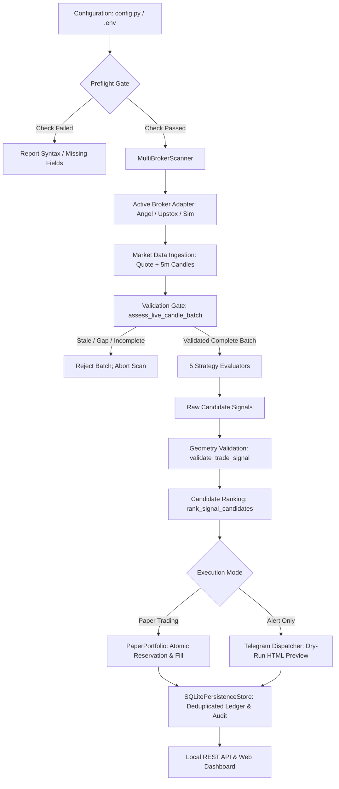

# TradePulse AI — Complete Project Inventory
**Task Identifier**: `20261019_FORENSIC_AUDIT`  
**Date**: `2026-10-19`  
**Workspace Root**: `C:\Users\HP\Downloads\indian_fo_signal_bot_phase3b\indian_fo_signal_bot_v1`  
**Environment**: Python `3.14.6` on Windows (x86_64), Git branch `main`

---

## 1. System Architecture & Directory Structure

TradePulse AI is a deterministic Python research, intraday signal generation, and risk-controlled paper trading platform designed for Indian National Stock Exchange (NSE) equity cash and F&O derivatives. The codebase strictly separates deterministic offline calculation from untrusted external data transport.

```
indian_fo_signal_bot_v1/
├── .env                              # Local configuration (secrets & runtime flags; git-ignored)
├── .env.example                      # Configuration template with non-secret dummy structure
├── Audit.md                          # Active audit instructions and specifications
├── README.md                         # Architecture overview and operational documentation
├── configuration_check.py            # Local-only syntax & flag diagnostic (zero secret disclosure)
├── release_management.py             # Release packager, SQLite backup/recovery & health monitor
├── config.py                         # Dataclass configuration, validation & dotenv parser
├── brokers.py                        # Broker adapters (Angel One, Upstox, Dhan, Simulated NSE)
├── diagnostics.py                    # Angel One isolated read-only market data acceptance diagnostics
├── upstox_diagnostics.py             # Upstox read-only market data acceptance diagnostics
├── instrument_identity.py            # Pinned symbols, response echo checking & contract binding
├── instrument_archive.py             # Historical master archive definitions & resolution
├── source_qualification.py           # Historical provenance qualification gate & authenticity policy
├── scanner_engine.py                 # Multi-broker intraday scan engine & candidate ranking
├── strategies.py                     # 5 Strategy evaluators, technical indicators, trade signal geometry
├── paper_portfolio.py                # Cash forward paper portfolio, risk limits & ledger reconciliation
├── forward_paper.py                  # Live/Simulated scan coordinator for paper execution
├── storage.py                        # SQLite persistence store, transactions & keyset pagination
├── historical_data.py                # Historical dataset preparation, validation & point-in-time slices
├── backtest_engine.py                # Chronological backtest engine & Indian statutory cost model
├── readiness_policy.py               # Research protocol execution gates & strategy eligibility
├── research_protocol.py              # Frozen research study protocol & parameter grids
├── performance_acceptance.py         # Sub-millisecond performance acceptance benchmark
├── server.py                         # Local REST API & dashboard HTTP server
├── telegram_bot.py                   # Telegram signal dispatcher (HTML formatting & dry-run preview)
├── public/
│   └── index.html                    # Single-page vanilla HTML/CSS/JS dashboard interface
├── docs/                             # Engineering audit reports, architecture specifications & evidence
│   ├── evidence/                     # Captured native master evidence and performance logs
│   └── reports/                      # Task-specific forensic audit and scorecard deliverables
└── test_*.py                         # Complete deterministic unittest suite (15 test modules)
```

---

## 2. Inventory of Source Files & Core Classes

| Module | Core Classes & Primary Functions | Scope / Purpose | Status |
|---|---|---|---|
| `config.py` | `BotConfig`, `ConfigValidationError`, `_load_dotenv` | Strongly-typed configuration dataclass; safe secret validation; syntax error diagnostic codes. | `IMPLEMENTED` |
| `configuration_check.py` | `check_configuration`, `main` | Zero-I/O local syntax and flag diagnostic; reports line and error code without values. | `IMPLEMENTED` |
| `release_management.py` | `ReleasePackager`, `DatabaseBackupRecovery`, `OperationalHealthMonitor` | Reproducible release packaging, online SQLite backup/restore drills, runtime matrix check. | `IMPLEMENTED` |
| `brokers.py` | `AngelOneSmartAPIAdapter`, `UpstoxV2Adapter`, `DhanHQAdapter`, `SimulatedNSEAdapter`, `MultiBrokerScanner` | Broker adapters, order-endpoint prohibition, secret sanitization, rate-limiting, candle normalization. | `PARTIAL` (Live candles blocked by 403) |
| `diagnostics.py` | `run_angelone_market_data_diagnostics`, `main` | Isolated, bounded Angel One preflight and read-only single live observation. | `IMPLEMENTED` |
| `upstox_diagnostics.py` | `run_upstox_diagnostics`, `main` | Isolated, bounded Upstox preflight and read-only live diagnostic. | `IMPLEMENTED` |
| `instrument_identity.py` | `spot_identity`, `check_echo`, `bind_candles`, `option_contract`, `dated_identity` | Pinned symbol reference checking; wire echo validation; tamper rejection. | `IMPLEMENTED` |
| `instrument_archive.py` | `prepare_archive`, `resolve_archives`, `resolve_archive_declarations` | Local master archive storage, digest verification, and declaration consistency. | `IMPLEMENTED` |
| `source_qualification.py` | `assess_source_evidence` | Adversarial historical source qualification gate (blocks unauthenticated data). | `IMPLEMENTED` |
| `scanner_engine.py` | `IntradayBotEngine`, `_assess_scan_candles`, `_require_current_scan_data` | Multi-broker scanning orchestrator; candidate ranking; duplicate prevention; scan locking. | `IMPLEMENTED` |
| `strategies.py` | `evaluate_order_block_fvg`, `evaluate_vwap_pullback`, `evaluate_orb_breakout`, `evaluate_supertrend_pullback`, `evaluate_option_apex_oi_shift`, `validate_trade_signal`, `rank_signal_candidates`, `size_position` | 5 deterministic strategy evaluators; signal geometry validator; candidate ranker. | `IMPLEMENTED` |
| `paper_portfolio.py` | `PaperPortfolio`, `PaperAccountConfig`, `PaperLedger` | Cash-only forward paper portfolio; atomic reservations; idempotent EOD reconciliation. | `IMPLEMENTED` |
| `forward_paper.py` | `ForwardPaperCoordinator` | Consumes scanner decisions into paper portfolio with bounded batch processing. | `IMPLEMENTED` |
| `storage.py` | `SQLitePersistenceStore`, `PersistenceValidationError` | SQLite schema, transactional signal persistence, keyset-paginated inventory. | `IMPLEMENTED` |
| `historical_data.py` | `validate_and_prepare_historical_dataset`, `get_point_in_time_candle_slice` | Historical OHLCV sanitization, session ordering, grid validation, no look-ahead slice. | `IMPLEMENTED` |
| `backtest_engine.py` | `run_backtest`, `split_sessions_chronologically`, `IndianCostModel` | Walk-forward simulation engine; conservative collision rules; realistic cost model. | `IMPLEMENTED` |
| `readiness_policy.py` | `execution_gate`, `historical_coverage` | Policy gate enforcing dataset completeness and rejecting unauthenticated replays. | `IMPLEMENTED` |
| `research_protocol.py` | `ResearchProtocol`, `StudySpecification` | Parameter grid freezing, chronological study splits, reproducible hashes. | `IMPLEMENTED` |
| `performance_acceptance.py`| `run_performance_benchmark` | Microsecond scanner benchmarks and memory allocation measurement. | `IMPLEMENTED` |
| `server.py` | `DashboardRequestHandler`, `run_server` | Local HTTP API; health routes; signals endpoint; paper account summary. | `IMPLEMENTED` |
| `telegram_bot.py` | `TelegramSignalDispatcher` | HTML alert formatting; setup quality reporting; dry-run preview enforcement. | `IMPLEMENTED` |

---

## 3. End-to-End Execution Flow



---

## 4. Disconnected or Incomplete Paths

1. **Live Completed Candle Ingestion**:
   - *Status*: `BLOCKED`
   - *Detail*: While Angel One live quote retrieval is verified, `getCandleData` fails with HTTP 403 on the broker side. Until Historical API permissions are active on the developer portal, the live candle intake path cannot reach scanner evaluators.
2. **Strategy 3 (Option Apex) Historical Replay**:
   - *Status*: `NOT_IMPLEMENTED`
   - *Detail*: Historical backtesting of Strategy 3 is blocked with `HISTORICAL_OPTION_EXECUTION_NOT_IMPLEMENTED`. Spot index candles do not model option premium fills or bid-ask decay.
3. **Live Futures Proposals from Spot**:
   - *Status*: `BLOCKED_BY_DESIGN`
   - *Detail*: Spot candles are strictly prevented from generating futures orders without a dedicated futures master and contract-specific candles.
4. **Historical Live Source Authenticity**:
   - *Status*: `BLOCKED`
   - *Detail*: `source_qualification.py` intentionally rejects unverified historical archives. Cryptographic publisher signatures and an external date-authority verifier are required before LIVE replay is unlocked.

---

## 5. Comprehensive Capability Classification

| Domain | Capability | Classification | Verification Method |
|---|---|---|---|
| **Configuration** | Environment Loading & Preflight | `IMPLEMENTED` | Unit-tested (isolated `.env` discovery, error codes) |
| **Broker: Angel One** | Authentication & Session | `PARTIAL` | Live login verified; session invalidated on candle 403 |
| **Broker: Angel One** | Real-Time Cash Quote | `IMPLEMENTED` | Genuine observation (LTP `1220.3`, 0.62s delay) |
| **Broker: Angel One** | Intraday 5m Candles | `BLOCKED` | HTTP 403 Forbidden on `getCandleData` |
| **Broker: Upstox** | Read-Only API Integration | `PARTIAL` | Offline unit tests pass; live quote blocked by prior 403 |
| **Market Data** | Candle Aggregation & Freshness | `IMPLEMENTED` | Strict deterministic unit tests (order, gap, completion) |
| **Instrument Identity** | Pinned Metadata & Echo Checks | `IMPLEMENTED` | Token/ISIN verification against checked-in references |
| **Derivative Universe** | Stock F&O Contract Mapping | `NOT_IMPLEMENTED` | Pinned indices supported; individual stock F&O unmapped |
| **Scanning** | Intraday Multi-Broker Scanning | `IMPLEMENTED` | Tested on synthetic fixtures and simulated feeds |
| **Signal Geometry** | Validation & Ranking | `IMPLEMENTED` | Quality score, T1 R:R, and identity ranking tested |
| **Risk Management** | Capital, Sizing & Statutory Costs| `IMPLEMENTED` | Indian statutory cost model (STT, GST, stamp duty) tested |
| **Paper Trading** | Durable Forward Paper Execution | `IMPLEMENTED` | Multi-session replay, reconciliation, 10k event bounds |
| **Persistence** | SQLite WAL, Sequences & Pagination| `IMPLEMENTED` | Keyset pagination, sequence invariants, VACUUM tests |
| **Research Engine** | Chronological Backtesting | `PARTIAL` | Synthetic walk-forward passes; live replay blocked |
| **Alerting** | Telegram Notifications | `PARTIAL` | Dry-run formatting verified; live delivery disabled |
| **Dashboard** | Web UI & API Routes | `IMPLEMENTED` | REST endpoints tested; renderer JS tests pass |
| **Release & Ops** | Packaging, Backup & Health | `IMPLEMENTED` | Release manifest, online backup, rollback drill tested |
