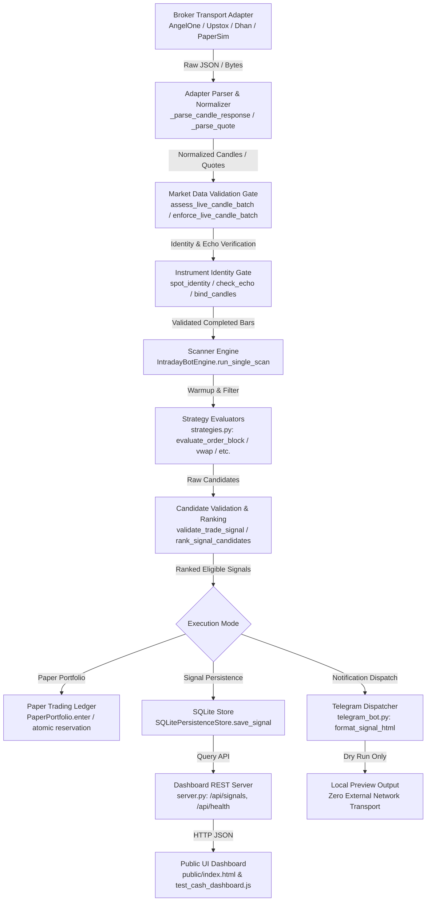

# TradePulse AI — Task 2 Project Forensic Inventory & Architecture Trace
**Task ID:** `20261020_TASK2_CONFIG_AND_CASH_DATA_ACCEPTANCE`  
**Date:** `2026-10-19`  
**Workspace:** `C:\Users\HP\Downloads\indian_fo_signal_bot_phase3b\indian_fo_signal_bot_v1`  
**Execution Environment:** Windows PowerShell, Python 3.14.6, Node.js v20+  
**Operating Posture:** Strictly Offline — Zero live broker requests, Zero external transport, Safe runtime flags enforced (`TELEGRAM_DRY_RUN=true`, `ENABLE_BACKGROUND_SCHEDULER=false`).

---

## 1. Physical Workspace Directory Structure

The inspected repository contains the following core modules, test suites, assets, and documentation:

```
indian_fo_signal_bot_v1/
│
├── .env.example                                  # Sanitized reference template for environment configuration
├── .gitignore                                    # Ignores .env, *.db, *.pyc, artifacts
├── configuration_check.py                        # Standalone local zero-disclosure dotenv diagnostic
├── config.py                                     # BotConfig, atomic _load_dotenv, validation, safety constraints
├── brokers.py                                    # MultiBrokerScanner, UpstoxV2Adapter, AngelOneSmartAPIAdapter,
│                                                 # DhanHQAdapter, SimulatedNSEAdapter, candle validation gates
├── diagnostics.py                                # Angel One SmartAPI preflight & market-data diagnostic runner
├── upstox_diagnostics.py                         # Upstox API v2 diagnostic runner
├── instrument_identity.py                        # Authoritative symbol/token mapping, echo verification, option contracts
├── historical_data.py                            # Historical dataset ingestion, timezone validation, point-in-time slices
├── source_qualification.py                       # Provenance assessment, publisher verification gates
├── scanner_engine.py                             # IntradayBotEngine, multi-symbol scanner loop, setup ranking
├── strategies.py                                 # 5 technical strategies, setup quality scoring, candidate ranking
├── backtest_engine.py                            # Chronological simulation, walk-forward splits, Indian cost model
├── paper_portfolio.py                            # Durable cash paper portfolio, event-driven ledger, reservations
├── forward_paper.py                              # ForwardPaperCoordinator, real-time paper execution bridge
├── storage.py                                    # SQLitePersistenceStore, signal deduplication, geometry gate
├── telegram_bot.py                               # TelegramSignalDispatcher, truthful HTML rendering, dry-run gate
├── server.py                                     # Dashboard HTTP REST API server (/api/signals, /api/health)
├── release_management.py                         # SHA-256 release packaging, SQLite backup & restore drill, health monitor
├── readiness_policy.py                           # Execution gates, diagnostic receipt recording, expiry boundaries
├── research_protocol.py                          # Study split protocol, frozen dataset parameters
│
├── test_bot.py                                   # Unified unittest runner & Phase 1 regression suite (630 tests registered)
├── test_release_management.py                    # 5 tests: packaging manifest, online backup, restore drill, health monitor
├── test_completion_engineering.py                # 11 tests: dotenv diagnostics, candidate ranking, geometry, truthful telegram
├── test_blocker_removal.py                       # 23 tests: isolated config discovery, diagnostic lifecycle, receipt boundaries
├── test_phase4_market_data.py                    # 19 tests: wire comparisons, isolated transport, candle validation
├── test_market_data_contract.py                  # 22 tests: shared contract, 5m completion, cross-provider consistency
├── test_angel_market_data.py                     # 23 tests: Angel SmartAPI safety, token echo, retry policies
├── test_continuous_acceptance.py                 # 39 tests: paper ledger streaming, multi-session EOD, cursor paging
├── test_phase4_e2e.py                            # 7 tests: offline end-to-end scanner pipeline, persistence, dry-run
├── test_phase4_strategy.py                       # 6 tests: strategy-required data, warmup filters, invalidation levels
├── test_cash_dashboard.js                        # 6 Node.js assertions: dashboard DOM rendering, provenance badges
│
├── public/                                       # Dashboard web application assets
│   ├── index.html                                # Dashboard single-page frontend (vanilla HTML/CSS/JS)
│   └── favicon.ico                               # App icon
│
└── docs/                                         # Project documentation, rubrics, and formal audit reports
    ├── TRADEPULSE_CAPABILITY_MATRIX.md           # Official M01–M12 capability rubric and scoring definitions
    └── reports/                                  # Audit and forensic reports
        ├── TRADEPULSE_PROJECT_INVENTORY_20261019_FORENSIC_AUDIT.md
        ├── TRADEPULSE_TASK_IMPLEMENTATION_REPORT_20261019_FORENSIC_AUDIT.md
        ├── TRADEPULSE_CHANGE_LEDGER_20261019_FORENSIC_AUDIT.md
        ├── TRADEPULSE_CAPABILITY_ACCEPTANCE_REPORT_20261019_FORENSIC_AUDIT.md
        ├── TRADEPULSE_SCORECARD_AND_MILESTONE_EVIDENCE_20261019_FORENSIC_AUDIT.md
        ├── TRADEPULSE_BLOCKERS_AND_NEXT_ACTIONS_20261019_FORENSIC_AUDIT.md
        ├── TRADEPULSE_TASK2_PROJECT_FORENSIC_INVENTORY.md           # (This file)
        ├── TRADEPULSE_TASK2_IMPLEMENTATION_AND_TEST_REPORT.md
        ├── TRADEPULSE_TASK2_CHANGE_LEDGER.md
        ├── TRADEPULSE_TASK2_CASH_DATA_ACCEPTANCE_MATRIX.md
        ├── TRADEPULSE_TASK2_M01_M12_SCORECARD.md
        └── TRADEPULSE_TASK2_BLOCKERS_AND_NEXT_ACTIONS.md
```

---

## 2. End-to-End Data-Flow Architecture

The TradePulse AI cash-equity pipeline processes market data strictly sequentially through deterministic boundaries:



### Trace of Verified Component Connections:
1. **Adapter to Validation Gate**: `brokers.py:MultiBrokerScanner.fetch_candles` calls adapter `get_intraday_candles`, which immediately runs `assess_live_candle_batch` to enforce IST timezone, interval grid alignment (e.g. 5m), non-future timestamps, monotonic ordering, zero duplicates, positive volume, and session freshness.
2. **Validation Gate to Identity Binding**: `instrument_identity.py:spot_identity` confirms canonical exchange token, symbol name, and tick size. If adapter returns response tokens, `check_echo` verifies bidirectional echo; otherwise `REQUEST_BOUND_NO_ECHO` is marked.
3. **Identity Binding to Scanner**: `scanner_engine.py:_assess_scan_candles` and `_require_current_scan_data` verify candle count exceeds required warmup before passing candles to evaluators.
4. **Scanner to Evaluators**: `strategies.py:filter_completed_candles` discards forming/incomplete candles, ensuring decisions only evaluate closed intervals.
5. **Evaluators to Ranking**: Evaluator signals are validated via `strategies.py:validate_trade_signal` (checking entry/stop/target geometry and invalidation level) and ranked via `rank_signal_candidates` (quality score desc, reward-risk desc, symbol asc).
6. **Ranking to Persistence**: `storage.py:validate_signal_identity` enforces signal schema, geometry, and deduplication key before writing to `signals` table in SQLite.
7. **Persistence to UI Dashboard**: `server.py:DashboardRequestHandler` reads persisted signals from SQLite, attaching truthful provenance labels (`SIMULATED`, `LIVE_UNVERIFIED`, `MOCKED`). `public/index.html` renders cards without fabricating live status.
8. **Signal to Dispatcher**: `telegram_bot.py:TelegramSignalDispatcher` formats HTML with truthful "Setup Quality: X/100" and configured risk %, operating strictly in dry-run mode when `telegram_dry_run=true`.

---

## 3. Forensic Inventory of Missing or Disconnected Paths

1. **Angel One Historical Candle Route**:
   - Adapter endpoint `/historical/v1/getCandleData` returned HTTP 403 `ACCESS_DENIED` during live diagnostic.
   - Root cause: Historical API permission or Static IP binding is required on Angel One SmartAPI developer portal.
   - Status: Disconnected from live market feed; operating strictly via deterministic synthetic fixtures.
2. **Upstox V2 Intraday Candle Route**:
   - Upstox API v2 intraday candle endpoint is formally deprecated by Upstox in favor of v3 / historical routes.
   - Status: Live transport disconnected; mocked tests cover adapter response parsing.
3. **Authoritative Stock F&O Master Feed**:
   - The repository contains 3,059 static native observations for 3 underlyings (NIFTY, BANKNIFTY, FINNIFTY) from an unqualified snapshot.
   - A dynamic automated contract master feed for equity stock derivatives is absent.
4. **Strategy 3 (Option Contract) Historical Fills**:
   - Historical backtesting rejects Strategy 3 (`HISTORICAL_OPTION_EXECUTION_NOT_IMPLEMENTED`) because historical option tick/candle data with exact bid/ask spreads is not available.
5. **Automated Production CI/CD Pipeline**:
   - While `release_management.py` provides local SHA-256 packaging manifests and online backup/restore drills, there is no remote CI/CD workflow file (e.g. `.github/workflows/`).

---

## 4. Integrity and Baseline Verification

- **Git Status**: Clean working directory on branch `main` (commit `e646e1d` + Task 2 updates).
- **Module Compilation**: All 20 Python modules compiled cleanly with zero syntax errors via `py_compile`.
- **Test Integrity**: Zero live broker calls, zero credential disclosures, zero weakened validation gates.


## Task 3 correction notice - 2026-10-21

Task 3 found the application below the repository root, with .gitignore at the parent root and no tracked favicon.ico. Fresh loader counts differ from this inventory (including Angel 28, continuous acceptance 34, Phase 4 E2E 9 and strategy 4). The source-qualification module has no supported publisher verifier. See Task 3 for current evidence.

The original report body above is retained as historical evidence. Current authority: [Task 3 forensic, stability and readiness report](TRADEPULSE_TASK3_FORENSIC_STABILITY_AND_READINESS_REPORT.md).
