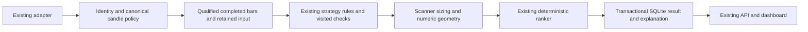

# TradePulse AI Phase 4 implementation and completion — 2026-10-23

**Verdict: `PHASE_4_IMPLEMENTATION_ACCEPTED`.** All eleven required engineering
gates pass against the final source. This accepts the tested offline implementation;
it does not establish live operational acceptance, profitability, predictive
accuracy, an approved historical study or broader F&O execution readiness.

The current mission explicitly authorizes implementation now. The earlier
read-only readiness audit and its gate decision remain preserved historical
documents. No unrelated market-day work or provider observation was performed.

## Final verified outcome

The [final canonical receipt](../evidence/master_phase4_implementation_20261023_02.json)
records **924/924 Python tests**, **14/14 dashboard tests**
and **72 compiled Python files**, exit 0. Python failures, errors,
skips, expected failures and unexpected successes are all zero. There are no
unraisable exceptions or unhandled ResourceWarnings; ResourceWarnings are errors.
JavaScript syntax also passes. All 77 source-file hashes match before/after
execution and the evidence validator checks the exact current source and log bytes.

The retained execution interval is `2026-10-23T17:33:46.521449+00:00` through
`2026-10-23T17:37:37.695026+00:00`. The Python log records the actual elapsed runtime. These
are fresh executed totals, not the 862/11/68 baseline reused as new results. The
new modules contribute 62 Python cases; three dashboard cases were added.

The [final release](../evidence/phase4_implementation_release_20261023_02.zip)
contains 102 public source/test/document files plus its manifest. SHA256:
`4e32d72553ab7b3572ffc115ca845f15e65971181958fc87e6bd02f5c0829aa2`. Inspection checks manifest bytes, exact current packaged
files, permitted archive paths and configured credentials without displaying their
values. `.env`, operational databases/WAL/SHM, `.local`, machine evidence and private
raw captures are excluded. The original evidence directory is a separate handover.

## Architecture and shared contracts

The application remains Python, SQLite and the existing vanilla JavaScript
dashboard. No framework, dependency, parallel scanner or replacement ranker was
introduced.



Feed/provider choice remains distinct from execution mode. An explicitly attached
feed failure cannot silently switch to REST, another provider, a historical
candidate or simulated data. Existing canonical checks continue to establish
identity, exchange/token binding, aware event times, session/interval, chronology,
completion, OHLCV, gap and freshness policy before actual evaluators run.

`TradeSignal` fields and all original evaluator parameter prefixes/return types
remain intact. Evaluators add an optional trailing `evaluation_trace`; the new
`evaluate_strategy_detailed` wrapper calls the chosen existing evaluator once.
Scanner-local evaluator overrides remain supported without TypeError retry or
duplicated mitigation side effects. A trace records only predicates actually
visited under the original short-circuit order.

Additive contracts are:

| Interface | New fields and semantics |
|---|---|
| Scan response | `strategy_evaluations`, `candidate_evaluations`, `evaluation_schema_version`, `actionable=false` |
| Strategy evaluation | Schema `tradepulse.strategy-evaluation.v1`; `DETECTED`, `REJECTED` or `UNAVAILABLE`; stable reason codes, rule IDs/status/measurements, warm-up count, human summary and source reference |
| Candidate evaluation | Schema `tradepulse.candidate-evaluation.v1`; stable dedup candidate ID, `QUALIFIED` or `REJECTED`, rank/policy, numeric risk, rule/rationale explanation, warnings and source reference |
| Source reference | Original scan run/provider/mode, actual completed timestamps and digest, canonical identity where supplied, retained cash batch IDs; hashes never confer source authority |
| Scan history API | `GET /api/scans` adds `evaluation`; old rows have unavailable details |
| Signal history API | `GET /api/signals` adds matched `candidate_evaluation`; old rows return null; existing lineage/PAPER decisions and false actionability remain |

An actual strategy detection is distinct from scanner qualification. A high-score
detected setup failing sizing or geometry is retained as a rejected candidate,
with rank null and explicit reasons. Acquisition failures keep their existing
structured freshness/identity errors and cannot reach strategy or output. An
empty qualified-input scan is a valid `COMPLETED_EMPTY` result. Warm-up, missing
session input and failed setup rules remain distinguishable in its evaluation.

## Implemented strategies, intervals and risk conventions

All five existing evaluators remain connected. Every strategy uses completed
five-minute input. The existing detailed formula audit remains in the preserved
[strategy/risk audit](phase4_readiness_strategy_risk_20261023_01.md); its old line
numbers and implementation-gate commentary are historical. Formulas and numeric
thresholds are unchanged here. Session-start qualification is the evidenced
correction described below.

| Strategy | Actual rules and required input | Existing level conventions |
|---|---|---|
| Order Block / BOS / FVG | 30 bars; search recent 15 for colored origin, break of structure plus FVG or 1.5 ATR displacement, first retest, mitigation/invalidation checks | Entry at completed close; structural block invalidation; stop beyond block by 0.25 ATR; nominal targets 2/3 risk multiples |
| VWAP pullback | 35 bars; session VWAP, EMA20, RSI14, prior-20 volume and 1.4 volume surge; directional pullback/rejection and candle confirmation | Stop beyond lower/upper of candle and VWAP by 0.35 ATR; nominal targets 1.8/2.5 |
| Option Apex OI shift | Nonempty completed underlying prefix, session VWAP, validated ATM chain/premiums/PCR/OI changes and explicit derivative lot; aligned source/contract requirements remain separate | Buy call or put premium; stop 0.78 premium; nominal targets 1.6/2.4; bearish-view put still uses long-premium geometry |
| ORB filtered | 30 bars, at least four current-session bars and exact 09:15/09:20/09:25 opening range; prior/current breakout, VWAP, RSI 55/45 and RVOL 1.6 filters | Opening-range structural invalidation, existing range/candle stop calculation, nominal targets 1.6/2.4 |
| Supertrend pullback | 200 bars; Supertrend(10,3), EMA200, session VWAP, two-bar trend confirmation, pullback/candle and RVOL 1.3; existing session exclusions retained | Stop beyond ST/candle by 0.25 ATR; ST invalidation; nominal targets 1.5/2.5 |

Direct positive tests cover both directions for all five strategies, and actual
scanner tests cover cash Order Block, VWAP, ORB and Supertrend. Existing index/
option integration and exact option identity tests remain in the canonical suite.
Unsupported LIVE futures and unsupported provider option contracts remain withheld;
this implementation does not expand their authority.

`size_position` still recomputes quantities at the scanner boundary using account
risk, whole units/lots, capital and existing modeled charges. Signal geometry
must be finite, positive, ordered and directionally consistent. Numeric RR uses
actual absolute entry-to-stop distance and actual target distances, all INR per
unit; it does not trust nominal display strings or minimum modeled target-distance
floors. Ratio overflow is unavailable. Numeric geometry must pass before ranking.

Net target RR remains unavailable because the existing charge estimate models a
stop exit, not both target exits with supported spread/slippage. Liquidity, fills,
slippage and empirical performance remain explicitly unestablished. Candidate
warning codes expose those limits. Existing `confidence_pct` remains a legacy
quality alias; old benchmark strings are not empirical probabilities or validated
TradePulse performance and are not promoted by the new output.

Ranking remains setup quality descending, actual numeric T1 RR descending, then
stable symbol/strategy/direction/position/timestamp/label and full-JSON ties. Policy:
`QUALITY_THEN_TARGET1_REWARD_RISK_THEN_IDENTITY_V1`. Its scope is candidate priority,
not portfolio capital allocation. Existing quality feature weights remain
RVOL .30, VWAP/ATR distance .25, displacement .30 and optional breadth .15,
renormalized over available inputs. Partial-session peers cannot now fabricate
session-VWAP breadth or influence those scores.

## Warm-up capacity, persistence and recovery

The initial five-minute ring held 150 bars while Supertrend required 200. The feed
now retains **300 five-minute bars**, with **750 one-minute bars** unchanged.
It selects independently contiguous completed runs from older observed sessions
plus the qualified current tail. It never fills a gap or promotes an incomplete
bar. Existing packet, raw-event and per-bar event budgets remain bounded and
unchanged. The strategy requirement remains 200.

Healthy heartbeat retention outside the cash session preserves memory history;
the scanner's session and freshness gates still withhold LIVE permission.
Heartbeat timeout always applies, and new-session inactivity grace is bounded.
Reconnect/restart discards this volatile history and reports `NOT_RESTORED`.
Database event/candle records remain durable evidence, but are not automatically
restored as trusted warm-up or silently mixed into current input.

The parser-driven three-session fixture reaches 199 then 200 retained completed
bars and checks raw baseline/event links. At 199 the count gate is unavailable;
at 200 it passes. That fixture still lacks the first session bar because the
initial cumulative-volume baseline is unknown, so session VWAP correctly remains
unavailable and Supertrend is not invoked. This is not papered over by claiming
that count alone constitutes full qualification. A separate full-session,
200-plus-bar fixture reaches the real Supertrend evaluator through the scanner.
All such data are explicitly authored offline fixtures, never genuine acceptance.

Persistence adds only the `scan_evaluations` table, keyed by scan-run foreign key,
with finite/size-bounded canonical JSON and a checksum. Same-payload writes are
idempotent; conflicting writes are rejected. Source run/batch scope, false
actionability, duplicate IDs and mode are checked. Reads verify checksums and
agreement with the separately retained committed cash result. Changing bytes and
recomputing the evaluation checksum cannot conceal a mismatch with that result.
Older results remain readable without invented explanation fields.

The explanation write participates in the existing borrowed scan transaction.
Signal, zone, scan result, explanation, linkage and outbox failures roll back
together; accepted input remains pending for explicit offline recovery. This task
did not run a migration against a user database. Existing schema initialization
will create the additive table when a store is normally opened.

## Confirmed defects, repairs and independent evidence

| Defect or integration gap | Reproduction / evidence | Correction and regression |
|---|---|---|
| 150-bar ring cannot admit a 200-bar strategy | Starting audited source contract; retained source baseline and current capacity test | Bounded 300-bar retention; parser-driven 199/200 and reconnect/heartbeat/history tests |
| Disconnect/quality loss after fetch still allowed commit | [Before race receipt](../evidence/phase4_implementation_focused_disconnect_before_01.json): one failing actual scanner case | Recheck attached-stream qualification at acquisition, writes, final commit and output; after receipt passes disconnect and connected-but-degraded cases |
| Late transition at result boundary or after commit | Independent injected checkpoints | Rollback before commit; preserve historical candidate but suppress preview and mark current readiness false after commit |
| Session VWAP inferred from a partial session | Existing actual OB fixture still emitted after removing only current 09:15 | Missing opening coverage gives `SESSION_START_COVERAGE_MISSING`; ORB keeps its existing range coverage rule |
| Partial peers influenced optional breadth/ranking | [Before breadth receipt](../evidence/phase4_implementation_focused_breadth_before_01.json): opening-covered peer plus lone 09:20 peer incorrectly counted two advances | Exclude unqualified peer; preserve qualified comparator and return unavailable when none qualify |
| Evaluation/API/dashboard details absent | Existing scalar rationale/legacy RR could not explain unavailable or downstream rejected setup | Structured actual checks, numeric gross RR, immutable history annotation and existing UI table/card/inspector integration |
| Downstream risk rejection absent from scan table | Independent final UI review found DETECTED plus zero signals omitted the retained rejection reason | Existing row now renders candidate status/reasons; new Node case asserts `REJECTED INVALID_SIGNAL_LEVELS` |
| Scan integrity errors could be ordinary query errors | Persistence validation derives from ValueError | Reconciliation failures produce HTTP 503; both history routes reject changed and rehashed inconsistent explanations |

The initial integrated run retained **93/94 passes and one failure**: its raw
200-bar test incorrectly expected indicator evaluation despite the newly enforced
missing opening coverage. The test was corrected to require the actual warm-up
PASS plus coverage UNAVAILABLE, retaining raw lineage and non-LIVE assertions;
the separate qualified scanner positive remains. No gate or strategy threshold
was reduced. The repeat integration run passed **94/94**, and independent QA
passed **20/20**. All failed receipts/logs are preserved.

The new scan-evaluation foreign key also rejects deleting parent metadata at the
write boundary. The existing privileged-corruption test now first asserts that
immediate rejection, then deliberately removes both metadata rows to preserve
its original read-reconciliation assertion. The FK was not weakened.

## Real parallel assignments and changed files

| Worker | Exclusive ownership and delivered work |
|---|---|
| `/root/dhan_track_b` | `angel_feed.py`, new `test_phase4_feed_history.py`; then separately transferred exclusive ownership of `storage.py`, `candle_lineage.py`, new `test_phase4_evaluation_storage.py` |
| `/root/historical_track_a` | `strategies.py`, new `test_phase4_explanations.py`; subsequent read-only semantic and coordinator review |
| `/root/phase4_readiness_qa` | New `test_phase4_recommendations.py`, independent QA report and offline contract examples; no production edits |
| `/root` | `scanner_engine.py`, `server.py`, `public/index.html`, `test_cash_dashboard.js`, canonical loader in `test_bot.py`, FK corruption fixture in `test_cash_lineage.py`, release document allowlist in `release_management.py`, new handover/report/evidence helpers |

Shared contracts and ownership were set before parallel edits. Source was frozen
for final verification. The actual baseline-to-final manifest identifies 15
changed/added source files, including four new test modules; existing changes in
other files remain intact. No worker staged, committed, reset, cleaned or removed
user work. Final Git state includes staged and unstaged work; HEAD alone is not
the source proof. The starting HEAD is `4eb7330bf074d9b07733fade6d7a8e08c200fa0b`.

## Requirements-to-code-to-test and acceptance matrix

The [machine matrix](../evidence/phase4_implementation_acceptance_20261023_01.json)
binds exact executed test IDs to every gate and the final strict receipt.

| Gate | Actual code / interface | Executed coverage | Verdict |
|---|---|---|---|
| A Scanner integration | Adapter, canonical candle policy, `_fetch_scan_candles`, retained cash snapshot | Actual scanner consumes completed fixture input; wrong token/exchange, stale/future/naive/out-of-session, gap/duplicate/disorder, forming-only and missing/negative volume fail before evaluator/output | PASS offline |
| B Strategy integration | Five existing evaluators and `evaluate_strategy_detailed` | Bidirectional parity for all five; actual four cash strategies and existing option scanner/identity integrations | PASS offline |
| C Warm-up | 300/750 cache, original minima, session coverage guards | Raw parser 199/200, qualified full Supertrend scanner input, missing history/opening, reconnect/not-restored and heartbeat checks | PASS offline |
| D Candidate generation | Existing predicates, boundary sizing/geometry and candidate records | Detected/qualified/rejected/unavailable; high quality cannot admit corrupted target | PASS offline |
| E Explanations | Actual visited rules, source references, scan/candidate JSON, current dashboard | Exact input timestamps/batches and numeric output, warm-up reasons, UI rule and downstream risk rejection cases | PASS offline |
| F Ranking | Existing ranker, qualified breadth and numeric T1 RR | All permutations, exact-identity ties, repeated calls, unchanged inputs and rejected high-score geometry | PASS offline |
| G Risk/reward | Existing sizing/geometry plus `signal_risk_reward` | Independent INR distance/ratio arithmetic, both directions/options, invalid/zero/nonfinite/overflow cases, unavailable net inputs | PASS offline |
| H Persistence/output | Additive evaluation table, cash result binding, existing APIs and UI | Idempotency, conflict/FK/scope checks, rollback/recovery, corruption/rehashed inconsistency and exact history roundtrip | PASS offline |
| I Compatibility | Original architecture, signatures/fields and existing loader | All final 924 Python and 14 Node cases, compilation and syntax | PASS offline |
| J Safety | No new transport/dependency; safe feed/output lifecycle and saved settings | External-network guard, attached-stream transitions, false actionability, cleanup and preservation checks | PASS offline |
| K Verification | Strict verifier, separate closeout validator and current archive | Exact source/log/test-ID bindings, prior evidence/config hashes and release inspection | PASS offline |

The [independent QA report](phase4_implementation_qa_20261023_01.md) separates
worker-focused execution from final coordinating acceptance. The executed
`phase4_implementation_contract_example_20261023_02.json` illustrates actual
qualified, short-warm-up, history and replay responses. It is explicitly an
offline fixture example, not additional unit tests or genuine input acceptance.

## Exact verification and release sequence

Executed from the application directory with the isolated Python interpreter:

```powershell
.venv_phase4\Scripts\python.exe -B -W error::ResourceWarning docs/evidence/phase4_implementation_focused_20261023_01.py --stage integrated_02 test_phase4_explanations test_phase4_feed_history test_phase4_evaluation_storage test_phase4_e2e test_cash_lineage test_cash_workflow test_bot.TestIndianFOSignalBotPhase1C
.venv_phase4\Scripts\python.exe -B -W error::ResourceWarning docs/evidence/phase4_implementation_focused_20261023_01.py --stage independent_qa_02 test_phase4_recommendations
.venv_phase4\Scripts\python.exe -B -W error::ResourceWarning verify_offline.py --stage phase4_implementation_20261023_02
.venv_phase4\Scripts\python.exe -B -W error::ResourceWarning verify_offline.py --validate-evidence docs/evidence/master_phase4_implementation_20261023_02.json
.venv_phase4\Scripts\python.exe -B -W error::ResourceWarning docs/evidence/phase4_implementation_closeout_20261023_01.py --build-release
.venv_phase4\Scripts\python.exe -B -W error::ResourceWarning docs/evidence/phase4_implementation_closeout_20261023_01.py --closeout
.venv_phase4\Scripts\python.exe -B -W error::ResourceWarning docs/evidence/phase4_implementation_closeout_20261023_01.py --validate
```

These final commands return exit 0. The final canonical command itself executes
`node test_cash_dashboard.js`, `node --check test_cash_dashboard.js` and compilation
of all root Python files; their exact subprocess records/logs are in its receipt.
The inline dashboard script executes in the Node DOM double, which catches syntax
and renderer behavior. This is not full-browser acceptance. Offline temp-file and
Node child-process sandbox restrictions required approved execution outside the
Windows sandbox; the canonical runner still prohibited external networking.
Git emitted line-ending normalization notices during diff inspection; the work
did not rewrite files merely to normalize them.

The first full run (`...20261023_01`) passed 924 Python, 13 Node and 72 compilation
checks before the final dashboard omission was corrected. Its release `_01`
remains historical. The original archive build succeeded, but that attempt's
wrapper exited 1 because its credential scan mistook an exact configured template
placeholder in `.env.example` for a private secret. The premature old build
receipt's wrapper exit-code field is not used as command-success proof. The
preserved [correction receipt](../evidence/phase4_implementation_release_scan_correction_20261023_01.json)
documents it. Only exact same-key template values carrying an explicit placeholder
marker are excluded by the corrected checker. Corrected inspection passed without
changing that archive. The final new `_02` archive was then built and inspected
against the final `_02` proof; no prior receipt or ZIP was overwritten.

## Preservation, evidence integrity and safety

The starting [baseline](../evidence/phase4_implementation_baseline_20261023_01.json)
validated the original strict receipt before source edits. Final checks confirm
all **359 prior document/evidence files** remain byte-identical, including earlier
reports, logs and archives. Both `.env` hashes are unchanged. Existing saved
provider/risk/execution settings were not edited. The new public
[handover](../TRADEPULSE_PHASE4_IMPLEMENTATION_20261023.md) is included in the new
archive; older public reports were preserved rather than rewritten.

The [closeout](../evidence/phase4_implementation_closeout_20261023_01.json) binds
actual source, final strict proof, focused pass/fail evidence, examples, report,
QA report, public handover and release checks. The [separate validation](../evidence/phase4_implementation_closeout_validation_20261023_01.json)
reads those artifacts back and rechecks their hashes, current source, preserved
inputs and exact archive. New stages use unique names and exclusive creation.

No broker request/login/quote/history call, real order, account mutation,
Telegram transmission, scheduler activation or dependency installation occurred.
All application executions used deterministic mocks/fixtures, in-memory databases
or disposable test databases and local HTTP fixtures under the offline guard.
Operational database/WAL/SHM files were not opened or hashed; their contents and
possible concurrent application activity are not attested. No production database
migration or reset ran. Secrets were not printed or added to the public release.

## Remaining limitations and next task

No unresolved in-scope software failure was found after the final independent
review and canonical verification. This is bounded engineering acceptance.
Qualified input, complete session coverage and strategy warm-up remain mandatory;
unknown initial stream volume baseline can withhold the opening bar and therefore
session VWAP even after 200 retained bars. Restart/reconnect requires a new
qualified warm-up because restoration is explicitly unavailable. These input
limitations are reported, not bypassed or represented as successful operational
evaluation. Offline full-session fixtures establish only deterministic software
behavior for the supported qualified-input contract.

Liquidity/depth, spread/slippage/fills, net target RR, empirical probabilities and
profitability are unavailable. Historical data authority/rights/study acceptance
and full dated F&O contract/execution evidence are separate dependencies and were
not expanded by this work. Existing nominal RR labels, hardcoded benchmark text,
modeled charges and legacy quality aliases retain those explicit limits.

**Next Phase 4 task: none remains for this offline engineering mission.** The
accepted deliverable is the final source plus its matching evidence and public
release. No new observation, execution, broader phase or configuration change is
authorized or initiated by this closeout.
