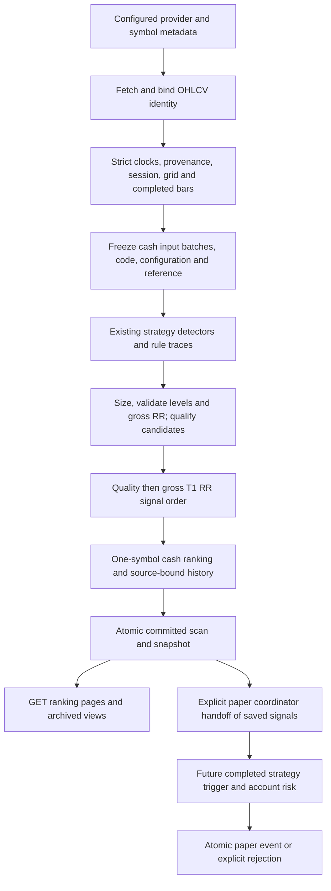

# TradePulse AI — R1 dynamic ranking reliability audit

Audit date: **2026-11-03, Asia/Calcutta**. Worktree: `C:\Users\91810\TradePulseAI-Worktrees\main`, branch `main`. Approved and inspected application baseline: **`3902c3f0a4d8f13d5e0392485a5cef67d68ee734`**. Initial tree was clean. This checkpoint changes only this report and isolated audit evidence. It changes no application, strategy, API, schema, React, Options Intelligence or Volume Research files and imports neither feature branch. No operational database, private credentials, provider requests, Telegram delivery or trading activation was used.

## 1. Verdict and evidence boundaries

**The implemented cash candidate priority engine works offline, including dynamic re-ranking, retained-source authentication, atomic publication and bounded API reads. The broader multi-factor opportunity engine is only partially implemented. Production and extended unattended paper evaluation are not accepted.**

The engine has a deterministic weighted **setup-quality** calculation followed by lexicographic **quality / actual gross target-one reward-to-risk** ordering. It has no implemented returns-based relative strength, sector-relative ranking, regime classifier, executable spread/depth factor, net target economics or calibrated empirical edge. These missing components are explicitly reported. Rank is advisory; it neither authorizes entry nor allocates paper capital. An analytical Option Apex signal remains outside forward-paper admission.

Evidence labels in this report:

- **SOURCE FACT:** inspected implementation at the baseline; links are relative source anchors at that revision.
- **EXECUTED OFFLINE:** tests run in this checkpoint using authored fixtures, blocked external socket/DNS transport and disposable stores. This does not establish feed authenticity, rights, profitability or live readiness.
- **RISK / HYPOTHESIS:** a consequence requiring measurement or a product decision; not a reproduced production defect.
- **RECOMMENDATION:** future work requiring its own owner-approved checkpoint. Nothing recommended here was implemented.

Final execution: **140/140 Python methods passed** (136 existing + four isolated audit methods), zero failures/errors/skips; **15/15 terminal opportunity tests** and **2/2 timezone parent tests** passed, the latter asserting nine child checks in UTC and nine in America/New_York. No browser or React integration run was performed. See section 8 for commands, failed initial oracle values, hashes and limits.

## 2. Actual architecture and execution trace



The paper branch consumes persisted signals, not the selected ranking page. This distinction is part of the implemented contract.

| Stage | Real implementation and authority | Boundaries |
|---|---|---|
| Data acquisition | [`scanner_engine.py:288`](../../scanner_engine.py#L288), [`:595`](../../scanner_engine.py#L595), [`:703`](../../scanner_engine.py#L703), [`:755`](../../scanner_engine.py#L755); configured provider adapter and identity metadata | Explicit scan write or enabled scheduler; no marketwide discovery. Live data is not silently replaced by simulation. |
| Candle admission | [`brokers.py:202`](../../brokers.py#L202), [`strategies.py:539`](../../strategies.py#L539), [`instrument_identity.py:160`](../../instrument_identity.py#L160) | Offset/epoch transport clocks, provider scope, exact identity, valid OHLCV, monotonic timestamps, no duplicates/gaps, NSE grid/session, completed five-minute bars. Raw live validation occurs before convenience normalization. |
| Universe readiness | [`scanner_engine.py:250`](../../scanner_engine.py#L250), [`:267`](../../scanner_engine.py#L267), [`:308`](../../scanner_engine.py#L308) | All required configured instruments must remain current. An attached stream must also remain eligible. Acquisition failure differs from a strategy returning no setup. |
| Retained inputs | [`candle_lineage.py:161`](../../candle_lineage.py#L161), [`:203`](../../candle_lineage.py#L203), [`scanner_engine.py:813`](../../scanner_engine.py#L813) | Completed-only cash batches; content, code/configuration, auxiliary index/chain inputs and original reference frozen before result evaluation. Source authenticity remains NOT_ESTABLISHED. |
| Strategy detection | [`strategies.py:243`](../../strategies.py#L243), [`scanner_engine.py:873`](../../scanner_engine.py#L873), [`:1070`](../../scanner_engine.py#L1070) | Existing five IDs and detailed DETECTED/REJECTED/UNAVAILABLE rule traces. Four cash evaluators feed cash priority; option/future support does not follow from a display label. |
| Candidate qualification | [`scanner_engine.py:883`](../../scanner_engine.py#L883), [`:1115`](../../scanner_engine.py#L1115), [`strategies.py:95`](../../strategies.py#L95), [`:196`](../../strategies.py#L196) | Scanner resizes against account risk/capital/lot constraints, validates signal geometry and actual numeric RR. Invalid detected setups are retained as rejected explanations. |
| Signal order | [`strategies.py:131`](../../strategies.py#L131), [`scanner_engine.py:1148`](../../scanner_engine.py#L1148) | Quality descending, actual T1 RR descending, then deterministic identity fields. |
| Cash opportunity snapshot | [`opportunity_ranking.py:41`](../../opportunity_ranking.py#L41), [`rank_history.py:109`](../../rank_history.py#L109), [`:261`](../../rank_history.py#L261) | Revalidates qualified cash scope and freshness, retains one row per symbol, binds to saved source/signals/explanations. Maximum 512 candidate evaluations. |
| Atomic publication | [`storage.py:836`](../../storage.py#L836), [`candle_lineage.py:430`](../../candle_lineage.py#L430) | `BEGIN IMMEDIATE` encompasses result/evaluations/signals/outbox/rank and COMMITTED transition. A partially staged rank is not published. Input preparation is an earlier recoverable transaction. |
| Read API | [`server.py:553`](../../server.py#L553), [`rank_history.py:311`](../../rank_history.py#L311) | GET `/api/opportunity-rankings`, server clock, retained pages only; no acquisition or recomputation in the ranking handler. Cold runtime initialization has a separate scheduler caveat below. |
| Paper decision | [`forward_paper.py:72`](../../forward_paper.py#L72), [`:178`](../../forward_paper.py#L178), [`paper_portfolio.py:741`](../../paper_portfolio.py#L741) | Successful saved scan/signals, strategy-owned subsequent-bar trigger, current guard and account risk checks. Rank does not establish an entry. |

**Durability scope:** automatic retained ranking is wired to **non-simulated cash scans with a store and cash inputs**, at `scanner_engine.py:813`. The standalone builder accepts SIMULATED declarations, and offline tests drive real scanner paths through mocked LIVE-shaped providers. A default `paper_sim` scan is not evidence that this durable cash ranking path is automatically populated. Similarly, auxiliary option chains/underlying bars do not become executable option premiums by being retained.

## 3. Exact quantitative mathematics

### 3.1 Setup quality, weights and normalization

SOURCE FACT: [`compute_setup_quality_score`, strategies.py:327](../../strategies.py#L327). For each available feature, normalize to [0,1]. Let `clip(x)=max(0,min(1,x))`.

| Feature | Exact transformation | Base weight |
|---|---|---:|
| Relative volume `v` | `R = clip((v - 0.80) / 1.70)` | 0.30 |
| Directional distance from session VWAP in ATR units `d` | `V=0` for `d <= -0.25` or `d >= 3.25`; `(d+0.25)/0.40` for `-0.25 < d < 0.15`; `1` for `0.15 <= d <= 1.25`; `1-(d-1.25)/2` for `1.25 < d < 3.25` | 0.25 |
| Strategy displacement/ATR `u` | `D = clip(u / 2)` | 0.30 |
| Aligned local-universe breadth fraction `a` | `B = clip((a - 0.25) / 0.50)` | 0.15 |

For available set `A`, effective weight `w_i = base_i / sum(base_j for j in A)`. Composite `q = sum(w_i * feature_i for i in A)`. Final quality `Q = clip_0_100(int(round(100*q)))`. If no feature is available, the helper raises an error. Python binary floating-point arithmetic and `round` apply; the displayed breakdown rounds features/weights to four decimals **after** the score calculation. Recalculating from rounded display weights can differ near a rounding boundary.

RVOL generally uses the current completed volume divided by the preceding 20 completed bars' mean, excluding the current bar. Order Block and ORB use `max(1, mean_volume)`; VWAP/ORB/Supertrend require positive baseline volume. There is no time-of-day volume curve, return z-score, cross-sectional percentile or volatility distribution normalization. Directional VWAP distance changes sign for short setups; displacement is strategy-specific structure/impulse magnitude, not a common return horizon. See [`strategies.py:1089`](../../strategies.py#L1089), [`:1305`](../../strategies.py#L1305), [`:1655`](../../strategies.py#L1655), [`:1820`](../../strategies.py#L1820) and scorer calls at `:1148/:1231/:1339/:1403/:1686/:1745/:1857/:1922`.

Session VWAP is cumulative volume-weighted typical price `(high+low+close)/3`, reset by date, rounded to two decimals. At zero cumulative volume it falls back to typical price ([`strategies.py:1004`](../../strategies.py#L1004)). That fallback is a calculation convention, not observed institutional trading or qualified VWAP evidence.

### 3.2 Breadth, direction and market regime

SOURCE FACT: [`scanner_engine.py:546`](../../scanner_engine.py#L546), called on combined configured index/equity maps at [`:841`](../../scanner_engine.py#L841). A usable current session requires the actual 09:15 bar. Latest close above `VWAP * 1.0002` counts as advance; below `VWAP * 0.9998` counts as decline; neutral/unusable series do not enter the denominator. `a=advances/(advances+declines)` for bullish and declines/total for bearish. Zero counted symbols means unavailable breadth.

This is **watchlist VWAP alignment breadth**, not exchange advances/declines, return relative strength or a market regime model. Indices count alongside stocks. There is no minimum breadth coverage fraction or market-cap/sector weighting. Required cash acquisition is strict, so this is not a claim that arbitrary missing cash symbols are silently accepted; neutral bars, session coverage and auxiliary input availability can still alter the counted subset.

Long and short cash candidates use direction-aligned scoring and share one rank list. Neither direction has an explicit preference weight. Both must have valid stop/invalidation/entry/target geometry. A direction change alters the opportunity identity and is reported as a new opportunity plus removal of the former one.

### 3.3 Gross reward/risk and two sorting policies

SOURCE FACT: [`strategies.py:196`](../../strategies.py#L196). For validated levels:

`risk = abs(entry - stop)`; `reward1 = abs(target1 - entry)`; `gross_T1_RR = reward1 / risk`.

Long geometry: `stop <= invalidation < entry < T1 <= T2`; short geometry: `T2 <= T1 < entry < invalidation <= stop`. All required levels and ratios must be positive finite values. Charge estimates do not make RR net: target-exit fees/slippage, observed spread and depth are unavailable. Nominal RR strings and legacy confidence/win-rate labels do not enter the ratio.

| Consumer | Ascending tuple actually sorted |
|---|---|
| Scanner signals | `(-Q, -gross_T1_RR, symbol, strategy_id, direction, position_type, timestamp, instrument_label, canonical_signal_JSON)` ([`strategies.py:131`](../../strategies.py#L131)) |
| Persisted cash opportunities | `(-Q, -gross_T1_RR, symbol, strategy_id, opportunity_key)` ([`opportunity_ranking.py:115`](../../opportunity_ranking.py#L115)) |

There is no weighted combination of quality and RR. A one-point quality advantage wins against any positive RR disadvantage. No economic strategy-priority weights exist; lexical strategy IDs settle otherwise equal scores. The cash policy is `CASH_QUALITY_ACTUAL_RR_DIRECTION_ONE_SYMBOL_V2`; scanner signal policy is `QUALITY_THEN_TARGET1_REWARD_RISK_THEN_IDENTITY_V1`. Their rank numbers need not match: scanner lists multiple setups while cash snapshot keeps the first **one per symbol**, including across opposing directions. Discarded alternatives retain `REDUNDANT_SYMBOL_SETUP` exclusions.

Opportunity key = SHA-256 of canonical `[scope, symbol, strategy_id, position_type, instrument_identity]`. Rank version hashes policy, scope, retained keys/order, source watermark/digest and score components; it excludes request time/run ID. The snapshot hash additionally binds the complete output envelope. These hashes establish local consistency; they are not provider authenticity or evidence of a trading edge.

### 3.4 Missing/stale inputs and qualification

SOURCE FACT: [`opportunity_ranking.py:64`](../../opportunity_ranking.py#L64). Rank requires scanner QUALIFIED and ranking.qualified true, matching run/provider/mode, NSE EQ non-index identity and cash direction, finite 0–100 quality, allowed positive numeric gross RR, source watermark and digest. Stale/incomplete/future source evidence is **excluded**, not gradually penalized. Rank requires `bar_start+5m <= reference <= bar_start+5m+60s`, same local date. Snapshot expiry is the earliest retained row's close+60s.

Missing quality helper inputs are renormalized, not discounted. Missing rank quality/RR/watermark makes a row ineligible. Missing raw candle price or volume is rejected upstream; it does not become a high-quality partial feature score. Missing advanced factors remain listed as `RELATIVE_STRENGTH`, `SECTOR`, `REGIME`, `LIQUIDITY_DEPTH`, `OBSERVED_SPREAD`, `NET_EXECUTABLE_REWARD`, `EMPIRICAL_EDGE` ([`opportunity_ranking.py:105`](../../opportunity_ranking.py#L105)).

There is no independent returns-relative-strength calculation to validate. Changing an extra `relative_strength` fixture field leaves rank rows/version unchanged in the isolated audit test. This verifies absence, not that a relative-strength model works.

### 3.5 Independent recalculation and actual dynamic updates

EXECUTED OFFLINE: isolated decimal arithmetic does not call the production scorer to derive expectations. Inputs below use `d=0.15`, displacement `1`, RVOL `1.65` unless stated otherwise. See the final receipt's `calculations` entries.

| Authored case | Independent composite | Expected / observed Q |
|---|---|---:|
| Bullish breadth 3 advances / 1 decline | `.30*.5 + .25*1 + .30*.5 + .15*1 = .70` | 70 / 70 |
| Same, breadth unavailable | `.55/.85 = .6470588…` | 65 / 65 |
| Short with same 3/1 breadth | `.15+.25+.15+0 = .55` | 55 / 55 |
| RVOL2.5, distance2.25, displacement2, no breadth | `(.30+.125+.30)/.85 = .852941…` | 85 / 85 |
| Only RVOL2.5 available at helper boundary | `.30/.30 = 1` | 100 / 100 |

Additional isolated comparisons: long entry100/stop98/T1=104 gives RR2; short entry100/stop102/T1=96 also gives RR2. A fixture with TCS Q90/RR1.01 ranks ahead of INFY Q89/RR100. A fully populated but unfavourable volume/VWAP/displacement vector scores35, whereas supplying only its saturated volume feature scores100. The last case exposes missing-feature comparability policy at the helper boundary, **not a missing-volume scanner bypass**.

The existing full-scanner test [`test_astra_rank_history.py:82`](../../test_astra_rank_history.py#L82) changes actual authored TCS/INFY volumes, runs later scans through the provider/scanner/storage path and proves TCS→INFY rank reversal, new run/version, previous rank2→1 and quality-component change. The pure builder also verifies reversals, permutation invariance, expiry, removals and direction changes. These establish dynamic **volume/quality** re-ranking; fixture symbol names convey no production preference or empirical result.

## 4. Universe, discovery and suppression

SOURCE FACT: [`config.py:188`](../../config.py#L188) configures 15 equities: RELIANCE, HDFCBANK, ICICIBANK, INFY, TCS, SBIN, BAJFINANCE, LT, TATAMOTORS, AXISBANK, M&M, BHARTIARTL, TRENT, HAL and TATASTEEL. Provider IDs and sector strings are declared metadata. NIFTY/BANKNIFTY serve separate index/auxiliary paths. There is no whole-exchange, current F&O-universe, mover or volume-leader discovery in the ranking path. Master inspection/cache does not activate a discovered rank universe. Configurability is not proof of current symbol mappings or corporate-action maintenance.

SOURCE FACT: warmup is Order Block30, VWAP35, ORB30, Supertrend200 completed bars; Option Apex has separate chain requirements. Cash rules additionally require strategy-specific session/structure/indicator conditions; VWAP/ORB/ST use positive volume baseline and RVOL thresholds1.4/1.6/1.3 respectively. Current-session VWAP needs the actual opening bar. These are strategy eligibility rules, not ranking-factor weights ([`strategies.py:151`](../../strategies.py#L151), [`:1062`](../../strategies.py#L1062), [`:1273`](../../strategies.py#L1273), [`:1618`](../../strategies.py#L1618), [`:1787`](../../strategies.py#L1787)).

RISK / HYPOTHESIS: many conjunctions plus whole-universe admission can yield sparse output or suppress valid peers during an outage. Sparse output alone is not a bug; chronological ablation and rejection-frequency evidence are missing. Scoring saturates and rounds to integer quality, so ties/threshold effects can be common. No measured signal-recall rate, cross-strategy calibration, predictive discrimination, turnover or net-of-cost benefit is established. Do not loosen these gates from fixture pass rates.

## 5. Snapshot, API and paper consistency

### 5.1 Closed bars, revisions and lineage

Raw live admission rejects duplicates, out-of-order bars, gaps, invalid OHLCV, bad source timestamps and cross-provider/synthetic substitution. A forming tail is excluded from retained cash content. Completeness uses bar start+5m at the decision reference; explicit incomplete status stays incomplete. Offset-aware clocks are required at transport/rank boundaries; legacy retained IST text is interpreted by `parse_ist_timestamp`, and explicit ISO offsets identify API expiry/reference instants.

Accepted candle facts use provider/token/exchange/segment/interval/timestamp identity. Changing accepted content under that identity rejects with `LINEAGE_CANDLE_CORRECTION_CONFLICT` ([`candle_lineage.py:289`](../../candle_lineage.py#L289)). This prevents silent repainting of retained evidence. It does **not** prove the broker never revises a closed candle or that legitimate corrections already have an accepted workflow.

Runtime profile includes execution parameters, universe and Python/SQLite versions but excludes credential values; code fingerprint hashes non-test root Python files ([`candle_lineage.py:137`](../../candle_lineage.py#L137)). A code/config mismatch archives current views and blocks unsafe pending recovery. Signal dedup identity is distinct from rank key and includes full candle timestamp, strategy, direction and provenance ([`strategies.py:296`](../../strategies.py#L296)).

### 5.2 Atomicity, concurrency and failures

Input preparation persists original accepted work before result evaluation. A single result transaction publishes linked signals, evaluations, rank descriptor/history and COMMITTED outcome. Exceptions roll back staged effects. An existing different PENDING work item blocks later work until explicit recovery; replay uses its original input/reference rather than newer favourable prices. Post-commit acknowledgement loss recovers retained results without duplicate effects.

`rank_history._source` and `_validate` authenticate saved candidate/quality/RR/source relationships and rebuild ranking, including one predecessor; merely recomputing payload checksums cannot forge scores. Earlier source watermarks or a changed score/digest at an unchanged opportunity watermark reject. This is bounded immediate-predecessor checking, not a claim that every read walks an unlimited historical chain. Existing tests exercise independent-connection concurrent scanners, repeated input, write-boundary faults, restarted recovery and tampered lineage. Extended load/soak, busy-timeout behavior and a 512-qualified-symbol backend run remain unverified.

The latest default view selects latest **COMMITTED cash work**, not an arbitrary latest rank row. Deleting a required latest snapshot fails closed; it does not fall back to an older one. A newer FAILED acquisition is not itself a ranking snapshot. Earlier committed priority may remain current within its original hard expiry; ranking response alone does not report that newer failure.

### 5.3 HTTP and frontend compatibility

H0 contracts remain [`TP_UI_API_CONTRACT_V1`](../agent-contracts/TP_UI_API_CONTRACT_V1.md) and [`TP_STRATEGY_INTEGRATION_CONTRACT_V1`](../agent-contracts/TP_STRATEGY_INTEGRATION_CONTRACT_V1.md), including H1 addenda. R1 makes **no contract change**.

`GET /api/opportunity-rankings?limit=...&offset=...&run_id=...` allows limit1–100, offset0–512 and optional nonempty bounded run ID; unknown/duplicate query parameters reject. Invalid query returns400; integrity failure returns503 without rows. `pagination.total` is snapshot row count, not `total_count`; top-level `as_of` is read time and snapshot `reference` is retained scan time (no `snapshot.as_of`). Metadata previews cap at100 with explicit totals/truncation. Snapshot/current rows remain `actionable:false` and source authenticity NOT_ESTABLISHED.

Pages are stable only when the client pins returned `snapshot.run_id` after page1 and verifies scope/version/count invariants. Independent unpinned reads can straddle scans. Explicit historical run IDs return retained pages; they do not mean “latest.” `historical_rows` retain the requested page even while current; `current_rows` require matching runtime/code/current scan and unexpired clock. Older still-fresh pinned snapshots can remain readable within their expiry; consumers must not treat a historical selection as the latest scan.

The existing static terminal collector has synthetic tests for >100 rows, full-snapshot filtering, run pinning, duplicate/mixed-version rejection, <=512 bound, expiry and late-response protection. Both backend contract checks and these tests passed. This establishes compatibility for the retained API and tested static consumer; **Antigravity's isolated React implementation was neither inspected nor accepted here**.

GET/HEAD scan aliases reject before initialization. Ranking handler reads are side-effect-free once initialized, but ordinary ranking GET can call `_ensure_initialized`; cold setup may start a scheduler if configured ([`server.py:216`](../../server.py#L216), [`:1157`](../../server.py#L1157), [`:1173`](../../server.py#L1173), [`:1386`](../../server.py#L1386)). Defaults keep it off; tests use injected runtimes. Do not generalize handler-level read-only tests into an unconditional cold-start side-effect guarantee.

### 5.4 Paper decisions and opposing exposure

The explicit coordinator validates saved successful scan and exact saved signal fields; a subsequent strategy-specific completed-bar trigger plus current guard/account checks is required. Its authority is the saved signal and future trigger, not current rank. Queue order is candidate timestamp, strategy ID and candidate ID ([`storage.py:1006`](../../storage.py#L1006)); rank/quality/RR do not control capital allocation. Snapshot one-symbol suppression does not suppress all alternatives in the saved signal queue.

The unchanged account-level protection rejects opposite OPEN exposure for the same stable provider/token/exchange/segment/type with `CONFLICTING_OPEN_POSITION` inside the entry write transaction ([`paper_portfolio.py:795`](../../paper_portfolio.py#L795)). Both directions, full retained positions, restart, idempotent recovery and independent-connection race passed the focused tests. Same-side entries remain subject to account limits; cross-account exposure coordination is outside this invariant.

Four cash trigger policies and Option Apex exclusion are preserved. H1 prospective preflight remains fail-closed; neither rank, chains, underlying bars, replay nor simulated premiums authorize forward Option Apex entry. R1 did not rerun every cash-policy lifecycle suite; those historical receipts remain separate from this audit's focused conflict/recovery coverage.

## 6. Offline/live capability matrix and direct answers

| Capability | Classification | What the classification covers |
|---|---|---|
| Weighted setup-quality arithmetic and gross RR ordering | VERIFIED OFFLINE | Independent calculations and existing tests at inspected source. No predictive calibration. |
| Dynamic quality/volume re-ranking | VERIFIED OFFLINE | Actual mocked-provider scanner→persisted rank reversal. |
| Relative strength, sector/regime ranking and net-executable/empirical factors | MISSING | Explicit unavailable components; no RS calculation or calibrated weights to verify. |
| Configured 15-stock cash coverage | VERIFIED OFFLINE | Known metadata and fixture identity paths; live mapping currency unverified. |
| Dynamic marketwide discovery and production-scale universe | MISSING | No discovery in this path; 512 is a bound, not demonstrated live coverage. |
| Candle admission, no silent repaint, source-bound history | VERIFIED OFFLINE | Source clocks/geometry/identity/closed bars/revisions and fault recovery fixtures. |
| API persistence/current/history/pagination safety | VERIFIED OFFLINE | Backend integrity and static terminal synthetic tests; client run pinning required. |
| Actual market-feed freshness, rights, rate/capacity and mapping validity | BLOCKED BY LIVE DATA | No authorized session/entitlement evidence collected. |
| Scheduler implementation and session skip/error paths | IMPLEMENTED BUT UNVERIFIED | Source-inspected here; no enabled scheduler/live soak run. Default off. |
| Genuine automatic live rank delivery | BLOCKED BY LIVE DATA | Polling exists; valid provider, enabled scheduler, sustained coverage/latency required. |
| Rank-driven paper allocation | MISSING | Explicit advisory scope; queued signals follow time/identity order. |
| Explicit cash paper conflict/recovery handoff | VERIFIED OFFLINE | Account protection and saved-scan/recovery fixtures; not all policies reaccepted here. |
| Unattended scheduler→paper lifecycle | PARTIALLY IMPLEMENTED | Scheduler has no paper-account handoff; explicit manual/test path exists. |
| Option Apex prospective entry | PARTIALLY IMPLEMENTED | Declaration preflight only; readiness/admission remain false. |
| React client integration, full 512-row backend concurrency/soak | IMPLEMENTED BUT UNVERIFIED | React ownership external to this audit; implementation acceptance not inferred from static tests. 512-scale behavior not proven. |
| Empirical rank value and commercial production acceptance | BLOCKED BY LIVE DATA | Also needs qualified historical/OOS evidence, security/operations/legal/data review. |

1. **Is the complete ranking engine operational offline?** The implemented cash priority subset is: yes, verified through scanner, immutable history and read APIs using fixtures. The complete envisioned multi-factor, broad-universe, rank-to-capital engine is not implemented. Default simulator alone does not prove automatic retained ranking.
2. **Can it process real broker data without fabricated fields?** Implemented cash adapters can structurally accept explicit source OHLCV/time/identity without synthesizing missing required fields: Angel requires source row fields, Dhan matching nonempty OHLCV/time arrays, Upstox source rows and checked reverse ordering ([`brokers.py:1937`](../../brokers.py#L1937), [`:2973`](../../brokers.py#L2973), [`:3520`](../../brokers.py#L3520)). Offline wire fixtures verify those mechanics. Actual provider response compatibility/entitlement across the configured universe is unproven. Neither optional metadata nor inspection-derived prices qualify missing rank factors.
3. **Which data/credentials are required?** Authorized, entitled NSE five-minute OHLCV with genuine source timestamps and exact current instrument mappings; enough completed history and current-session opening coverage. Select one supported provider: Angel `ANGEL_API_KEY`, `ANGEL_CLIENT_CODE`, `ANGEL_PIN`, `ANGEL_TOTP_SECRET` (optional declared master path where needed); Dhan `DHAN_CLIENT_ID`, `DHAN_ACCESS_TOKEN`; Upstox `UPSTOX_ACCESS_TOKEN` (API key is also configurable). Streaming adds explicit subscription/acceptance requirements. These are variable names from [`config.py:208`](../../config.py#L208), not inspected local secrets. Existing legacy live-acceptance receipts have provider-specific limitations; credentials alone cannot establish acceptance ([`readiness_policy.py:59`](../../readiness_policy.py#L59)). D1 provider research remains VS Code's ownership.
4. **Are updates genuinely automatic?** Only if explicitly enabled and valid live input arrives. Default `ENABLE_BACKGROUND_SCHEDULER=false` ([`config.py:275`](../../config.py#L275)). Scheduler polls `run_single_scan()` at default60s, floor5s, waits after work rather than aligning to each bar close ([`scanner_engine.py:1496`](../../scanner_engine.py#L1496), [`:1518`](../../scanner_engine.py#L1518)). It does not receive a paper account. Explicit paper scans require scheduler disabled (`:615`). No genuine live automated update was observed.
5. **Closures/outages/incomplete candles?** Live scans skip outside session before acquisition; calendar is weekdays plus configured holidays. Prior closing data can be reference-only, not scanner admission. Acquisition outages invalidate aggregate evidence and suppress publication; no synthetic fallback. Forming-only, gapped, duplicate, stale or wrong-identity inputs reject; valid forming tails are excluded. Prior rank expires; missing required latest rank/corruption fails closed. Strategy errors can remain explicit per-instrument diagnostics while other qualified detectors continue.
6. **Deterministic and reproducible?** Yes for validated identical input/code/profile/reference, with canonical identities/ties and retained history; permutation, retries, tampering and revision tests passed. Reproduction assumes matching Python/SQLite profile and original bytes. This is not deterministic live availability, a cross-platform floating-point proof or a data-authenticity guarantee.
7. **Ready for extended paper-only evaluation?** Ready for controlled offline cash experiments and preparation of a separately authorized monitored paper pilot. Not accepted for extended unattended live paper: automatic paper handoff, sustained feed acceptance, scheduling/freshness alignment, recovery/soak and empirical protocol remain open. Option Apex remains blocked.
8. **What prevents production acceptance?** Missing advanced factors/universe maintenance, no empirical ranking benefit, no independently accepted live feed/session, operational/latency/recovery gaps, no rank allocation contract, unverified external React integration, calendar/corrections policy, plus wider security/data-rights/launch gates. Offline correctness is necessary evidence, not production approval.

## 7. Severity-ranked findings and recommendations

No new **P0 implementation defect** or real-order bypass was reproduced by R1. Production acceptance remains blocked; that is not evidence of a safe production release. P1 means consequential capability/availability/measurement gap; P2 means narrower policy/observability/UX issue. Findings below distinguish intentional behavior from bugs.

| ID / severity | Finding and evidence type | Recommended later fix / expected benefit | Regression risk and acceptance |
|---|---|---|---|
| R1-01 P1 | SOURCE FACT: engine omits RS/sector/regime/liquidity/net-edge, static universe; broad product capability is partial. | Owner define truthful bounded product scope; define source-qualified factor contracts before adding any model. Prevent unsupported claims. Research remains with designated owners. | New factors can reorder all candidates and hide missing data; frozen baseline comparisons and separate review required. |
| R1-02 P1 | SOURCE FACT + evidence gap: no empirical calibration/comparability of Q across strategies, one-point quality dominates all RR; gross RR ignores executable target costs. | Frozen chronological after-cost benchmark/ablation and calibration study, with coverage and uncertainty. Demonstrate value before changing sort or weights. | Overfit or in-sample improvements; holdout/strategy stratification and predeclared objectives required. |
| R1-03 P1 | SOURCE FACT: shared freshness admits up to360s **after close** at default5m+60s (`brokers.py:299`), but cash rank/paper allow60s. Sequential acquisition and unaligned polling can publish no current rank despite scanner acceptance. Live impact unmeasured. | Align/version freshness semantics and expose per-stage watermarks/latency; maintain strict rank/paper guard until reviewed. More comprehensible availability and measured lag. | Tightening broad admission reduces coverage; loosening rank risks stale recommendations. Boundary/multi-symbol latency tests and authorized measurements required. |
| R1-04 P1 | SOURCE FACT: whole configured universe is required; PENDING work and legitimate accepted-candle corrections block later work. Intentional fail-closed availability tradeoff. | Coverage-aware design proposal plus explicit versioned correction/recovery workflow; retain original facts. Improve outage recovery without silent partial rank. | Partial coverage biases breadth/selection; correction can repaint or duplicate trades. Require stable coverage IDs, supersession links and adverse recovery tests. |
| R1-05 P1 | SOURCE FACT: scheduled scans do not pass a paper account; queue allocation is time/identity, not rank. | Define separate experimental paper orchestration/allocation contract, leave default off; UI should state advisory rank now. | Reordering affects reservations, chronology and conflicts; preserve idempotence, atomic guard and all four cash policies. No rank or trigger alone may bypass risk. |
| R1-06 P2 | SOURCE FACT: helper renormalizes unavailable features; breadth excludes neutrals/unusable entries and has no coverage floor. RISK: scores with different evidence sets may be incomparable. | Record/compare feature-availability masks and breadth counts; test coverage sensitivity before adopting any penalty/floor. | A penalty/floor can suppress otherwise valid setups. Missing raw OHLCV must still reject independently. |
| R1-07 P2 | SOURCE FACT: one symbol excludes alternative strategies/opposite directions; lexical strategy ID breaks exact ties. | Present excluded alternatives/conflicting hypotheses explicitly; owner decide whether one-symbol selection is the desired product policy. | Changing dedup can crowd the board or imply conflicting simultaneous actions; independent paper conflict guard must remain. |
| R1-08 P2 | SOURCE FACT: empty snapshot expires at its reference instant (`opportunity_ranking.py:139`), so a later read reports stale rather than fresh zero-opportunity state. | Give zero-result coverage a separately defined freshness window/status. Distinguish healthy no-signal from absent/stale coverage. | Never extend stale row actionability; test empty/current/history boundaries and UI contract. |
| R1-09 P2 | SOURCE FACT: latest FAILED scan is absent from ranking envelope; old committed priority can remain current until expiry. | Present last attempt/provider health next to ranking and define failure overlay. Avoid misleading availability. | Overlay must not delete retained history or substitute failed input as current. |
| R1-10 P2 | SOURCE FACT: cold ranking read may initialize configured scheduler; isolated read-handler tests do not cover that operating side effect. | Explicit lifecycle/read-start policy and cold initialization tests; default off retained. | Breaking initialization can make legitimate first reads fail; separate scheduler lifecycle from harmless retained reads carefully. |
| R1-11 P2 | COVERAGE GAP / HYPOTHESIS: no authentic 512-symbol scale run, live soak, signal suppression ablation or real React contract evidence. | Staged load/latency/fault and client contract plan, then monitored authorized pilot. | Fixtures can conceal provider limits and missing market structures; report coverage and authentic acceptance separately. |

Strengths: explicit non-actionability, rejection traces, finite geometry, direction-aware identities, honest missing factors, current/archive separation, immutable source/version checks, transactional rollback, no stale-history fallback, no fabricated missing OHLCV, and independent account conflict protection. These protections should survive any later enhancement.

An optional adversarial builder concern is duplicate identical opportunity keys with different caller candidate IDs: pure sorting can retain input-first ID on a complete tie. Normal source-bound scanner generation is one candidate per symbol/strategy and saved-ID validation constrains runtime. This is **not a reproduced persisted-runtime defect** and is not promoted to a P1 finding.

## 8. Executed tests, exact commands and evidence

Only isolated audit evidence was added, because existing tests do not independently derive quality mathematics or explicitly demonstrate missing RS/missing-feature policy. No application test file was changed. The runner contains four audit test methods and loads ten existing modules, producing **136 existing methods + four isolated methods = 140** with no duplicate test IDs.

Exact final invocation, from `indian_fo_signal_bot_v1`:

```powershell
$env:ACTIVE_BROKER='paper_sim'
$env:TELEGRAM_DRY_RUN='true'
$env:ENABLE_BACKGROUND_SCHEDULER='false'
python -B docs/research/evidence/TP_RANK_R1_verify.py
```

The retained runner is [`evidence/TP_RANK_R1_verify.py`](evidence/TP_RANK_R1_verify.py). It reserves fresh evidence paths, uses credential-free `test_bot` bootstrap before importing application configuration, blocks outbound socket/DNS with `verify_offline.offline_network`, records complete expected/executed/passed IDs and application source hashes, and uses authored fixtures/disposable stores. Root Python/JS/assets/manifests are identical before/after. No project `.env` is read by the bootstrap; logs' LIVE-shaped provider names are fixtures. The runner does not mutate operational stores. Node tests use authored readers/DOM doubles.

| Existing selection | Main coverage |
|---|---|
| `test_astra_ranking` | Nine pure ranking methods: reversal, exact ties/permutations, duplicate refresh, one-symbol/option exclusion, stale/forming, revisions, direction identity, tampering. |
| `test_astra_rank_history` | Eighteen retained-scanner methods: real quality re-ranking, current/history, restart, code/profile, faults/corruption, ordering and HTTP query integrity. |
| `test_astra_scan_references` | Four exact source-reference/cache/mutation checks. |
| `test_market_data_contract` | Twenty-two source/clock/OHLCV/identity/admission/API fixture methods, including missing volume/price, duplicates, gaps, stale and incomplete data. |
| `test_phase4_recommendations` | Twenty actual scanner qualification/ranking/explanation/disconnect/forming/warmup methods. |
| `test_phase4_evaluation_storage` | Twelve retained evaluation identity, checksum, rollback and committed-result checks. |
| `test_cash_lineage` | Twenty-seven input/result fault, no-repaint, concurrent scanner, pending/restart/replay and failed paper-handoff recovery methods. |
| `test_h1_paper_conflicts` | Ten account conflict, compatibility, restart, idempotence and race methods. |
| `test_astra_http_safety`, `test_track_a_cold_http` | Two and twelve explicit scan-write/cold request validation methods. |
| Four isolated `R1IndependentCalculations` methods | Decimal quality oracle, long/short RR and lexicographic precedence, absent relative-strength influence, missing-feature comparability. |

The module subtotals above are described by source intent; the authoritative exact count and IDs are in the receipt. No claim of all-suite coverage is made.

Node commands executed by the runner:

```powershell
node --test --test-reporter=tap test_terminal_opportunities.js
node --test --test-reporter=tap test_terminal_clock.js
```

| Receipt | Observed result | Interpretation |
|---|---|---|
| [Initial receipt](evidence/TP_RANK_R1_20261103.json) / [Python log](evidence/TP_RANK_R1_20261103.txt) / [initial runner bytes](evidence/TP_RANK_R1_verify_initial.txt) | 140 methods, 139 successful methods, two failing subtests in one audit method, zero errors/skips; exit1. Existing tests and Node checks passed. | My handwritten expected labels were58 and50; the independent decimal oracle correctly produced70 and55 before comparing production. Corrected labels only; no application defect or production code change. Retained rather than hidden. |
| [Final receipt](evidence/TP_RANK_R1_20261103_02.json) / [Python log](evidence/TP_RANK_R1_20261103_02.txt) | **140/140 passed**, zero failures/errors/skips; exit0. Final Python run30.677s. Source unchanged during both runs. | Same selection, corrected oracle labels; exact IDs, before/after manifests, runner SHA and log SHA retained. |
| [Final terminal log](evidence/TP_RANK_R1_20261103_02_test_terminal_opportunities.txt) | **15/15 passed**, zero failures/skips; exit0. | Synthetic static-consumer paging/detail/expiry tests; no React/browser/live claim. |
| [Final clock log](evidence/TP_RANK_R1_20261103_02_test_terminal_clock.txt) | **2/2 parent tests passed**; each validates nine child checks, zero failures/skips; exit0. | UTC and America/New_York hosts parse/render retained IST/offset clocks consistently. Do not add parent+child counts as independent full integration cases. |

Coverage gaps: no implemented RS/regime model to test; no genuine live feed, provider entitlement or correction exercise; no expanded 512-qualified-stock backend soak; no real-browser/React pass; no empirical net outcome validation; scheduler lifecycle was source-inspected but its dedicated full suite was not rerun; all four cash lifecycle suites were not fully rerun here. Initial and final application source manifests match the approved baseline; only docs/evidence are committed.

Review hygiene: the staged whitespace check flags one trailing space emitted by unittest on the initial failing subtest line. That raw evidence log is preserved byte-for-byte so its recorded hash remains valid. No application source or report whitespace issue was found; the final source-manifest comparison had zero mismatches.

## 9. Quantitative validation and paper-forward plan

RECOMMENDATION, not executed:

1. Freeze this policy/version, universe membership, score availability masks and source acceptance policy. Establish per-scan candidate/rejection counts by strategy, side and exclusion reason. Separate no-setup, no-data, stale, archived and failed-scan states. Record local-universe breadth numerator/denominator and neutral/invalid coverage.
2. Obtain an owner-authorized, rights-qualified chronological dataset with point-in-time symbols/mappings/corporate actions and exchange calendar. Preserve source clocks/closed-bar availability and provider corrections. Keep provider investigation with D1; do not manufacture dataset authority from fixture hashes.
3. Predeclare objectives: net return/expectancy with uncertainty, drawdown/tail loss, rank bucket discrimination, turnover/costs, signal coverage and latency. Compare current Q→RR rank with RR-only, quality-only and non-rank allocation baselines. Use chronological train/validation/locked OOS splits, purge overlapping trade horizons, separate strategy/side/sector/regime analyses and report dependence/effective sample sizes. Use paired session/blocked bootstrap where justified; do not assume independent trades or optimize on the final holdout.
4. Conduct feature/missingness/threshold and suppression ablations without deploying them. Quantify saturation/ties, rank stability and changes from universe/breadth coverage. Test spreads, slippage and target-exit fee sensitivity. Relative strength or new volume/contract research stays with its designated owner and requires separate integration acceptance.
5. Build a disposable forward fixture harness with all four cash policies, strict future-bar clocks, missing/late/duplicate/out-of-order observations, cross-strategy conflicts, reserved capital exhaustion, two competing candidates and restart at each write/ack boundary. Assert zero real-order/Telegram dispatch and preserve `CONFLICTING_OPEN_POSITION`. Decide rank allocation explicitly before testing its benefit.
6. Run offline 15→100→512 universe load tests with realistic bar histories and fault injection. Measure acquisition/validation/transaction/API p50/p95/p99, queue delay, missed <=60s publication windows, lock timeouts, retention growth and restoration. Paginate a genuinely persisted large backend snapshot while another scan commits, with run pinning and expired/removed selection checks. Review React through U2's contract evidence separately.
7. Only after separate approval, start a monitored paper-only live pilot with explicit provider/time/rate/universe scope, no real orders, default-off activation and rollback. Measure complete-session and outage recovery, freshness/coverage, unresolved positions, observed-versus-modeled execution costs and reconciliation. Extend by evidence and predeclared stop criteria, not a passing fixture count. Live acceptance and empirical acceptance remain separate gates.

## 10. Proposed next implementation checkpoint and stop

Propose **R2: rank publication freshness and coverage contract**, limited to the existing cash priority engine. First reproduce the shared360s/rank60s distinction, delayed acquisition, fresh-empty expiry and newer-failed-scan display using deterministic stored fixtures. Then submit an owner-reviewable design for consistent stage-specific freshness plus explicit coverage/last-attempt metadata, preserving current conservative rank/paper entry gates and existing H0 compatibility. Add zero-result/current/history and fault/concurrent-page regressions. Do not add advanced scoring, discovery, paper allocation, new strategies or live provider activation in that checkpoint.

This is a proposal only. **R1 stops for owner review after a local docs/evidence commit. No push, merge, production implementation, strategy activation or subsequent checkpoint is authorized or performed.**
